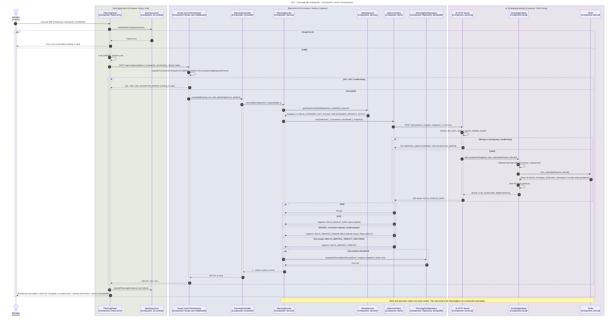

# AI05 UC1 - Calculate Bill of Materials

| Attribute | Value |
|---|---|
| C4 view | Dynamic diagram, Level 3 (Component) |
| SAD view | Process View, Level 3 |
| Containers | Web Application, Back-end API, Database, AI Scheduling Module |
| Endpoint | `POST /planning/bom` with body `{ scenarioId, stockMode }` (back end), which calls `POST /service/bom` with `{ request, snapshot }` and `X-Api-Key` (AI Scheduling Module) |
| Allowed roles | MANAGER (permission `planning:execute`); the back end calls the AI Scheduling Module with its service identity |
| Success response | 200 OK, `{ status: "ok", simulation: true, feasible, calculatedAt, scenario, inputs, orders[], items[], shortages[], production[], warnings[], runId }` |
| Error handling | 401/403; 400 `VALIDATION_ERROR` / `MALFORMED_JSON` (body), 400 `SCENARIO_WITHOUT_STOCK`; 404 `AI_SCENARIO_NOT_FOUND`; 422 `AI_INVALID_DATA` (`details.problems`, for example `MISSING_SCENARIO_STOCK`, `INCOMPLETE_RECIPE`); 503 `AI_SERVICE_UNAVAILABLE` (`details.reason`, `Retry-After: 5`); 504 `AI_SERVICE_TIMEOUT`. No run is saved on any error. |
| ADRs | [ADR-0020](../../adr/0020-planning-snapshot-as-the-data-contract-with-the-ai-service.md), [ADR-0047](../../adr/0047-recording-planning-runs-with-their-input-versions.md), [ADR-0049](../../adr/0049-synchronous-ai-execution-with-duplicate-submission-guard.md), [ADR-0018](../../adr/0018-secrets-management-strategy.md) |

## Description

The Manager opens `/ai` → Execution, chooses the calculation "Bill of Materials", types the AI scenario code (for example `DEMO-PARTIAL`) and chooses the stock mode: the scenario's own stock, or the current stock of the back end. The forecast and supplier-scenario fields are only used by the requirements calculation ([WEB07 UC9](../ai-planning/execute-forecast.md)), so they are not sent.

On Execute, the page:

1. Ignores the click if a calculation is already running (synchronous `useRef` lock).
2. Checks the form with `validatePlanningInput`, using the same rules as the back end. With an error, it marks the field and sends nothing.
3. Sends `POST /api/v2/planning/bom` (`calculatePlanning`) with `{ scenarioId, stockMode }`, disables the form and shows a progress bar.

The back end:

1. `requirePermission(Permission.PLANNING_EXECUTE)` checks the session and the permission (401 or 403).
2. Validates the body with `planningRequestSchema` (`scenarioId` `^[A-Z0-9-]{1,64}$`, `stockMode` `live` or `scenario`; unknown keys are removed). An invalid body answers 400 `VALIDATION_ERROR` and nothing is read.
3. `PlanningService.calculateBom` builds the snapshot for this calculation with `getSnapshot` ([AI06 UC1](../ai-knowledge-base/provide-planning-snapshot.md)): catalogue and BOM, stock (live, or the scenario's own), orders of the AI scenario, and `meta` with the `snapshotId` and the source of every input. An unknown scenario answers 404 `AI_SCENARIO_NOT_FOUND`, and a scenario without stock in scenario mode answers 400 `SCENARIO_WITHOUT_STOCK`.
4. `AiServiceClient.calculate('bom', request, snapshot)` sends `POST {AI_SERVICE_URL}/service/bom` with `X-Api-Key`, never the user's token, and waits up to `AI_SERVICE_TIMEOUT_SECONDS` (15 s).

The AI Scheduling Module checks the key (`service_key_ok/1`), the request and the presence of the snapshot (400 `VALIDATION_ERROR`, with fields `request.scenarioId`, `request.stockMode` and `snapshot`). It then runs `with_snapshot(Snapshot, bom_calculate(Params, Result))`: it validates and loads the snapshot ([AI06 UC2](../ai-knowledge-base/build-knowledge-base.md)), explodes the orders through the BOM (pizza → components → ingredients of the aggregates produced internally), compares the requirements with the stock and clears the knowledge base. Data that block the calculation (invalid snapshot, scenario mismatch, incomplete recipe, a component without stock in scenario mode, ...) give 422 `AI_INVALID_DATA` with all the problems. Warnings (`PIZZA_STOCK_IGNORED`, `UNMEASURED_NON_STOCK_COMPONENT`, other back-end issues) do not block and are returned with the result.

Back in the back end, a 200 is saved as a `PlanningRun` with `kind: "bom"`, the request, `snapshotId`, `scenario`, `bomVersion`, `stockSource`, status, full result and `requestedBy`. The answer is the result plus `runId`. Neither the back end nor the Prolog service writes stock or purchase orders. Errors are mapped as in the README table, and nothing is saved.

The page shows `BomResult`: the simulation tag and "stock not changed", the scenario and snapshot used, then the items (required, in stock, used, remaining, shortage), the production of the aggregates, the replenishment needed and the warnings. A failure is shown as invalid input, missing information or service unavailable (`classifyPlanningError`).

## Diagram

See the [README](./README.md) for the notation key and the element catalogue.
