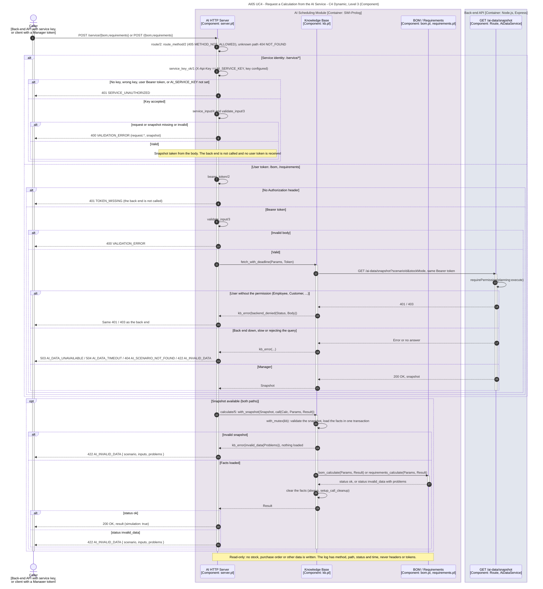

# AI05 UC4 - Request a Calculation from the AI Service

| Attribute | Value |
|---|---|
| C4 view | Dynamic diagram, Level 3 (Component) |
| SAD view | Process View, Level 3 |
| Containers | AI Scheduling Module, Back-end API |
| Endpoints | Service identity (push): `POST /service/bom`, `POST /service/requirements` with `{ request: { scenarioId, stockMode }, snapshot }`. User token (pull): `POST /bom`, `POST /requirements` with `{ scenarioId, stockMode }` |
| Allowed callers | The Back-End Application with `X-Api-Key: <AI_SERVICE_KEY>`; a client with the `Authorization: Bearer` token of a user with `planning:execute` (MANAGER). The service listens only on `127.0.0.1` |
| Success response | 200 OK, the result of `bom_calculate/2` or `requirements_calculate/2` (`status: "ok"`, `simulation: true`, `scenario`, `inputs`, ...) |
| Error handling | Push: 401 `SERVICE_UNAUTHORIZED`, 400 `VALIDATION_ERROR` (`request.*`, `snapshot`), 422 `AI_INVALID_DATA`. Pull: 401 `TOKEN_MISSING`, 400 `VALIDATION_ERROR`, 401/403 of the back end (as received), 404 `AI_SCENARIO_NOT_FOUND`, 422 `AI_INVALID_DATA`, 503 `AI_DATA_UNAVAILABLE`, 504 `AI_DATA_TIMEOUT`. Both: 404 `NOT_FOUND`, 405 `METHOD_NOT_ALLOWED` |
| ADRs | [ADR-0039](../../adr/0039-planning-snapshot-as-the-data-contract-with-the-ai-service.md), [ADR-0040](../../adr/0040-knowledge-base-loaded-per-calculation.md), [ADR-0017](../../adr/0017-secrets-management-strategy.md) |

## Description

This is the access to the Prolog service itself: who may ask for a calculation, with which credential, and what the service answers. The two calculations share the same routes and rules; only the predicate called inside the knowledge base changes (`bom_calculate` for `/bom`, `requirements_calculate` for `/requirements`).

`route/2` (`server.pl`) runs every request: it checks the method (`route_method/2`, otherwise 405 `METHOD_NOT_ALLOWED`), runs the handler, turns any exception into a JSON error (`error_reply/3`) and writes one log line with the method, path, status and time, never the headers. An unknown path answers 404 `NOT_FOUND`.

**Service identity (push, the path used by the Web Application).**

1. `service_key_ok/1` reads `AI_SERVICE_KEY` from the environment and compares it with the `X-Api-Key` header. The check fails when the key is not configured, so the service routes are closed by default. A missing or wrong key, or a user `Authorization: Bearer` token instead of the key, answers 401 `SERVICE_UNAUTHORIZED`. The back end turns this 401 into 503 `service_auth_failed` and logs it, because it means the two `.env` files disagree ([UC1](./calculate-bom.md)).
2. `service_plan_request/4` reads the body, splits it with `service_input/4` and validates `request` with `validate_input/3`. Missing or invalid fields are reported together in the back-end format, with the prefix `request.` (`request.stockMode`) or the field `snapshot`. 400 `VALIDATION_ERROR`.
3. The snapshot comes in the body: the service never calls the back end in this path, and it never sees the user's token. The user was already authorized by the back end (`planning:execute`).

**User token (pull, direct calls for tests and demos).**

1. `authenticated/4` requires `Authorization: Bearer`; without it, 401 `TOKEN_MISSING` and the back end is not called.
2. `plan_request/5` validates the body (400 `VALIDATION_ERROR`) and calls `fetch_with_deadline/3`, which asks the back end for the snapshot with the same token ([AI06 UC1](../ai-knowledge-base/provide-planning-snapshot.md)). The back end decides: without `planning:execute` it answers 401 or 403, and the service returns that answer as received. The token is never logged nor put in an error.
3. Back-end failures become 404 `AI_SCENARIO_NOT_FOUND`, 422 `AI_INVALID_DATA` (other 400), 503 `AI_DATA_UNAVAILABLE` (`details.reason`) or 504 `AI_DATA_TIMEOUT`.

**Calculation (both paths).** `calculate/5` runs `with_snapshot(Snapshot, call(Calc, Params, Result))` ([AI06 UC2](../ai-knowledge-base/build-knowledge-base.md)): under the `kb` mutex it validates the whole snapshot, loads it as facts in one transaction, runs the calculation and always clears the facts. A snapshot with problems (`kb_error(invalid_data(Problems))`) or a result with `status: "invalid_data"` (for example a snapshot of another scenario, `SCENARIO_MISMATCH`, or a missing stock entry) answers 422 `AI_INVALID_DATA` with `details { scenario, inputs, problems }`. A result with `status: "ok"` answers 200. The calculation only reads the facts: nothing is written, in the service or in the back end.

## Diagram

See the [README](./README.md) for the notation key and the element catalogue, and [AI Service Interface](./service-interface.md#2-ai-scheduling-module-prolog-service) for the request and response examples.
