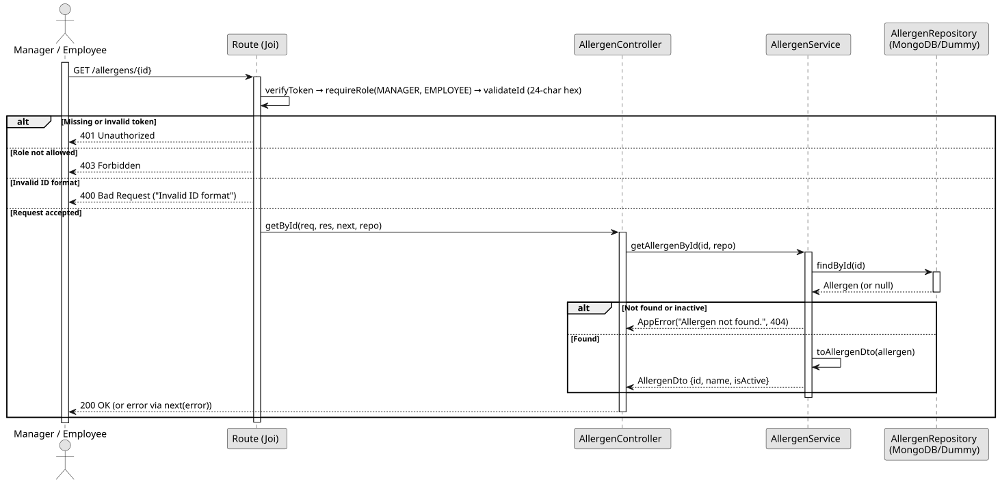

# UC3: Consult Allergen by ID

## Use Case View

**Primary Actor:** Manager / Employee  
**Description:** Allows an authenticated user to retrieve the details of a specific active allergen by its unique ID.

**Preconditions:**

- The user must be authenticated and have the `MANAGER` or `EMPLOYEE` role.

**Main Success Scenario:**

1. The User provides the ID of the target allergen.
2. The System validates the 24-character hexadecimal format of the ID.
3. The System searches for an active allergen matching the ID.
4. The System returns the allergen details with a 200 OK status.

**Alternative Flows:**

- _Invalid ID format:_ The System throws a 400 Bad Request error.
- _Allergen not found or deactivated:_ The System throws a 404 Not Found error.

**Postconditions:**

- None (Read-only operation).

## 1. Domain Assumptions

Due to a lack of client clarification, the following domain restrictions were assumed in the code:

- The allergen identifier is a 24-character hexadecimal string (MongoDB ObjectId);
- A deactivated allergen is treated as if it did not exist (404 Not Found).

## 2. Solution Design

## 3. Business Test Planning

- All unit tests use isolated in-memory Dummy Repositories (`allergens.dummy.repository.js`). The Mockito library isn't used in this project.
- **Scenario A:** Provide the id of an existing active allergen. Result: The allergen is returned as `{ id, name, isActive }`.
- **Scenario B:** Provide the id of an allergen that was deactivated. Result: Throws `AppError` (404 Not Found).
- **Scenario C:** Provide an id that does not exist. Result: Throws `AppError` (404 Not Found).

## 4. Postman E2E Tests

- **Base Endpoint:** `GET /api/v1/allergens/{id}`
- **Validated Scenarios:**
  - Existing id -> `200 OK` (Returns the allergen)
  - Id with an invalid format -> `400 Bad Request` (Blocked by id validation)
  - Unknown id -> `404 Not Found`
  - Id of a deactivated allergen -> `404 Not Found`
