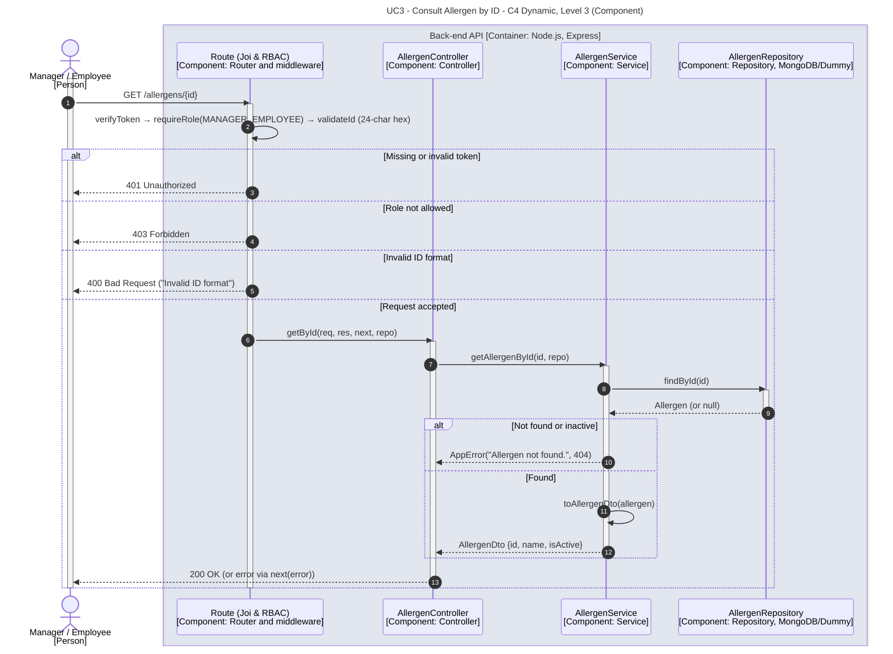

# UC3 - Consult Allergen by ID

| Attribute | Value |
|---|---|
| C4 view | Dynamic diagram, Level 3 (Component) |
| SAD view | Process View, Level 3 |
| Container | Back-end API |
| Endpoint | `GET /allergens/{id}` |
| Allowed roles | MANAGER, EMPLOYEE |
| Success response | 200 OK |
| Error handling | 401 (invalid token), 403 (role not allowed), 400 (invalid id format), 404 (allergen not found or inactive) |

## Description

A Manager or Employee consults a single active allergen by its id. The route rejects invalid tokens, roles and id formats before the service looks the allergen up.

## Diagram

See the [README](./README.md) for the notation key and the element catalogue.
