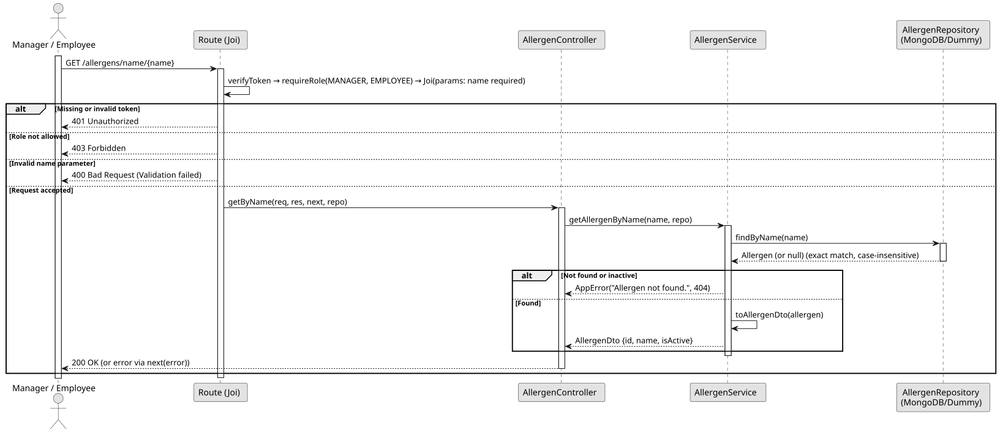

# UC4: Consult Allergen by Name

## 1. Domain Assumptions
Due to a lack of client clarification, the following domain restrictions were assumed in the code:
* The lookup by name is exact: a partial name does not match;
* Special characters in the name are treated as plain text;
* A deactivated allergen is treated as if it did not exist (404 Not Found).

## 2. Solution Design

## 3. Business Test Planning
* All unit tests use isolated in-memory Dummy Repositories (`allergens.dummy.repository.js`). The Mockito library isn't used in this project.
* **Scenario A:** Provide the exact name of an existing active allergen. Result: The allergen is returned as `{ id, name, isActive }`.
* **Scenario B:** Provide only part of an allergen name. Result: Throws `AppError` (404 Not Found).
* **Scenario C:** Provide the name of an allergen that was deactivated or does not exist. Result: Throws `AppError` (404 Not Found).

## 4. Postman E2E Tests

* **Base Endpoint:** `GET /api/v1/allergens/name/{name}`
* **Validated Scenarios:**
    * Exact name -> `200 OK` (Returns the allergen)
    * Unknown name -> `404 Not Found`
    * Partial name -> `404 Not Found`
    * Name of a deactivated allergen -> `404 Not Found`
