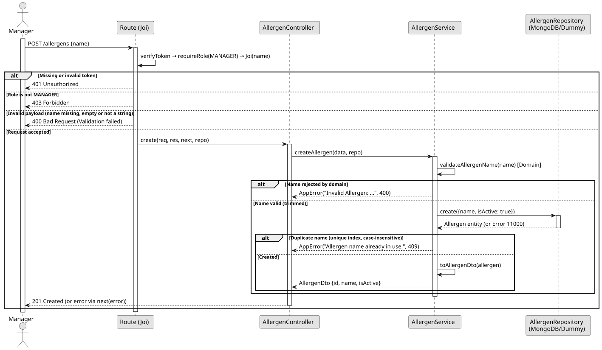

# UC1: Create Allergen

## 1. Domain Assumptions
Due to a lack of client clarification, the following domain restrictions were assumed in the code:
* An allergen has a unique `name` and an `isActive` flag; the identifier is generated by the database;
* The name is trimmed and must be a non-empty string; no maximum length or character restrictions are applied;
* Name uniqueness ignores letter case (unique index with collation strength 2) and also applies to deactivated allergens, so their names stay reserved;
* New allergens are always created active; `isActive` and any other unknown field sent in the body are ignored;
* Only users with the `MANAGER` role can create allergens.

## 2. Solution Design

## 3. Business Test Planning
* All unit tests use isolated in-memory Dummy Repositories (`allergens.dummy.repository.js`). The Mockito library isn't used in this project.
* **Scenario A:** Provide a valid name (including surrounding spaces). Result: The allergen is stored as active with the trimmed name and returned as `{ id, name, isActive: true }`.
* **Scenario B:** Provide an empty, blank, null, undefined or non-string name. Result: Throws `AppError` (400 Bad Request) and nothing is stored.
* **Scenario C:** Provide a name already in use, with a different letter case. Result: Throws `AppError` (409 Conflict).
* **Scenario D:** Request the creation with the `EMPLOYEE` role. Result: The request is rejected (403 Forbidden) before reaching the service.

## 4. Postman E2E Tests

* **Base Endpoint:** `POST /api/v1/allergens`
* **Validated Scenarios:**
    * Valid name with spaces around it -> `201 Created` (Returns the allergen)
    * Duplicate name -> `409 Conflict` (Request 2.2 checks another letter case once its name is edited by hand, as its comment explains)
    * Missing, empty, blank or non-string name -> `400 Bad Request` (Blocked by Joi validation)
    * Extra fields in the body (e.g. `isActive`, `role`) -> `201 Created` (Fields ignored, allergen is active)
    * Missing token -> `401 Unauthorized`
