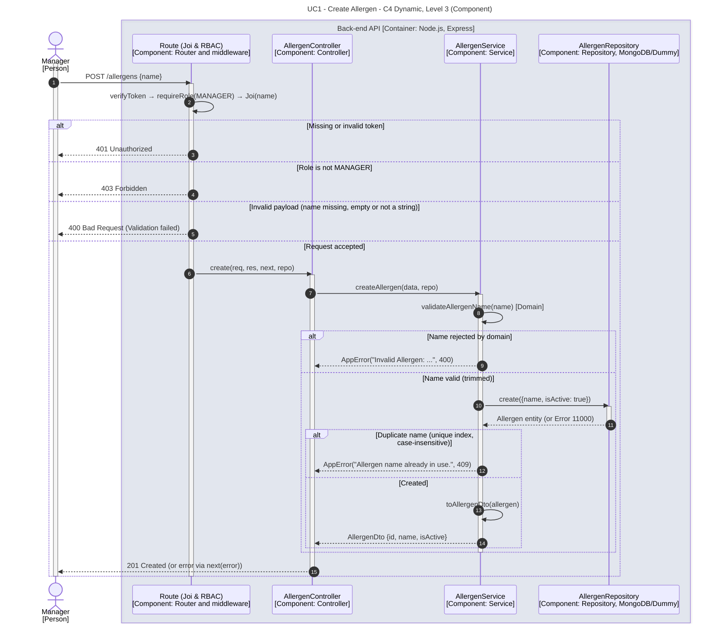

# UC1 - Create Allergen

| Attribute | Value |
|---|---|
| C4 view | Dynamic diagram, Level 3 (Component) |
| SAD view | Process View, Level 3 |
| Container | Back-end API |
| Endpoint | `POST /allergens` |
| Allowed roles | MANAGER |
| Success response | 201 Created |
| Error handling | 401 (invalid token), 403 (role not allowed), 400 (invalid payload or name), 409 (name already in use) |

## Description

A Manager creates an allergen. The name is validated by the domain rules and trimmed, and a case-insensitive unique index rejects duplicated names, which the service translates into a conflict error.

## Diagram

See the [README](./README.md) for the notation key and the element catalogue.
