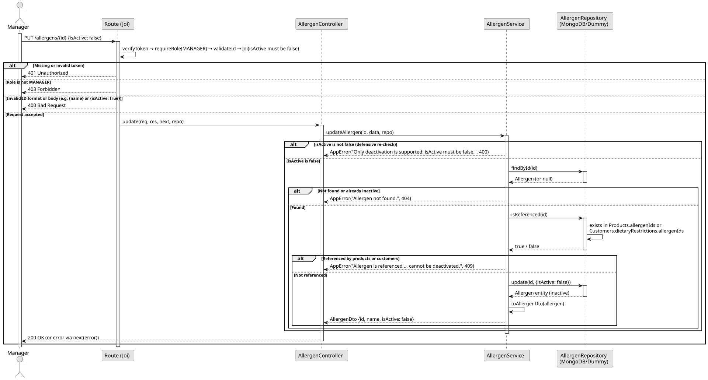

# UC5: Deactivate Allergen

## 1. Domain Assumptions
Due to a lack of client clarification, the following domain restrictions were assumed in the code:
* Allergens are never deleted, only deactivated, so existing business information remains consistent;
* Only `{ "isActive": false }` is accepted: an allergen cannot be renamed or reactivated;
* An allergen referenced by a product (`allergenIds`) or by a customer's dietary restrictions (`dietaryRestrictions.allergenIds`) cannot be deactivated;
* The name of a deactivated allergen stays reserved, so it cannot be used by a new allergen.

## 2. Solution Design

## 3. Business Test Planning
* All unit tests use isolated in-memory Dummy Repositories (`allergens.dummy.repository.js`). The Mockito library isn't used in this project.
* **Scenario A:** Deactivate an allergen that is not referenced. Result: The allergen is returned with `isActive: false` and is no longer returned by the queries.
* **Scenario B:** Deactivate an allergen referenced by a product or by a customer. Result: Throws `AppError` (409 Conflict).
* **Scenario C:** Send a body other than `{ "isActive": false }` (e.g. a new name). Result: Throws `AppError` (400 Bad Request, only deactivation is supported).
* **Scenario D:** Deactivate an allergen that does not exist or is already inactive. Result: Throws `AppError` (404 Not Found).

## 4. Postman E2E Tests

* **Base Endpoint:** `PUT /api/v1/allergens/{id}`
* **Validated Scenarios:**
    * `{ "isActive": false }` for an allergen without references -> `200 OK` (Returns the allergen with `isActive: false`; a `name` sent in the body is ignored)
    * Empty body, only `name`, `isActive: true` or invalid `isActive` -> `400 Bad Request` (Blocked by Joi validation)
    * Id with an invalid format -> `400 Bad Request`
    * Unknown id -> `404 Not Found`
    * Deactivating the same allergen again -> `404 Not Found`
    * Get by id, get by name and list after deactivation -> `404 Not Found` (list: `200 OK` without the allergen)
    * Create an allergen with the name of a deactivated one -> `409 Conflict`
    * Missing token -> `401 Unauthorized`
