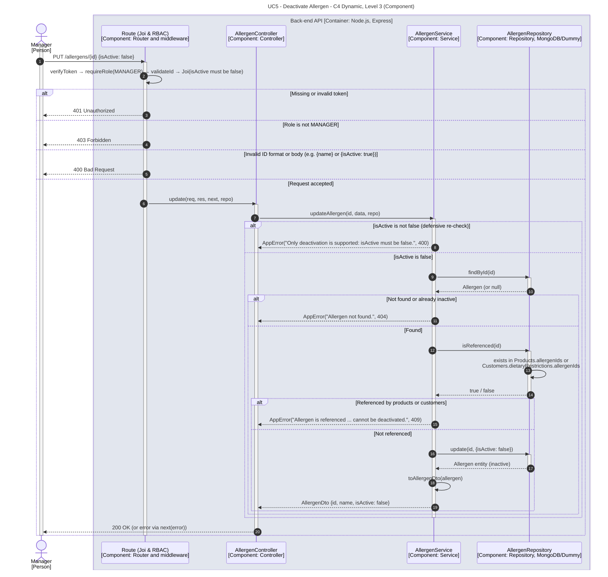

# UC5 - Deactivate Allergen

| Attribute | Value |
|---|---|
| C4 view | Dynamic diagram, Level 3 (Component) |
| SAD view | Process View, Level 3 |
| Container | Back-end API |
| Endpoint | `PUT /allergens/{id}` |
| Allowed roles | MANAGER |
| Success response | 200 OK |
| Error handling | 401 (invalid token), 403 (role not allowed), 400 (invalid id, body or isActive not false), 404 (allergen not found or already inactive), 409 (allergen still referenced) |

## Description

A Manager deactivates an allergen. Only deactivation is supported (isActive must be false) and an allergen that is still referenced by products or by customer dietary restrictions cannot be deactivated.

## Diagram

See the [README](./README.md) for the notation key and the element catalogue.
