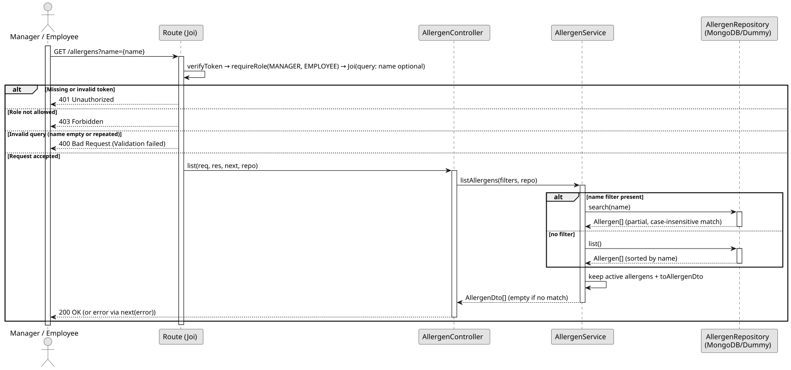

# UC2: List and Search Allergens

## 1. Domain Assumptions
Due to a lack of client clarification, the following domain restrictions were assumed in the code:
* Only active allergens are listed; deactivated allergens are never returned;
* The list is sorted by name and is not paginated;
* The search is partial and case-insensitive: the text may appear anywhere in the name, and special characters are treated as plain text.

## 2. Solution Design

## 3. Business Test Planning
* All unit tests use isolated in-memory Dummy Repositories (`allergens.dummy.repository.js`). The Mockito library isn't used in this project.
* **Scenario A:** Request the list when active and deactivated allergens exist. Result: Only the active allergens are returned, mapped to `{ id, name, isActive }`.
* **Scenario B:** Request the list with a `name` filter. Result: Only the active allergens whose name contains the text (ignoring letter case) are returned.
* **Scenario C:** Request the list with a `name` that matches no allergen. Result: An empty list is returned (200 OK).

## 4. Postman E2E Tests

* **Base Endpoint:** `GET /api/v1/allergens[?name=]`
* **Validated Scenarios:**
    * List without filter -> `200 OK` (Returns the active allergens)
    * Partial search by name -> `200 OK`
    * Search without results -> `200 OK` (Returns `[]`)
    * Search with regex characters (`?name=.*`) -> `200 OK` (Returns `[]`, treated as text)
    * Empty or repeated `name` -> `400 Bad Request` (Blocked by Joi validation)
    * After deactivating an allergen -> `200 OK` (The deactivated allergen is no longer listed)
    * Missing or invalid token -> `401 Unauthorized`
