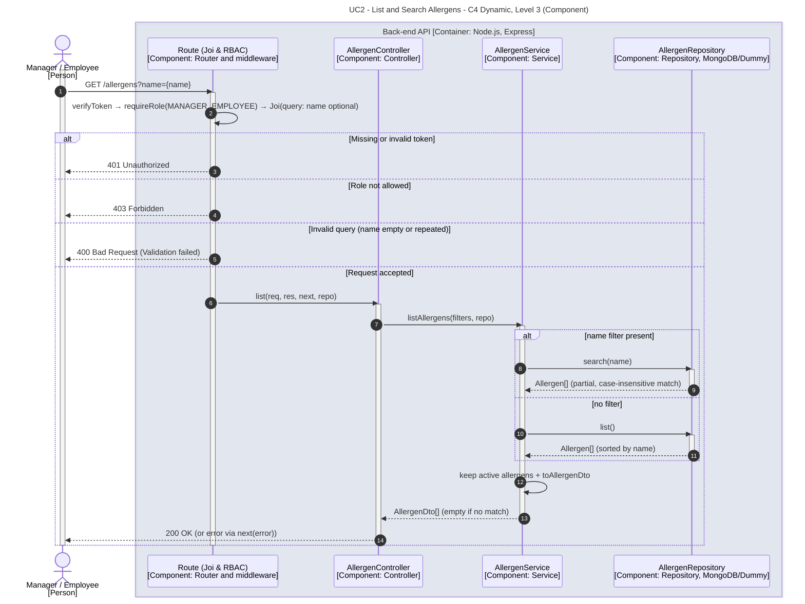

# UC2 - List and Search Allergens

| Attribute | Value |
|---|---|
| C4 view | Dynamic diagram, Level 3 (Component) |
| SAD view | Process View, Level 3 |
| Container | Back-end API |
| Endpoint | `GET /allergens?name={name}` |
| Allowed roles | MANAGER, EMPLOYEE |
| Success response | 200 OK |
| Error handling | 401 (invalid token), 403 (role not allowed), 400 (invalid query) |

## Description

A Manager or Employee lists the active allergens (sorted by name), optionally filtered by a partial, case-insensitive name. An empty list is returned when nothing matches.

## Diagram

See the [README](./README.md) for the notation key and the element catalogue.
