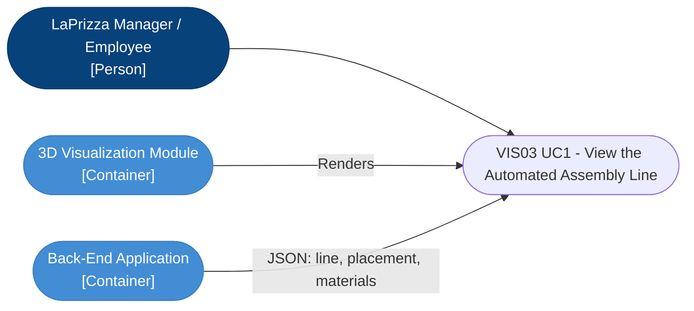

# Assembly Line - Design Diagrams (Mermaid)

The automated pizza assembly line (VIS03) is drawn on one wall of the kitchen: a large counter, a rectangular receiving platform on the left fed by an overhead crust dispenser, a conveyor belt, robotic arms along the line and a wood-fired oven on the right. It is drawn by the **3D Visualization** module embedded in the **Web Application**, from an assembly line configuration read from the back end as JSON and referenced by the active kitchen configuration ([WEB06 UC3](../kitchen-configuration/get-active-kitchen-configuration.md), [ADR-0031](../../adr/0031-assembly-line-referenced-by-kitchen.md)). The textures and materials of its components are VIS04 ([Textures and Materials](../textures-and-materials/README.md)).

Process View (SAD), Level 3, documented as a C4 dynamic diagram of the **Web Application**, **3D Visualization** and **Back-end API** containers.

## Use Cases



The use case is described in the [Use Case Views](../../analysis/use-case-views.md#vis03-automated-pizza-assembly-line-representation).

## Diagrams

| Use case | Endpoint | Pages | Result | Document |
|---|---|---|---|---|
| [VIS03 UC1 - View the Automated Assembly Line](./view-assembly-line.md) | `GET /kitchen-configurations/active`, `GET /assembly-line-configurations/{id}` | `/visualization3d`, `/kitchen-configurations` | The line drawn on its wall, with procedural models named for the Sprint 3 animations | `view-assembly-line.md` |

## Assembly line configuration

The line is a configuration of its own (`Assembly Line Configurations`), described in its own local frame; the kitchen configuration places it with `content.assemblyLine`:

```json
"assemblyLine": {
  "configurationId": "<id of the assembly line configuration>",
  "position": { "x": 0, "y": 0, "z": -2.3 },
  "rotation": { "x": 0, "y": 0, "z": 0 }
}
```

| Property | Rule |
|---|---|
| `dimensions` | `width`, `length`, `height` greater than zero: the footprint of the line |
| `elements[].type` | VIS03 components: `counter`, `receiving-platform`, `crust-dispenser`, `conveyor-belt`, `robotic-arm`, `wood-fired-oven` (the generic `equipment`, `assembly-line`, `decoration`, `tool` are kept for compatibility) |
| `elements[].id` | Unique in the line; the viewer names the 3D group after it, so Sprint 3 can find each component |
| `elements[].position`, `rotation`, `scale` | In the line frame (metres, degrees): x along the line from left to right, y up, z from the wall towards the kitchen; inside the line dimensions (x from `-width/2` to `width/2`, z from `0` to `length`, y from `0` to `height`) |
| `elements[].material` | Required textured material ([VIS04](../textures-and-materials/README.md)) |
| `elements[].modelReference` | Optional URL of an imported model (absolute `http(s)` URL or root-relative path, [ADR-0021](../../adr/0021-asset-references-strategy.md)); without it the component is procedural |

The SPA proposes a new line with the VIS03 arrangement (`default-assembly-line.js`, the same content as the back-end fixture `valid-vis03-line.json`): a 9 m counter, the receiving platform and the overhead dispenser on the left, the conveyor belt along the counter, six robotic arms 1 m apart behind the belt (one per ingredient station) and the wood-fired oven on the right, every component with its own texture. The kitchen page places a new line against the back wall, centred.

| Method and path | Permission | Success | Errors |
|---|---|---|---|
| `GET /assembly-line-configurations` | `kitchen:read` | 200 | |
| `GET /assembly-line-configurations/{id}` | `kitchen:read` | 200 | 400 (invalid id), 404 |
| `POST /assembly-line-configurations/validate` | `kitchen:write` | 200 `{ "valid": true }` (nothing stored) | 400 with the property path of each violation |
| `POST /assembly-line-configurations` | `kitchen:write` | 201 | 400 |
| `PATCH /assembly-line-configurations/{id}` | `kitchen:write` | 200 | 400, 404 |
| `DELETE /assembly-line-configurations/{id}` | `kitchen:write` | 204 | 404, 409 (referenced by a kitchen configuration) |

Paths under `/api/v2`. `kitchen:read` is granted to the Manager and the Employee, `kitchen:write` only to the Manager.

### Procedural models

| Type | Model (`assembly-line-models.jsx`) | Named parts for the Sprint 3 animations |
|---|---|---|
| `counter` | Base and top, unit footprint stretched by the scale, 0.9 m high | - |
| `receiving-platform` | Rectangular platform for the pre-formed crusts | - |
| `crust-dispenser` | Overhead dispenser with a stack of crusts | `crust-stack`, `release` |
| `conveyor-belt` | Frame, belt and rollers; the length is `scale.x` and slats are added, not stretched | `belt`, `rollers` |
| `robotic-arm` | Articulated arm, each joint a group with its pivot at the joint | `base` → `shoulder` → `elbow` → `wrist` |
| `wood-fired-oven` | Dome oven with its mouth and base | - |

Every model stands on y = 0 of its own origin, so its JSON position places its base (for example on the counter top, y = 0.9). The whole line is one group (`assembly-line-<id>`) at the placement of the kitchen.

## Business rules shown in the diagrams

- **Everything from the back end as JSON.** The line arrangement, the model types, the materials and the texture URLs come from the kitchen and assembly line configurations; the SPA embeds no layout.
- **One wall.** The kitchen places the line through `content.assemblyLine` (position and rotation in the kitchen, inside its bounds). The line keeps its own frame, so the same line can be placed in different kitchens.
- **Resolvable reference.** The kitchen stores only the line id. If the line cannot be loaded, the kitchen is still shown with a warning; another line is never drawn in its place. A line referenced by a kitchen cannot be deleted (409).
- **Ready for animation (Sprint 3).** Each component is a 3D group named after its element id, and the parts to animate are named groups with their pivot at the joint.
- **Textured components.** Each component has its own textured material from the JSON ([VIS04](../textures-and-materials/README.md)).

## Related ADRs

| ADR | Decision | Status |
|---|---|---|
| [ADR-0020](../../adr/0020-strorage-model-of-kitchen-configurations.md) | Storage model of kitchen configurations | Accepted |
| [ADR-0021](../../adr/0021-asset-references-strategy.md) | Asset references strategy (URLs and root-relative paths) | Accepted |
| [ADR-0025](../../adr/0025-active-configuration-endpoint-and-no-fallback-policy.md) | Active configuration endpoint and no fallback policy | Accepted |
| [ADR-0030](../../adr/0030-adoption-of-r3f-for-3d-module-integration.md) | React Three Fiber for the 3D module | Accepted |
| [ADR-0031](../../adr/0031-assembly-line-referenced-by-kitchen.md) | Assembly line referenced by the kitchen | Accepted |
| [ADR-0052](../../adr/0052-ui-consistency-and-input-validation-after-the-sprint-2-review.md) | UI consistency and input validation (D7: positions inside the line and the kitchen) | Accepted |

## Notation key

| Notation | Meaning |
|---|---|
| Actor (stick figure) | Person using the system, with the role shown in the label |
| Shaded box "Web Application" | Container (React, Vite) that holds the page components |
| Shaded box "3D Visualization" | Container (WebGL, Three.js) that holds the viewer and the scene |
| Shaded box "Back-end API" | Container (Node.js, Express) that holds the back-end components |
| Participant label | `Name`, followed by `[Type: technology]` |
| Solid arrow | Call or request |
| Dashed arrow | Return value or response |
| Arrow to the same participant | Work done inside that component |
| Number on an arrow | Order of the interaction (autonumber) |
| `alt` / `else` frame | Alternative flows, only one of them runs |
| `loop` frame | Flow that repeats |
| `opt` frame | Optional flow |
| `Note` | Reference to another diagram or a remark |

## Element catalogue

| Element | Type | Technology | Responsibility | Used in |
|---|---|---|---|---|
| Manager / Employee | Person | - | Users with `kitchen:read` | [VIS03 UC1](./view-assembly-line.md) |
| KitchenViewer | Component | React component | Loads the active configuration and its assembly line (`useKitchenConfiguration`), shows the loading, empty and warning states and renders `KitchenScene` | [VIS03 UC1](./view-assembly-line.md) |
| useKitchenConfiguration | Component | React hook | `loadActive` (`GET /kitchen-configurations/active`) and `loadAssemblyLine` (`GET /assembly-line-configurations/{id}`, silent errors) | [VIS03 UC1](./view-assembly-line.md) |
| KitchenScene | Component | React Three Fiber `Canvas` | Floor, walls, kitchen elements and the `AssemblyLine` group, lighting (VIS05) and camera | [VIS03 UC1](./view-assembly-line.md) |
| AssemblyLine | Component | R3F group | Group `assembly-line-<id>` at the kitchen placement, with one `SceneElement` per line element | [VIS03 UC1](./view-assembly-line.md) |
| VIS03 models | Component | R3F meshes (`assembly-line-models.jsx`) | `CounterModel`, `ReceivingPlatformModel`, `CrustDispenserModel`, `ConveyorBeltModel`, `RoboticArmModel`, `WoodFiredOvenModel` | [VIS03 UC1](./view-assembly-line.md) |
| Route (Joi & Permissions) | Component | Express router and middleware | `requirePermission(kitchen:read)`, id validation | [VIS03 UC1](./view-assembly-line.md) |
| AssemblyLineConfigurationService | Component | Node.js module | `getConfigurationById`, `listConfigurations`, `createConfiguration`, `validateConfigurationContent`, `updateConfiguration`, `removeConfiguration` (schema, material rules and bounds) | [VIS03 UC1](./view-assembly-line.md) |
| AssemblyLineConfigurationRepository | Component | Repository, MongoDB | `findById` | [VIS03 UC1](./view-assembly-line.md) |

## Notes

- **Imported models are not drawn yet.** `modelReference` is validated and stored, but the viewer always draws the procedural model of the type (the `Model` component with `useGLTF` in `kitchen-scene.jsx` is not used). VIS03 allows procedural models, and the default line has no `modelReference`.
- The viewer is shown to every user with `kitchen:read` (Manager and Employee, Table 1); the user story names the Manager.
- Tests:
  - Back end: `test/domain/assembly-line-configuration.domain.test.js`, `kitchen-configuration-assembly-line.domain.test.js`; fixture `test/domain/fixtures/assembly-line-configurations/valid-vis03-line.json`.
  - httpyac flow `backend/test-flows/assembly-line-configuration-test-flow.http`: RBAC, validation, dry-run of the VIS03 line (3.6b), line referenced by a kitchen not deletable.
  - Front end: `test/features/assembly-line-configuration.test.js` (line selection and default placement on the back wall).
  - The rendering of the models is validated manually in the viewer.
