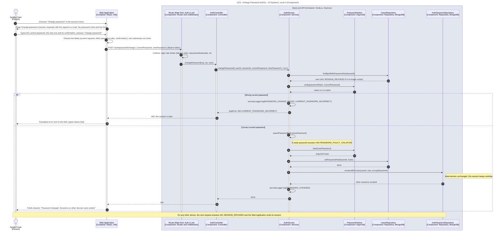

# UC5 - Change Password (AA01)

| Attribute | Value |
|---|---|
| C4 view | Dynamic diagram, Level 3 (Component) |
| SAD view | Process View, Level 3 |
| Containers | Web Application, Back-end API, Database |
| Endpoint | `POST /auth/password/change` with body `{ "currentPassword", "newPassword" }` |
| Allowed roles | Authenticated (any active account with a valid session) |
| Success response | 204 No Content (the current session is kept) |
| Error handling | 400 `VALIDATION_FAILED`, 400 `CURRENT_PASSWORD_INCORRECT` (the session is not ended), 400 `PASSWORD_POLICY_VIOLATION`, 401 `TOKEN_MISSING`, `TOKEN_INVALID`, `SESSION_REVOKED`, 429 `RATE_LIMITED` (failed attempts per IP, shared with the login) with `Retry-After` |
| ADRs | [ADR-0009](../../adr/0009-implement-rate-limiting-policies.md), [ADR-0043](../../adr/0043-secure-session-handling-in-the-api-and-the-spa.md), [ADR-0023](../../adr/0023-password-recovery-with-single-use-hashed-tokens.md) |

## Description

The user opens **Change password** in the account menu of the header. The page (`/change-password`, protected by the route guard, not shown in the navigation) shows the e-mail of the signed-in account and the password rules. The user types the current password, the new one and its confirmation, and presses "Change password". The form checks that the current password is filled, the new one follows the AA01 rules (`passwordRules()`) and the confirmation is equal, and allows one request at a time.

The Back-end API:

1. **Route:** `noStore`, the `login` rate limiter (per IP, counts only failed requests, so a stolen session cannot be used to guess the password), `requireAuthenticated` (valid access token, active account, same `tokenVersion`, session not revoked) and Joi `{ currentPassword, newPassword }`, each at most 256 characters.
2. **Current password:** the user is loaded with the password hash (a user that no longer exists answers `401 SESSION_REVOKED`) and the current password is verified with Argon2id. A wrong password logs `PASSWORD_CHANGE_FAILED` (reason `CURRENT_PASSWORD_INCORRECT`) and answers `400 CURRENT_PASSWORD_INCORRECT`; the session is kept, so the user can try again.
3. **New password:** `assertPasswordPolicy` (8 to 64 characters, one uppercase letter, one of `! @ # $ % ^ & * . , - _ ?`), then `passwordHasher.hash` (Argon2id) and `setPasswordHash`.
4. **Sessions:** every other `Auth Session` of the user is revoked (`revokeAllForUser` with `exceptSessionId`). The `tokenVersion` is not incremented, so the current access token and refresh cookie keep working.
5. **Log and answer:** `PASSWORD_CHANGED` (user id, session id, IP, never the passwords) and `204`.

On success the page clears the fields and shows "Password changed. Sessions on other devices were ended."; on failure it keeps the typed values and shows the translated error next to the field. The same page offers **Logout** and **Logout on all devices** ([UC2 - End Sessions](./end-sessions.md)).

## Diagram

See the [README](./README.md) for the notation key and the element catalogue.
