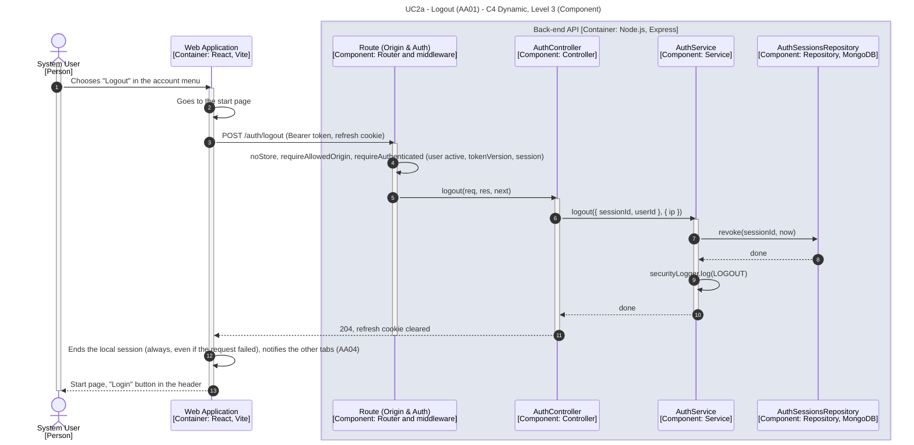
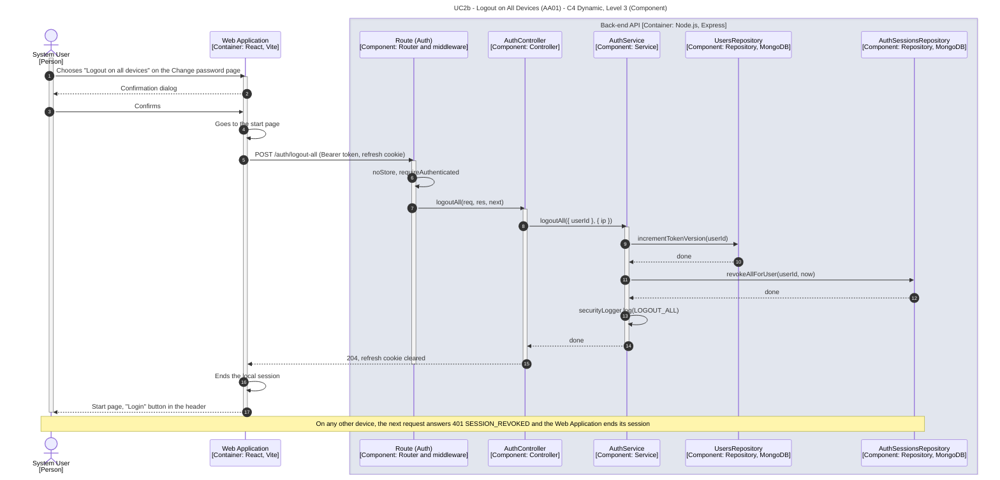

# UC2 - End Sessions (AA01)

| Attribute | Value |
|---|---|
| C4 view | Dynamic diagram, Level 3 (Component) |
| SAD view | Process View, Level 3 |
| Containers | Web Application, Back-end API, Database |
| Endpoints | `POST /auth/logout` (this session), `POST /auth/logout-all` (every session of the user) |
| Allowed roles | Authenticated (any active account with a valid session) |
| Success response | 204 No Content, refresh cookie cleared |
| Error handling | 401 `TOKEN_MISSING`, `TOKEN_INVALID`, `SESSION_REVOKED` (the HTTP client refreshes an expired token before the logout), 403 `ORIGIN_NOT_ALLOWED` (logout from another origin) |
| ADRs | [ADR-0012](../../adr/0012-implement-refresh-tokens-for-secure-sessions.md), [ADR-0043](../../adr/0043-secure-session-handling-in-the-api-and-the-spa.md) |

## Description

**Logout (this session).** The user chooses **Logout** in the account menu of the header. The Web Application goes to the start page and calls `POST /auth/logout`, which requires the `Origin` to be allowed and a valid access token. The back end revokes the `Auth Session` identified by the `sid` of the token, logs `LOGOUT` and clears the refresh cookie. The Web Application always ends its local session, even if the request fails, and the other tabs end theirs through the session channel (AA04).

**Logout on all devices.** On the Change password page the user chooses **Logout on all devices** and confirms it. `POST /auth/logout-all` increments the `tokenVersion` of the user and revokes every one of the user's sessions, logs `LOGOUT_ALL` and clears the cookie.

**Afterwards.** The middleware checks the session and the `tokenVersion` on every protected request, so an access token of an ended session is refused (`401 SESSION_REVOKED`) even before it expires, and its refresh token can no longer be rotated (`401 REFRESH_INVALID`).

## Diagrams

### Logout (this session)

### Logout on all devices

See the [README](./README.md) for the notation key and the element catalogue.
