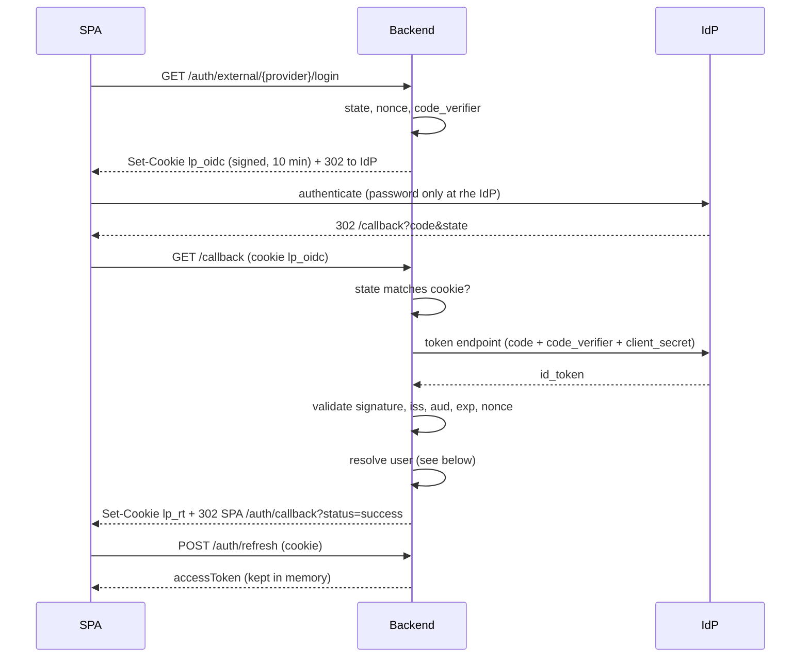
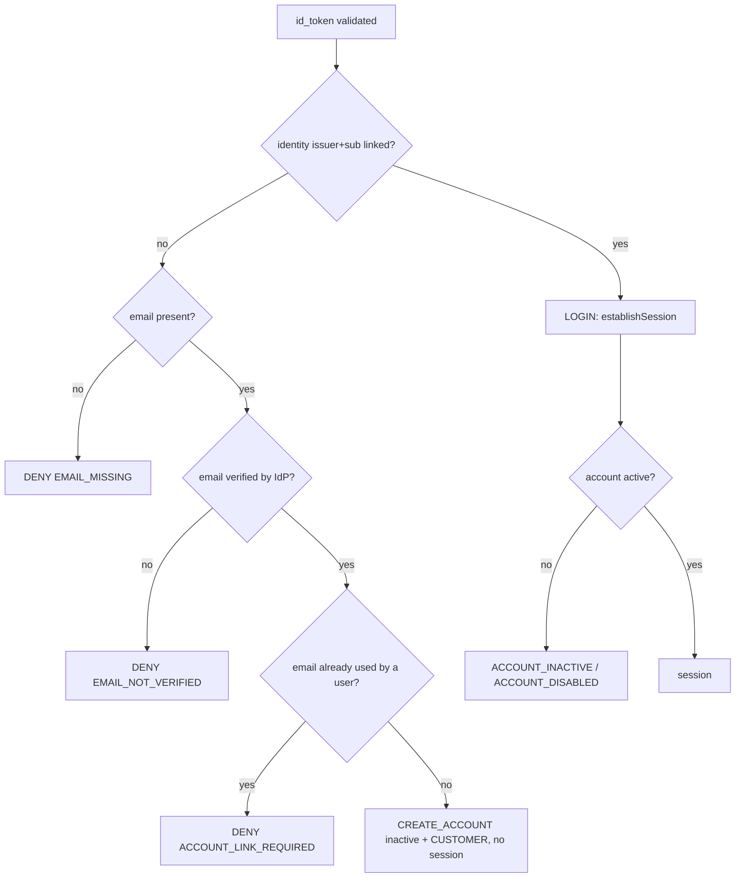

# External Identity Provider Integration (AA02)

## Login Sequence

## User Resolution (Domain: `resolveExternalLogin`)

## Error codes returned to the SPA (`?status=error&code=`)
`ACCESS_DENIED` (user cancelled), `AUTH_FAILED`, `EMAIL_MISSING`, `EMAIL_NOT_VERIFIED`,
`ACCOUNT_LINK_REQUIRED`, `ACCOUNT_PENDING_ACTIVATION`, `ACCOUNT_INACTIVE`, `ACCOUNT_DISABLED`.
Never include IdP messages, tokens or e-mail in the URL.

## Configuration (`.env`)
| Variable | Description |
|---|---|
| `API_PUBLIC_URL` | Public base URL of the API (used to build redirect URIs). HTTPS required except `localhost`. |
| `APP_BASE_URL` | SPA base URL (already used by AA01). |
| `OIDC_TRANSACTION_TTL_MINUTES` | Lifetime of the login transaction. Default `10`. |
| `GOOGLE_CLIENT_ID` / `GOOGLE_CLIENT_SECRET` | Provider enabled only if both are set. |
| `MICROSOFT_CLIENT_ID` / `MICROSOFT_CLIENT_SECRET` / `MICROSOFT_TENANT` | Tenant GUID or `consumers`. `common`/`organizations` are rejected. |

Redirect URI to register at each IdP: `{API_PUBLIC_URL}/api/v1/auth/external/{provider}/callback`.