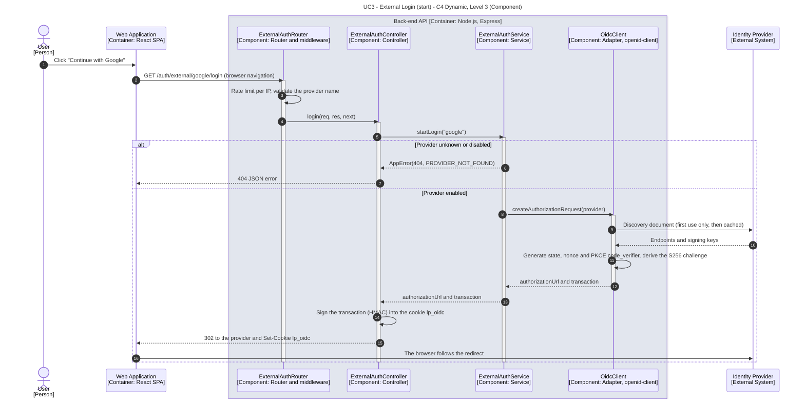
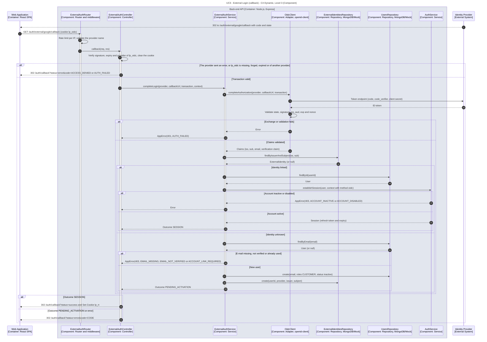
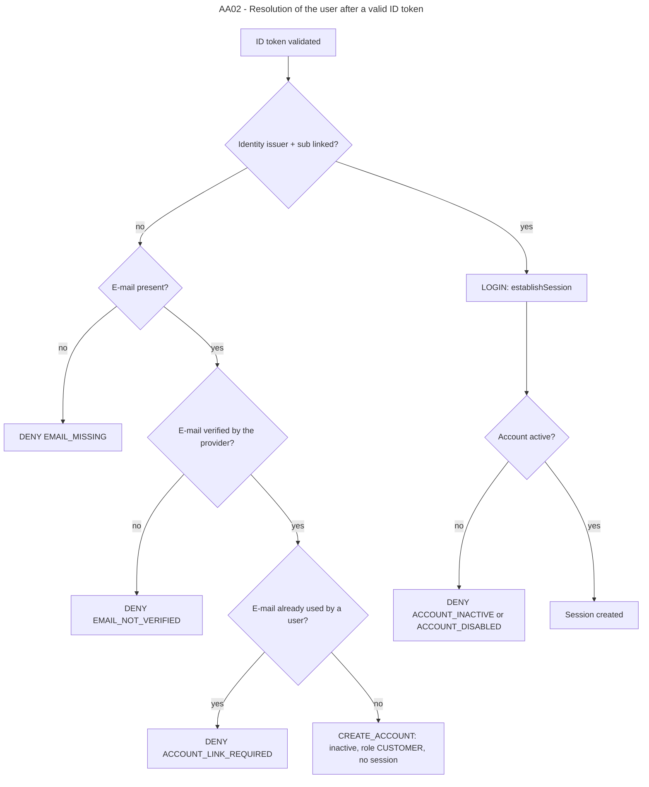
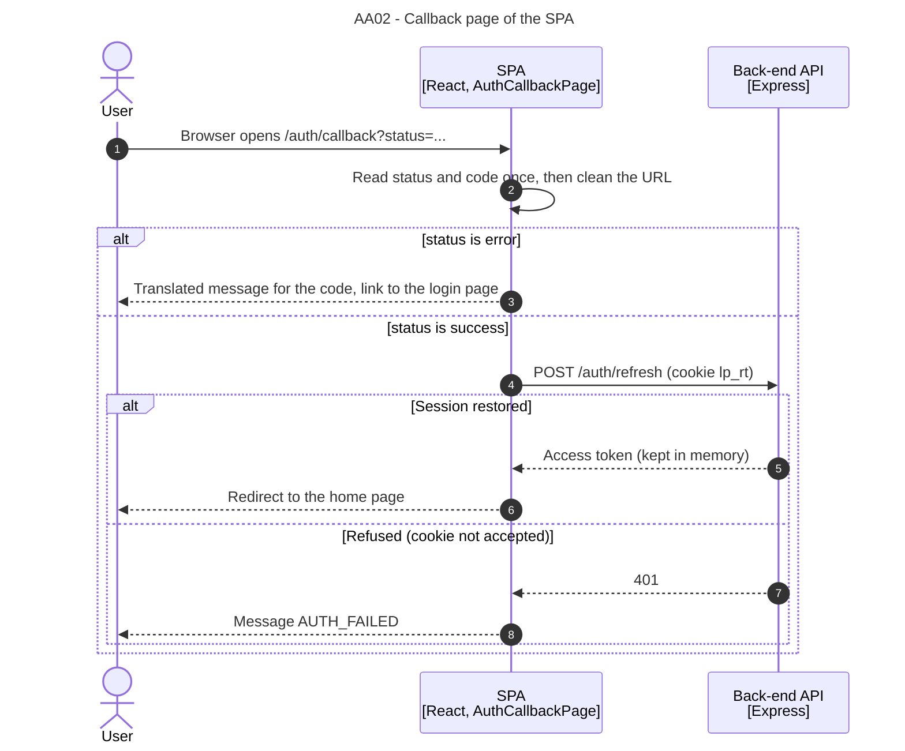

# External Authentication (AA02)

| Attribute | Value |
|:---|:---|
| User Story | AA02 - External Identity Provider Integration |
| C4 view | Dynamic diagrams, Level 3 (Component) |
| SAD view | Process View, Level 3 |
| Diagram type | Sequence diagrams and a flowchart (Mermaid) |
| Containers | Web Application (SPA), Back-end API, MongoDB, Identity Provider (external system) |
| Endpoints | `GET /auth/external/providers`, `GET /auth/external/{provider}/login`, `GET /auth/external/{provider}/callback` |
| Allowed roles | Public (no authentication) |
| Success response | 302 to the SPA with `status=success` and the refresh cookie `lp_rt` |
| Error handling | 404 `PROVIDER_NOT_FOUND` (login) and 302 to the SPA with `status=error&code=<CODE>` (callback) |
| Decision records | [ADR 0033](../../adr/0033-external-authentication-with-openid-connect.md), [ADR 0034](../../adr/0034-external-identity-model-and-account-resolution.md), builds on [ADR 0011](../../adr/0011-implement-refresh-tokens-for-secure-sessions.md) and [ADR 0032](../../adr/0032-secure-session-handling-in-the-api-and-the-spa.md) |

## Description

A user signs in with Google or Microsoft through OpenID Connect (Authorization Code flow with PKCE). The back end runs the flow as a confidential client: the provider secret and the ID token never reach the browser, and the password is typed only at the provider.

When the ID token is valid, the back end identifies the user by `(issuer, sub)`:

* **Known identity and active account:** a session is created by `establishSession`, the same function used by the local login ([Session Handling](./session-handling.md)). The refresh cookie `lp_rt` is set and the browser is redirected to the SPA. The SPA restores the session with `POST /auth/refresh`, as after a reload. No token travels in a URL.
* **Known identity and inactive or disabled account:** no session, `ACCOUNT_INACTIVE` or `ACCOUNT_DISABLED`.
* **Unknown identity with a verified e-mail that no user has:** an `inactive` account with the role `CUSTOMER` is created and linked to the identity. No session is created (`ACCOUNT_PENDING_ACTIVATION`). The account receives an activation invitation by e-mail ([AA06](./role-assignment-and-invitations.md)) and is activated through it (AA07).
* **Unknown identity whose e-mail belongs to another user:** refused (`ACCOUNT_LINK_REQUIRED`). There is no automatic linking by e-mail ([ADR 0034](../../adr/0034-external-identity-model-and-account-resolution.md)).

A cancelled or failed login never creates a session. Logout is the existing `POST /auth/logout`.

Providers are configuration. The SPA reads `GET /auth/external/providers` and shows a button only for the enabled ones.

## Credentials of the flow

| Credential | Content | Where it lives | Lifetime | Checked |
|:---|:---|:---|:---|:---|
| `lp_oidc` | `state`, `nonce`, `code_verifier` and provider, signed with HMAC-SHA256 (key derived from `JWT_SECRET`) | `HttpOnly` cookie, `SameSite=Lax`, `Secure` as `REFRESH_COOKIE_SECURE`, path `/api/<version>/auth/external` | `OIDC_TRANSACTION_TTL_MINUTES` (10), cleared on every callback | Only by `/callback`: signature, expiry and provider |
| `lp_rt` | Refresh token of the new session | Same cookie and options as the local login ([Session Handling](./session-handling.md)) | `REFRESH_TOKEN_TTL_DAYS` (7), absolute | By `POST /auth/refresh` |

`SameSite=Lax` is required for `lp_oidc`: the callback is a top-level navigation that comes from the provider, which `Strict` would not send.

## Diagrams

### Start of the login

### Completion of the login

### Resolution of the user

The decision is a pure function of the domain (`resolveExternalLogin`). The account status check belongs to `establishSession`.

### Landing page in the SPA

Any status or code that is not on the closed list is shown as `AUTH_FAILED`.

## Error codes

| Code | When | Raised by | Message in the SPA |
|:---|:---|:---|:---|
| `ACCESS_DENIED` | The user cancelled at the provider | `ExternalAuthController` | Sign-in was cancelled |
| `AUTH_FAILED` | Error from the provider, missing or invalid `lp_oidc`, failed code exchange or ID token validation, invalid `sub` or `iss` in the ID token | Controller and `ExternalAuthService` | External sign-in failed |
| `EMAIL_MISSING` | New identity without e-mail | `resolveExternalLogin` | The provider did not share an e-mail address |
| `EMAIL_NOT_VERIFIED` | New identity whose e-mail the provider does not vouch for | `resolveExternalLogin` | The e-mail is not verified at the provider |
| `ACCOUNT_LINK_REQUIRED` | New identity whose e-mail belongs to another user | `resolveExternalLogin` | An account with this e-mail already exists, contact the manager |
| `ACCOUNT_PENDING_ACTIVATION` | A new inactive account was just created | `ExternalAuthService` | The account must be activated, contact the manager |
| `ACCOUNT_INACTIVE` | Linked identity of an inactive account | `establishSession` | The account is not active yet |
| `ACCOUNT_DISABLED` | Linked identity of a disabled account | `establishSession` | The account is disabled |
| `PROVIDER_NOT_FOUND` | Unknown or disabled provider (JSON 404 on `/login`, never in the callback URL) | `ExternalAuthService` | - |

The URL never carries provider messages, tokens or e-mail addresses.

## Configuration (`.env`)

### Back end

| Variable | Default | Purpose | Production (HTTPS) |
|---|---|---|---|
| `API_PUBLIC_URL` | none, required when a provider is enabled | Public origin of the API, without a path. Used to build the redirect URI | `https://` origin of the API |
| `APP_BASE_URL` | `http://localhost:4200` | Base of the SPA. The callback redirects to `{APP_BASE_URL}/auth/callback` | Public URL of the SPA |
| `OIDC_TRANSACTION_TTL_MINUTES` | `10` | Lifetime of the cookie `lp_oidc` | `10` |
| `GOOGLE_CLIENT_ID`, `GOOGLE_CLIENT_SECRET` | empty (provider disabled) | Credentials of the Google OAuth client. Both or none | Secret from the secret store ([ADR 0017](../../adr/0017-secrets-management-strategy.md)) |
| `MICROSOFT_CLIENT_ID`, `MICROSOFT_CLIENT_SECRET` | empty (provider disabled) | Credentials of the Microsoft app registration. Both or none | Secret from the secret store |
| `MICROSOFT_TENANT` | none, required when Microsoft is enabled | Tenant id, or `consumers`. `common` and `organizations` are refused | The tenant id |

The application does not start if only one of the two credentials of a provider is set, if `API_PUBLIC_URL` is not an `https://` origin (only `localhost` may use `http://`), or if the Microsoft tenant is missing or `common`/`organizations`.

The client secrets are secrets in the sense of ADR 0017: they never go to the repository, to the SPA or to the logs.

### Redirect URI

Registered at each provider, one per environment:

`{API_PUBLIC_URL}/api/<current version>/auth/external/{provider}/callback`

Example for development: `http://localhost:3000/api/v2/auth/external/google/callback`. The version is `CURRENT_API_VERSION` of `api-versions.js`: if the current version changes, the URI must be registered again.

### Provider setup

| Provider | Where | Settings |
|---|---|---|
| Google | Google Cloud Console, *Google Auth Platform* | Client type *Web application*. Authorized redirect URI as above. While the app is in *Testing*, the accounts that sign in must be listed as test users |
| Microsoft | Microsoft Entra, *App registrations* | Platform *Web* with the redirect URI as above. A client secret (the value, not the id). Optional claim `xms_edov` in the ID token, which is what proves the e-mail (to be confirmed in the Microsoft documentation). Without it, new Microsoft users get `EMAIL_NOT_VERIFIED` |

### Front end

No new variable. The SPA uses `VITE_API_BASE_URL` to reach the API. The button list comes from the API.

## Rate limiting

`/auth/external/login` and `/auth/external/callback` share the limiter of the other `/auth/*` routes (`AUTH_RATE_LIMIT_*`, see [Session Handling](./session-handling.md)). `/auth/external/providers` is outside it, because the SPA calls it on every visit to the login page and it would otherwise consume the quota of the login.

## Threat model

| ID | Threat | Mitigation in the system | Evidence | Residual risk |
|---|---|---|---|---|
| E1 | Login CSRF: the attacker makes the victim finish a login started by the attacker | `state` in the signed cookie `lp_oidc`, compared with the one in the callback by the library. A callback without the cookie is refused | `oidc-transaction.test.js`, `external-auth.controller.test.js` | None identified |
| E2 | Interception of the authorization code | PKCE S256: the code is useless without the `code_verifier`, which stays in the cookie | `oidc-client.js` | The cookie is signed, not encrypted. A script cannot read it (`HttpOnly`) |
| E3 | Replay of an ID token | `nonce` bound to the transaction. The library also checks `exp` | `oidc-client.js` | None identified |
| E4 | Token from another provider or tenant (mix-up) | `iss` and `aud` checked by the library. The identity is `(issuer, sub)`. Microsoft `common` and `organizations` are refused | `oidc.config.test.js`, `external-identity.domain.test.js` | None identified |
| E5 | Account takeover through a provider that reports someone else's e-mail | No linking by e-mail. A new account needs a verified e-mail, and it is inactive. An e-mail already in use is refused | `external-auth.service.test.js` | A provider that lies about `email_verified` can still reserve an unused e-mail on an inactive account |
| E6 | Privilege escalation through the login | The new account gets only `CUSTOMER` and is inactive. Roles are never taken from the provider | `external-auth.service.test.js` | None identified |
| E7 | Tokens or secrets in URLs, messages and logs | Only a closed list of codes in the URL. The session is restored by cookie. The security logger drops keys that look like secrets. The log of a failed exchange keeps only the error name, never its message. No e-mail in the events of this flow | `external-auth.controller.test.js`, `external-auth.service.test.js` | Events from `establishSession` follow the rules of AA04 |
| E8 | Open redirect | The target of every redirect is built from configuration (`APP_BASE_URL`), never from a request value. The callback URL used for the exchange comes from `API_PUBLIC_URL`, not from the `Host` header | `external-auth.controller.test.js` | None identified |
| E9 | Unknown or crafted provider name | Pattern `^[a-z]{2,20}$` and a lookup with `Object.hasOwn` in the configured providers (so `__proto__` is refused) | `external-auth.service.test.js` | None identified |
| E10 | Abuse of the login endpoints | Per-IP rate limit on `/login` and `/callback` | `auth.routes.js` | In-memory limiter ([ADR 0008](../../adr/0008-implement-rate-limiting-policies.md)) |
| E11 | Provider outage or slow discovery | The failure ends in `AUTH_FAILED` and is not cached: the next login tries the discovery again. Local login is not affected | `oidc-client.js` | No timeout is configured for the provider requests beyond the library default |

## AA02 acceptance criteria

| Criterion | How it is met | Evidence |
|---|---|---|
| The user can choose an external provider in addition to local authentication | Buttons on the login page, from `GET /auth/external/providers`, shown only for enabled providers | `external-login-buttons.jsx`, flow 1.1 in `external-auth-test-flow.http` |
| OpenID Connect with OAuth 2.0 | Authorization Code with PKCE, `state` and `nonce` ([ADR 0033](../../adr/0033-external-authentication-with-openid-connect.md)) | `oidc-client.js`, `oidc-transaction.test.js` |
| The user is sent to the provider and returned to the application | `GET /login` redirects (302), `GET /callback` redirects to the SPA | `external-auth.controller.test.js`, flows 1.4 to 1.6 |
| A verified identity exists before protected functionality is available | ID token validated by the library. The identity is `(issuer, sub)`. New accounts are inactive and have no session | `external-auth.service.test.js`, `external-identity.domain.test.js` |
| The application does not collect or store the provider password | The password is typed at the provider. Only `iss`, `sub` and the e-mail are kept | `external-identity.model.js` |
| Cancelled or failed authentication gives feedback and no access | Closed list of codes, translated in the SPA. No session or cookie is created | `external-auth.controller.test.js`, `external-auth.test.js` (front end), flows 1.5 and 1.6 |
| The user can log out of the application | The session is the same `AuthSession`: `POST /auth/logout` | [Session Handling](./session-handling.md), `auth.service.test.js` |

## Test evidence

| Layer | File | Covers |
|---|---|---|
| Domain | `external-identity.domain.test.js` | Value Object, claim extraction, every branch of `resolveExternalLogin` |
| Infrastructure | `oidc.config.test.js` | Provider enabling, HTTPS rule, Microsoft tenant, redirect URI per API version |
| Infrastructure | `oidc-transaction.test.js` | Signature, expiry, tampering and foreign secret of the cookie |
| Application | `external-auth.service.test.js` | Linked login, new inactive `CUSTOMER` account, refused logins, failed exchange, no e-mail in logs |
| API | `external-auth.controller.test.js` | Cookies, redirects, cancelled login, forged or missing cookie, no token or message in the URL |
| API | `external-auth.openapi.test.js` | The three endpoints are documented |
| Front end | `external-auth.test.js` | Login URL, callback parameters, texts in English and Portuguese, route not in the menu |
| Flow | `external-auth-test-flow.http` | Provider list, unknown provider, cancelled login and missing cookie, without a provider account |

The tests use `node:test` with its native `mock` ([ADR 0028](../../adr/0028-mock-based-unit-testing.md)). They do not contact a real provider: the OIDC client is replaced by a mock.

### Manual validation with the real providers

The full login needs a consent screen, so it is validated by hand. The team records the result in this table.

| Step | Expected | Result |
|---|---|---|
| 1. Click "Continue with Google" with an unknown account | Provider login, return to `/auth/callback`, message `ACCOUNT_PENDING_ACTIVATION` | |
| 2. In the database | One `inactive` user with role `CUSTOMER` and one `External Identities` document | |
| 3. The user activates the account with the invitation e-mail (AA07; since AA06 an Administrator cannot enable an account that was never activated) | Account `active` | |
| 4. Repeat step 1 | Return to the home page with a session, cookie `lp_rt` present | |
| 5. Logout | Session ended, the old access token gets 401 | |
| 6. Cancel at the provider | Message `ACCESS_DENIED`, no cookie | |
| 7. Existing local user's e-mail | Message `ACCOUNT_LINK_REQUIRED` | |
| 8. Repeat 1 to 7 with Microsoft | Same results (needs the optional claim) | |

## Known limitations and follow-ups

| Item | Impact | Proposal |
|---|---|---|
| The deployed site uses `http://` | Google and Microsoft accept `http://` only for `localhost`, so external login does not work on the server until HTTPS is configured | TLS and a reverse proxy in front of the API (ASIST) |
| No linking of an existing account | An existing local user cannot use a provider | AA07: link the identity at activation, after checking the invited e-mail |
| New external users need a Manager | A new user cannot work immediately | Intended (AA03 and AA06). Invitation flow in AA06 and AA07 |
| Apple is not implemented | One provider less than the three considered | Needs HTTPS, a paid developer account and a different client secret and callback (`form_post`) |
| No provider logout | Logging out of LaPrizza does not end the provider session | Out of scope for AA02 |
| After the login the user lands on the home page | The page the user wanted is not restored | Pass a validated target through the transaction, using `safeRedirectPath` |
| The transaction cookie is not single-use on our side | A replay is harmless because the code is single-use at the provider | Store a transaction id with a TTL if replay must be refused explicitly |
| User and identity are created in two writes | If the second fails an inactive user without identity remains | Use a transaction if MongoDB runs as a replica set |
| Microsoft verified e-mail depends on an optional claim | Without the claim new Microsoft users are refused | Enable the claim in the app registration and confirm its name |

## Use of AI

| Tool | Purpose | Validation |
|---|---|---|
| Claude (Anthropic) | Design options, drafts of the code, tests and documents of AA02 | The team reviews and runs the code and the tests (`npm test`, `npm run lint`). Before submission, confirm against the official documentation: the `openid-client` calls used in `oidc-client.js`, the verification claim of Microsoft (`xms_edov`) and the behaviour of the refresh cookie after the redirect. The manual validation table above is the evidence that the real providers work |

See the [README](./README.md) for the notation key and the element catalogue.