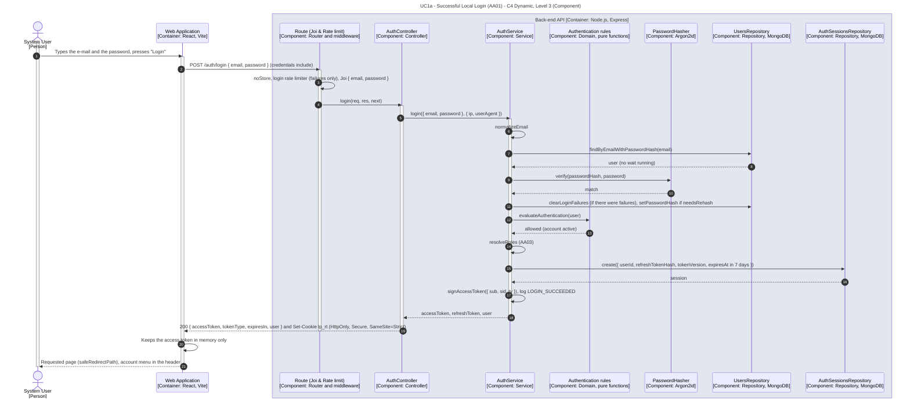
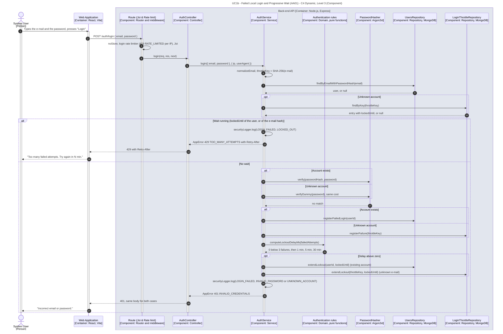
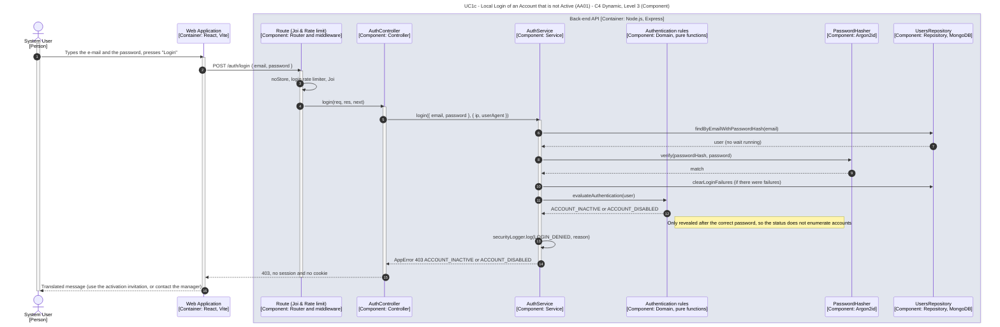

# UC1 - Log In with a Local Account (AA01)

| Attribute | Value |
|---|---|
| C4 view | Dynamic diagram, Level 3 (Component) |
| SAD view | Process View, Level 3 |
| Containers | Web Application, Back-end API, Database |
| Endpoint | `POST /auth/login` with body `{ "email", "password" }` |
| Allowed roles | Public (Guest) |
| Success response | 200 OK `{ accessToken, tokenType, expiresIn, user }` and the refresh cookie `lp_rt` |
| Error handling | 400 `VALIDATION_FAILED`, 401 `INVALID_CREDENTIALS` (unknown account or wrong password, same body), 403 `ACCOUNT_INACTIVE` / `ACCOUNT_DISABLED` (only with the correct password), 403 `NO_ACTIVE_ROLE`, 429 `TOO_MANY_ATTEMPTS` (account waiting) or `RATE_LIMITED` (IP), both with `Retry-After` |
| ADRs | [ADR-0003](../../adr/0003-authentication-and-authorization.md), [ADR-0009](../../adr/0009-implement-rate-limiting-policies.md), [ADR-0012](../../adr/0012-implement-refresh-tokens-for-secure-sessions.md), [ADR-0043](../../adr/0043-secure-session-handling-in-the-api-and-the-spa.md), [ADR-0022](../../adr/0022-local-login-without-account-enumeration-and-with-progressive-lockout.md) |

## Description

The user opens the login page from the **Login** button of the header (or is sent there by the route guard of a protected page), types the e-mail and the password and presses "Login". The form checks that both fields are filled and allows one request at a time.

The Back-end API:

1. **Route:** `noStore`, the `login` rate limiter (per IP, counts only failed requests and is reset after a successful one) and Joi `{ email, password }`. Joi messages never echo the values.
2. **Wait:** the e-mail is normalized and its SHA-256 is the key for unknown accounts. If the account has `lockedUntil` in the future, or the e-mail hash has a running wait in `Login Throttles`, the answer is `429 TOO_MANY_ATTEMPTS` with `Retry-After`, before the password is checked.
3. **Password:** an existing account is verified with Argon2id. An unknown account is verified against a fictitious hash (`verifyDummy`), so both paths take the same time.
4. **Failure:** the failure is counted atomically on the user (`registerFailedLogin`) or on the e-mail hash (`Login Throttles`). From the 3rd consecutive failure `computeLockoutDelayMs` sets a wait of 1, 5 and then 30 minutes. `LOGIN_FAILED` is logged with the reason (never the password) and the answer is `401 INVALID_CREDENTIALS`, identical for both cases.
5. **Correct password:** the counters are cleared and the hash is upgraded if it was created with other Argon2 parameters (`needsRehash`).
6. **Session (`establishSession`, shared with AA02):** `evaluateAuthentication` refuses an inactive or disabled account with `403 ACCOUNT_INACTIVE` or `403 ACCOUNT_DISABLED` (`LOGIN_DENIED`). The roles are read from the database (AA03). An `Auth Session` is created with the SHA-256 of a new opaque refresh token and an absolute expiry of 7 days, and a 60-minute access token is signed with only `sub`, `sid`, `tv`, `jti`, `iat`, `exp` and `iss`.
7. **Answer:** `200` with the access token and the user (id, e-mail, roles, permissions, status, never the password hash), and the cookie `lp_rt` (`HttpOnly`, `Secure`, `SameSite=Strict`, path `/api/v2/auth`).

The Web Application keeps the access token only in memory and goes back to the requested page (`safeRedirectPath`). The header then shows the account menu.

The flow is split into three diagrams: the successful login (UC1a), the failed attempts with the progressive wait (UC1b) and the refusal of an account that is not active (UC1c).

## Diagrams

### UC1a - Successful login

### UC1b - Failed attempts and progressive wait

### UC1c - Correct password, account not active

An active account without any active role gets `403 NO_ACTIVE_ROLE` at the same point; that rule is shown in [Role Resolution (AA03)](./role-resolution.md). The renewal of the access token, the restore after a reload and the route guard are in [Session Handling (AA04)](./session-handling.md). See the [README](./README.md) for the notation key and the element catalogue.
