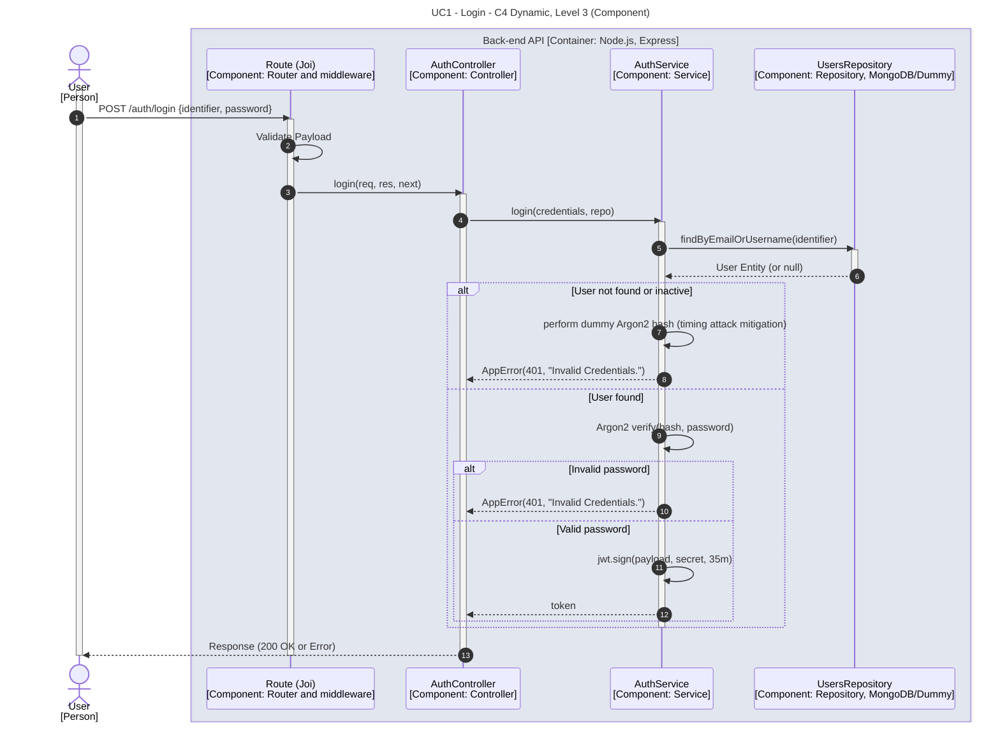

# UC1 - Login

| Attribute | Value |
|---|---|
| C4 view | Dynamic diagram, Level 3 (Component) |
| SAD view | Process View, Level 3 |
| Container | Back-end API |
| Endpoint | `POST /auth/login` |
| Allowed roles | Public (no authentication) |
| Success response | 200 OK (JWT token) |
| Error handling | 401 (invalid credentials) |

## Description

A user authenticates with an email or username and a password. The service verifies the password with Argon2 and issues a signed JWT. When the user does not exist or is inactive, a dummy Argon2 hash is computed to mitigate timing attacks, and the same generic error is returned for every failure.

## Diagram

See the [README](./README.md) for the notation key and the element catalogue.
