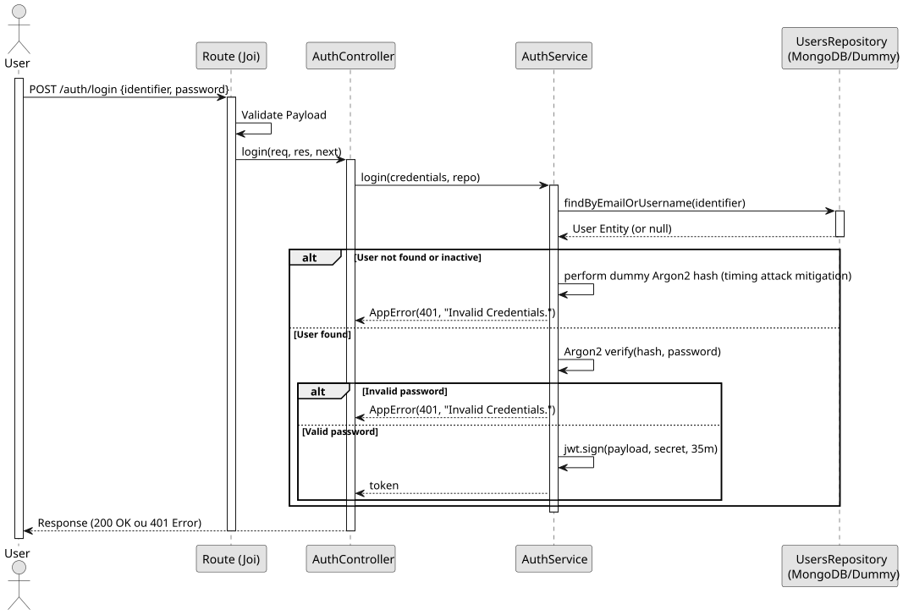

# UC1: Authenticate User (Login)

## Use Case View
**Primary Actor:** System User  
**Description:** Allows registered users to authenticate into the system to access protected operations.

**Preconditions:**
* The user must have a registered and active account in the system.

**Main Success Scenario:**
1. The User provides their identifier (email or username) and password.
2. The System verifies the credentials against the records.
3. The System validates that the account is active.
4. The System generates and returns an authentication token (JWT).

**Alternative Flows:**
* *User not found or inactive:* The System performs a dummy hash validation (timing attack mitigation) and throws a 401 Unauthorized error.
* *Invalid password:* The System throws a 401 Unauthorized error.

**Postconditions:**
* The User receives a valid JWT token with a 35-minute expiration time, enabling access to protected endpoints based on their role.

## 1. Domain Assumptions
* Authentication uses `Argon2` for password hashing verification;
* Upon successful authentication, a JSON Web Token (JWT) is generated with a 35-minute expiration time;
* A timing attack mitigation mechanism is implemented: if a user is not found or is inactive, the system performs a dummy `Argon2` hash calculation to maintain consistent response times.

## 2. Solution Design

## 3. Business Test Planning
* All unit tests use isolated in-memory Dummy Repositories (`users.dummy.repository.js`). The Mockito library isn't used in this project.
* **Scenario A:** Provide valid existing credentials. Result: A valid JWT token populated with the `userId` and `role`.
* **Scenario B:** Provide incorrect password for an existing user. Result: Throws `AppError` (401 Unauthorized).
* **Scenario C:** Provide an email that does not exist in the database. Result: System delays execution (dummy hash) and throws `AppError` (401 Unauthorized).

## 4. Postman E2E Tests

* **Base Endpoint:** `POST /api/v1/auth/login`
* **Validated Scenarios:**
    * Complete payload with valid credentials -> `200 OK` (Returns token)
    * Missing identifier/password -> `400 Bad Request` (Blocked by Joi validation)
    * Incorrect credentials -> `401 Unauthorized`