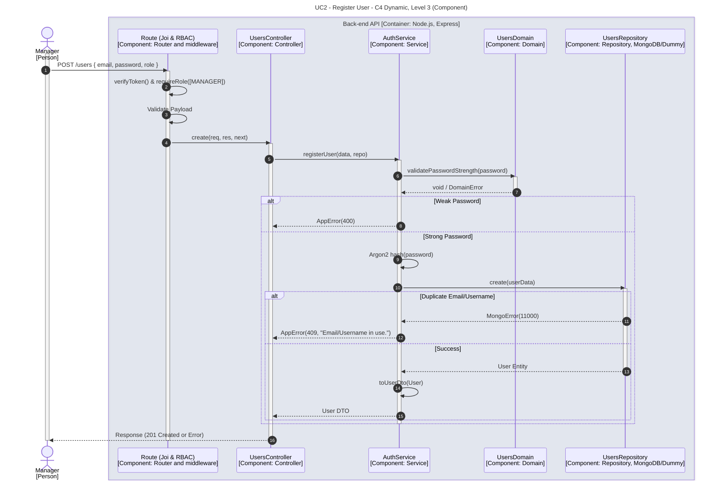

# UC2 - Register User

| Attribute | Value |
|---|---|
| C4 view | Dynamic diagram, Level 3 (Component) |
| SAD view | Process View, Level 3 |
| Container | Back-end API |
| Endpoint | `POST /users` |
| Allowed roles | MANAGER |
| Success response | 201 Created |
| Error handling | 400 (weak password), 409 (email or username already in use) |

## Description

A Manager registers a new user. The domain validates the password strength, the service hashes the password with Argon2 and persists the user, and a duplicated email or username results in a conflict error.

## Diagram

See the [README](./README.md) for the notation key and the element catalogue.
