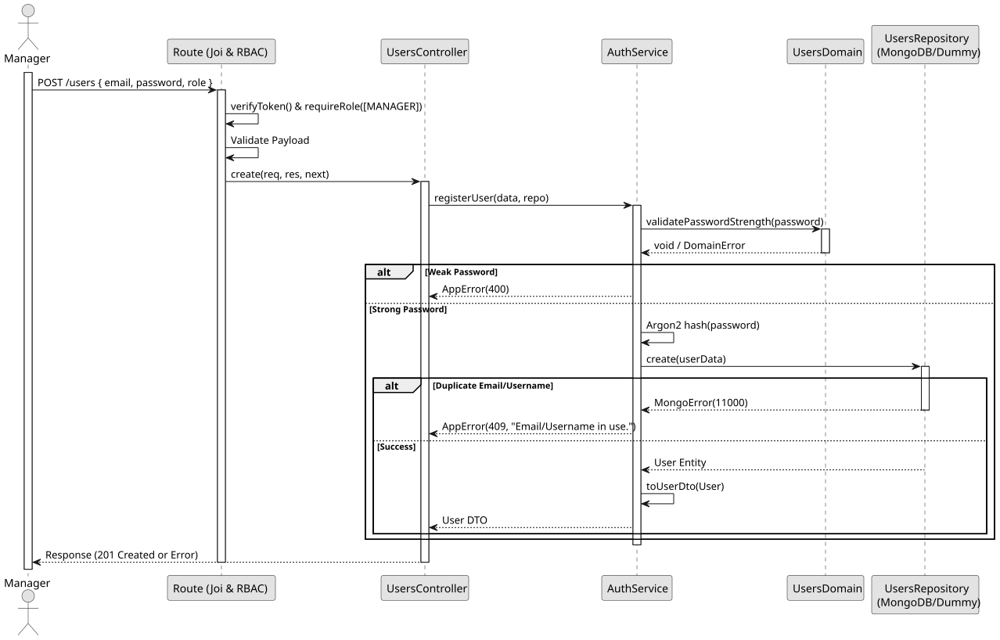

# UC2: Register User

## Use Case View
**Primary Actor:** LaPrizza Manager  
**Description:** Allows a manager to register new users and assign appropriate roles.

**Preconditions:**
* The Manager must be authenticated and authorized.

**Main Success Scenario:**
1. The Manager provides the new user data (username, email, password, role, and customerId if applicable).
2. The System validates the password strength (NIST rules) and payload constraints.
3. The System ensures the email or username is not already registered.
4. The System encrypts the password.
5. The System persists the new user and returns the created record (omitting the password).

**Alternative Flows:**
* *Weak password provided:* The System throws a 400 Bad Request error.
* *Duplicate email or username:* The System throws a 409 Conflict error.
* *customerId provided for a non-CUSTOMER role:* The System throws a 400 Bad Request error.

**Postconditions:**
* A new active user is successfully registered in the system with an encrypted password.

## 1. Domain Assumptions
* Passwords must comply with the strict NIST guidelines (8-64 characters, at least one uppercase letter, and one special character);
* User roles are strictly limited to `MANAGER`, `EMPLOYEE`, or `CUSTOMER`;
* Only users assigned the `CUSTOMER` role can have an associated `customerId`;
* Usernames and emails must be unique across the system.
* The creation of internal accounts (`MANAGER` and `EMPLOYEE`) is strictly protected and restricted to Managers. 
* Customers can register autonomously through a dedicated public endpoint. This registration mandates the collection of Name, Phone Number, and Email, automatically generating and linking the corresponding `Customer` entity to the new user account.

***Sprint 1 Constraint (Late Client Feedback):***
* The business rule stipulating autonomous customer registration through a separate public endpoint was only confirmed by the client close to the Sprint 1 delivery date. For risk management reasons, the implementation of this specific flow (Customer Self-Registration) is being moved to Sprint 2. In the current version, user registration with the `CUSTOMER` role is performed via Manager.*

## 2. Solution Design
.

## 3. Business Logic Testing Planning
* All unit tests use isolated in-memory Dummy Repositories (`users.dummy.repository.js`). The Mockito library isn't used in this project.
* **Scenario A:** Attempt to register a user with a weak password (e.g., '123'). Result: The domain rejects the input, throwing an `app-error` (400 Bad Request) without interacting with the database.
* **Scenario B:** Provide an email already in use. Result: The Dummy Repository throws a duplicate key error (11000), which the service translates to an `app-error` (409 Conflict).
* **Scenario C:** Provide valid data with a strong password. Result: Password is hashed via `Argon2`, saved to the database, and mapped to a DTO (omitting the password and exposing `id` instead of `_id`).

## 4. Postman E2E Tests
* **Base Endpoint:** `POST /api/v1/users`
* **Validated Scenarios:**
    * Request without Bearer Token -> `401 Unauthorized`
    * Request with EMPLOYEE Bearer Token -> `403 Forbidden` (RBAC enforcement)
    * Valid payload by MANAGER -> `201 Created`
    * Missing mandatory fields (e.g., role or password) -> `400 Bad Request`
    * Duplicate email or username -> `409 Conflict`