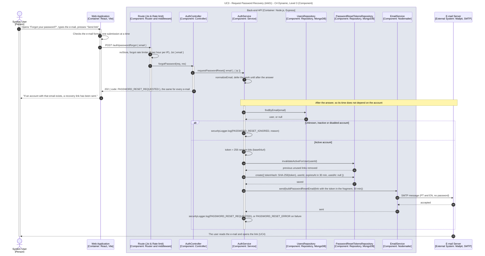

# UC3 - Request Password Recovery (AA01)

| Attribute | Value |
|---|---|
| C4 view | Dynamic diagram, Level 3 (Component) |
| SAD view | Process View, Level 3 |
| Containers | Web Application, Back-end API, Database, E-mail Server |
| Endpoint | `POST /auth/password/forgot` with body `{ "email" }` |
| Allowed roles | Public (Guest) |
| Success response | 202 Accepted `{ "code": "PASSWORD_RESET_REQUESTED" }`, always the same |
| Error handling | 400 `VALIDATION_FAILED` (malformed e-mail), 429 `RATE_LIMITED` (3 requests per hour per IP) with `Retry-After`. Nothing that depends on the account is ever returned |
| ADRs | [ADR-0009](../../adr/0009-implement-rate-limiting-policies.md), [ADR-0023](../../adr/0023-password-recovery-with-single-use-hashed-tokens.md), [ADR-0024](../../adr/0024-e-mail-delivery-with-nodemailer-and-mailpit.md) |

## Description

From the login page the user opens "Forgot your password?", types the e-mail of the account and presses "Send link".

1. **Route:** `noStore`, the `forgot` rate limiter (3 requests per hour per IP) and Joi `{ email }`.
2. **Answer first:** `requestPasswordReset` schedules the work (`defer`) and the controller answers `202` with the same body for every e-mail, so neither the answer nor its time tells whether the account exists. The page shows "If an account with that email exists, a recovery link has been sent".
3. **After the answer:** only an **active** account goes on. An unknown, inactive (it must use its activation invitation, AA07) or disabled account is only logged (`PASSWORD_RESET_IGNORED`, with the reason).
4. **Token:** 256 random bits in base64url. The unused tokens of the user are deleted (a new request invalidates the previous links) and only the SHA-256 of the new one is stored in `Password Reset Tokens`, with `expiresAt` 30 minutes later (removed by a TTL index).
5. **E-mail:** `buildPasswordResetEmail` writes a plain-text message in Portuguese and English with the link `{APP_BASE_URL}/reset-password#token=...` and the expiry. The token is in the fragment, which browsers never send to a server nor put in the `Referer`. `EmailService` sends it through SMTP to the E-mail Server (Mailpit). No password is ever sent.
6. **Log:** `PASSWORD_RESET_REQUESTED` (user id and IP), or `PASSWORD_RESET_ERROR` if the delivery fails. Neither contains the token.

## Diagram

See the [README](./README.md) for the notation key and the element catalogue.
