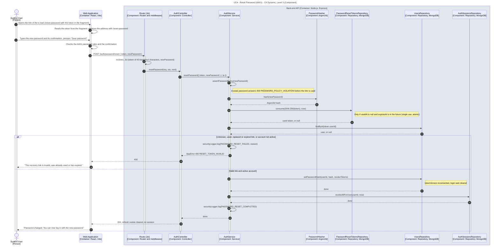

# UC4 - Reset Password (AA01)

| Attribute | Value |
|---|---|
| C4 view | Dynamic diagram, Level 3 (Component) |
| SAD view | Process View, Level 3 |
| Containers | Web Application, Back-end API, Database |
| Endpoint | `POST /auth/password/reset` with body `{ "token", "newPassword" }` |
| Allowed roles | Public (Guest): the link proves control of the account |
| Success response | 204 No Content (no session opened, refresh cookie cleared) |
| Error handling | 400 `VALIDATION_FAILED` (malformed token, the value is never echoed), 400 `PASSWORD_POLICY_VIOLATION` (checked before the link is used), 400 `RESET_TOKEN_INVALID` (unknown, used, replaced or expired link, or account no longer active) |
| ADRs | [ADR-0023](../../adr/0023-password-recovery-with-single-use-hashed-tokens.md), [ADR-0043](../../adr/0043-secure-session-handling-in-the-api-and-the-spa.md) |

## Description

The user opens the link of the recovery e-mail (UC3). `ResetPasswordPage` reads the token from the fragment and immediately replaces the address with `/reset-password`, so the token stays neither in the address bar nor in the history. Without a token the page shows "Invalid recovery link". The page shows the password rules; the user types the new password and its confirmation, which the form checks with the AA01 rules (`passwordRules()`, same as confirmation) before sending.

The Back-end API:

1. **Route:** `noStore` and Joi: `token` must be 43 base64url characters, `newPassword` at most 256 characters.
2. **Password first:** `assertPasswordPolicy` (8 to 64 characters, one uppercase letter, one of `! @ # $ % ^ & * . , - _ ?`) and `passwordHasher.hash` (Argon2id), before the link is touched, so a weak password never spends it.
3. **Use the link:** `consume(SHA-256(token), now)` is one conditional update (`usedAt: null`, `expiresAt > now`) that sets `usedAt`, so two concurrent requests cannot both use it.
4. **Account:** the account must still exist and be `active`. Otherwise, or if the link was unknown, used, replaced or expired, `PASSWORD_RESET_FAILED` is logged with the reason and the answer is `400 RESET_TOKEN_INVALID`.
5. **Replace the password:** `setPasswordHash(..., { revokeTokens: true })` stores the new hash, clears the login wait and increments `tokenVersion`, and every `Auth Session` of the user is revoked. `PASSWORD_RESET_COMPLETED` is logged.
6. **Answer:** `204`, with the refresh cookie cleared. No session is opened.

The page shows "Password changed. You can now log in with the new password." and a link to the login (UC1).

## Diagram

See the [README](./README.md) for the notation key and the element catalogue.
