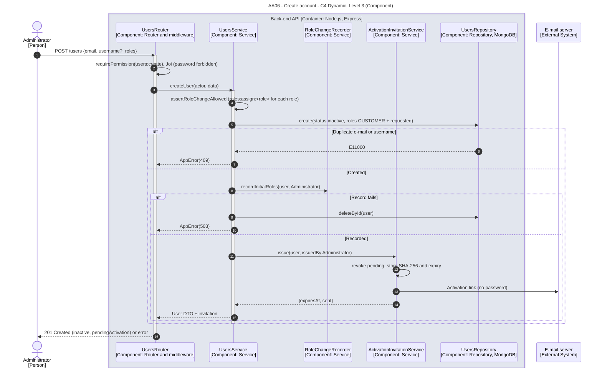
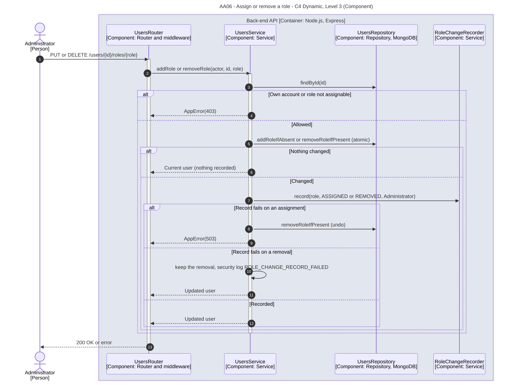
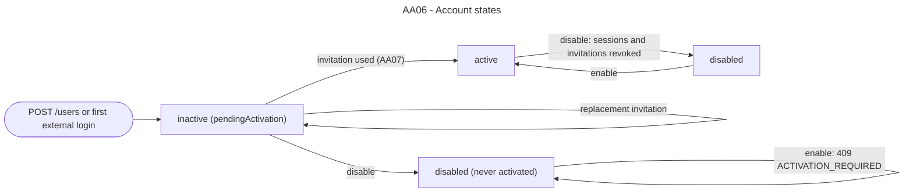

# Role Assignment and Activation Invitation (AA06)

| Attribute | Value |
|:---|:---|
| User Story | AA06 - Role Assignment and Activation Invitation |
| C4 view | Dynamic diagrams, Level 3 (Component) |
| SAD view | Process View, Level 3 |
| Diagram type | Sequence diagrams and a flowchart (Mermaid) |
| Containers | Web Application (SPA), Back-end API, MongoDB, e-mail server (external system) |
| Endpoints | `GET /users`, `GET /users/assignable-roles`, `POST /users`, `GET /users/{id}`, `PATCH /users/{id}`, `PUT /users/{id}/roles/{role}`, `DELETE /users/{id}/roles/{role}`, `GET /users/{id}/role-history`, `POST /users/{id}/invitation` |
| Allowed roles | ADMINISTRATOR |
| Success response | 200 OK, 201 Created |
| Error handling | 400 (validation, password refused), 403 `FORBIDDEN`, `SELF_ROLE_CHANGE`, `ROLE_NOT_ASSIGNABLE`, 404, 409 `ACTIVATION_REQUIRED`, `ACCOUNT_ALREADY_ACTIVATED`, `ACCOUNT_DISABLED`, `EMAIL_MISSING`, duplicate e-mail, 503 (role change not recorded) |
| Decision records | [ADR 0041](../../adr/0041-administrator-role-role-change-records-and-activation-invitations.md), builds on [Role Resolution (AA03)](./role-resolution.md) and [Session Handling (AA04)](./session-handling.md) |

## Description

The website roles follow Table 1. `ADMINISTRATOR` is a new base role that manages user accounts, activation invitations and roles. It grants no restaurant management: a person who also manages the restaurant needs `MANAGER` as well. The Manager no longer manages users.

| Permission | Granted to | Used by |
|:---|:---|:---|
| `users:read` | ADMINISTRATOR | List, consult, role history, assignable roles, and the route guard of the role endpoints |
| `users:create` | ADMINISTRATOR | `POST /users` |
| `users:manage` | ADMINISTRATOR | `PATCH /users/{id}` (enable, disable, password) |
| `users:invite` | ADMINISTRATOR | `POST /users/{id}/invitation` |
| `roles:assign:<role>` | ADMINISTRATOR (the four roles) | Checked by the service for each role added or removed |
| `resources:write` | ADMINISTRATOR | Upload, replace and delete in the shared folder ([SYS04](../../sys-admin/shared-resources.md)). Every role keeps `resources:read` |

Guest is not a role: it applies automatically when there is no session ([AA05](./session-handling.md)).

### New accounts

* `POST /users` creates the account **inactive**, with `CUSTOMER` (automatic, AA03) and the requested roles. No password is accepted: the user sets it while activating the account (AA07).
* The first external login creates an inactive account with `CUSTOMER` only ([AA02](./external-authentication.md)).
* In both cases the back end sends a **unique activation invitation** to the account e-mail. Automatic `CUSTOMER` does not replace activation.

### Invitations

| Property | Rule |
|:---|:---|
| Unique | 256 random bits per invitation. Only the SHA-256 is stored (`Activation Invitations`) |
| Intended recipient | The e-mail of the account, stored with the invitation |
| Expiry | `INVITATION_TTL_HOURS` (72). Expired documents are removed by a TTL index |
| Single use | `consume()` marks it used atomically (activation, AA07) |
| Replacement | `POST /users/{id}/invitation` (Administrator). The previous pending invitation is revoked |
| Only when needed | Only for accounts never activated. Adding a role to an active account never requires reactivation (409 `ACCOUNT_ALREADY_ACTIVATED`) |
| Link | `{APP_BASE_URL}/activate#token=...`. The token is in the fragment, so it never reaches a server log or a `Referer` |
| No password in the e-mail | The e-mail carries only the link |

If the e-mail cannot be sent, the invitation stays valid, the answer says `sent: false` and the Administrator can issue a replacement.

### Role changes

* Only an Administrator assigns or removes roles, including `ADMINISTRATOR`. The only exception is the automatic `CUSTOMER` of AA03.
* Nobody changes their own roles or their own status (403 `SELF_ROLE_CHANGE`). So an active Administrator can only be demoted or disabled by another active Administrator, and the system always keeps one.
* Every assignment and removal is recorded in `Role Changes` (append-only): user, role, action, actor (`USER` with the Administrator id, or `SYSTEM` with the process) and time. `GET /users/{id}/role-history` shows them.
* System processes: `initial-customer-role` (AA03), `external-first-login`, `initial-account-seed` (seeder) and `migration-aa06`.
* A removed role or a disabled account stops working on the next request: roles are read from the database on every request ([AA03](./role-resolution.md)), and disabling increments `tokenVersion` and revokes the sessions ([AA04](./session-handling.md)) and the pending invitations.
* An account that was never activated cannot be enabled by an Administrator (409 `ACTIVATION_REQUIRED`): it is activated only through its invitation.

### Infrastructure administration

Website roles and infrastructure administration are independent. The website roles live in the `users` collection and only grant website permissions. Server access, deployment and backups are granted through Linux accounts and groups (for example `ssh-admins`, see [SSH security](../../sys-admin/ssh-security.md)), which no website role grants or requires.

## Diagrams

### Create an account and send the invitation

### Assign or remove a role

A removal is never undone, because undoing it would give back a permission that was withdrawn. The security log keeps the Administrator, the role and the time if the record cannot be written.

### Account states

## Error codes

| Code | When | Raised by | Message in the SPA |
|:---|:---|:---|:---|
| `SELF_ROLE_CHANGE` | Change to one's own roles | `evaluateRoleChange` | You cannot change your own roles |
| `ROLE_NOT_ASSIGNABLE` | Role without `roles:assign:<role>` | `evaluateRoleChange` | You are not allowed to assign this role |
| `ACTIVATION_REQUIRED` | Enabling an account never activated | `evaluateStatusChange` | This account was never activated, send a new invitation |
| `ACCOUNT_ALREADY_ACTIVATED` | Invitation for an activated account | `evaluateInvitationIssue` | This account is already activated |
| `ACCOUNT_DISABLED` | Invitation for a disabled account | `evaluateInvitationIssue` | This account is disabled |
| `EMAIL_MISSING` | Invitation for an account without e-mail | `evaluateInvitationIssue` | This account has no e-mail address |
| 503 | A role change could not be recorded and was not applied | `UsersService` | The change could not be recorded, so it was not applied |

## Configuration (`.env`)

| Variable | Default | Purpose |
|:---|:---|:---|
| `INVITATION_TTL_HOURS` | `72` | Validity of an activation invitation |
| `APP_BASE_URL` | `http://localhost:4200` | Base of the activation link (`/activate`) |
| `SMTP_*`, `MAIL_FROM` | Mailpit | E-mail delivery (same as password recovery) |

## Migration and first start

* `migrations/aa06-administrator-and-activation.js`: marks the accounts already usable (`active`, `disabled`) as activated, creates the indexes of the two new collections and, if no account is Administrator, gives `ADMINISTRATOR` to the first Manager (`admin@laprizza.pt` when it exists). The assignment is recorded with the process `migration-aa06`.
* On an empty database the seeder creates `admin@laprizza.pt` with `ADMINISTRATOR`, `MANAGER` and `CUSTOMER`, records the three assignments and marks it activated.
* A database with a Manager but no Administrator refuses to start until `npm run migrate:up` runs, so user administration is never left without an Administrator.
* `npm run seed:dev-users` adds `administrator@laprizza.pt` (Administrator only) and `pending@laprizza.pt` (waiting for activation).
* The `.http` flows (`backend/test-flows`) no longer create accounts with a password: they log in with the accounts of `seed:dev-users`, seeded with `SEED_DEV_PASSWORD=LaPrizzaDev_013DI!`. The flows that change a password or disable an account restore it at the end. `users-test-flow.http` covers the AA06 endpoints.

## AA06 acceptance criteria

| Criterion | How it is met | Evidence |
|:---|:---|:---|
| An Administrator assigns, updates and removes the authenticated-user roles of Table 1; Guest is automatic | `ADMINISTRATOR` role with `roles:assign:*` for the four roles; role endpoints; Users page. Guest has no assignment | `permissions.domain.test.js`, `api.auth.test.js`, `users.service.test.js`, `users-api.test.js` |
| Role changes limited to authorized administrators, except the automatic Customer; responsible user or process and time recorded | Permission checks per role, `Role Changes` records with actor and time, `GET /users/{id}/role-history` | `users.service.test.js`, `role-changes.domain.test.js`, `api.auth.test.js`, `api.authorization-matrix.test.js` |
| No administrative role by registering, changing profile information or selecting an authentication method | Only an Administrator assigns roles; external accounts get `CUSTOMER` only, whatever the provider sends; password changes and profile routes never touch roles | `external-auth.service.test.js`, `users.service.test.js`, `permissions.domain.test.js` |
| A new inactive account receives a unique invitation at its intended e-mail; Customer does not replace activation; adding a role to an active account needs no reactivation | Invitation issued on local and external creation; `ACTIVATION_REQUIRED`; role assignment never touches the status | `activation-invitation.service.test.js`, `users.service.test.js`, `external-auth.service.test.js` |
| Invitations expire, become unusable after activation, and can be replaced | TTL, atomic `consume`, revocation on replacement | `activation-invitation.domain.test.js`, `activation-invitation.service.test.js`, `activation-invitations.repository.integration.test.js` |
| Removing a role or disabling an account stops the withdrawn permissions | Roles read on every request (AA03); disabling revokes sessions and invitations | `auth.service.test.js` (AA03), `users.service.test.js`, `api.auth.test.js` |
| Website permissions independent of infrastructure administration | No website permission concerns infrastructure; Linux groups are managed separately | This document, [SSH security](../../sys-admin/ssh-security.md) |

## Manual validation

Accounts of `npm run seed:dev-users`. Use Mailpit (`http://localhost:8025`) to see the e-mails.

| Step | Expected | Result |
|:---|:---|:---|
| 1. Log in as `manager@laprizza.pt` | No "Users" entry; `GET /users` answers 403 | |
| 2. Log in as `administrator@laprizza.pt`, open "Users" | List of accounts, form without password | |
| 3. Create an account with role Employee | Status "Waiting for activation", roles Customer and Employee, e-mail in Mailpit with a link and no password | |
| 4. "Send new invitation" for that account | A new e-mail; the link of step 3 no longer works (after AA07) | |
| 5. "Role history" of that account | Customer by the automatic process, Employee by `administrator@laprizza.pt`, with dates | |
| 6. Add Manager to `employee@laprizza.pt`, then remove it | Both changes in its history; no new invitation; the user keeps working | |
| 7. With `employee@laprizza.pt` signed in elsewhere, remove Employee | Its next request to a staff page answers 403 | |
| 8. Disable `customer@laprizza.pt` | The user is signed out; "Enable" brings it back | |
| 9. Try to enable `pending@laprizza.pt` with `PATCH /users/{id}` | 409 `ACTIVATION_REQUIRED` | |
| 10. Try to change your own roles | 403 `SELF_ROLE_CHANGE`, controls hidden in the SPA | |

## Known limitations and follow-ups

| Item | Impact | Proposal |
|:---|:---|:---|
| Activation is AA07 | Until AA07 exists, new accounts cannot be activated: the invitation is issued but there is no `/activate` page or endpoint | AA07: page `/activate` and endpoint that `consume()` the invitation, set the password or check the external identity, and set `activatedAt` |
| User creation is not atomic (no transactions on the standalone MongoDB) | If the role record fails, the account is deleted (compensation) | Use a transaction if MongoDB runs as a replica set |
| An Administrator may still set a password with `PATCH /users/{id}` | Sprint 1 behaviour kept for existing accounts | Remove it once AA07 and password recovery cover every case |

## Use of AI

| Tool | Purpose | Validation |
|:---|:---|:---|
| Claude (Anthropic) | Split of the user story, drafts of the code, tests and this document | The team reviews and runs the code and the tests (`npm test`, `npm run lint`, `npm run test:integration`). The manual validation table above is the evidence of the behaviour in the SPA |

See the [README](./README.md) for the notation key and the element catalogue.
