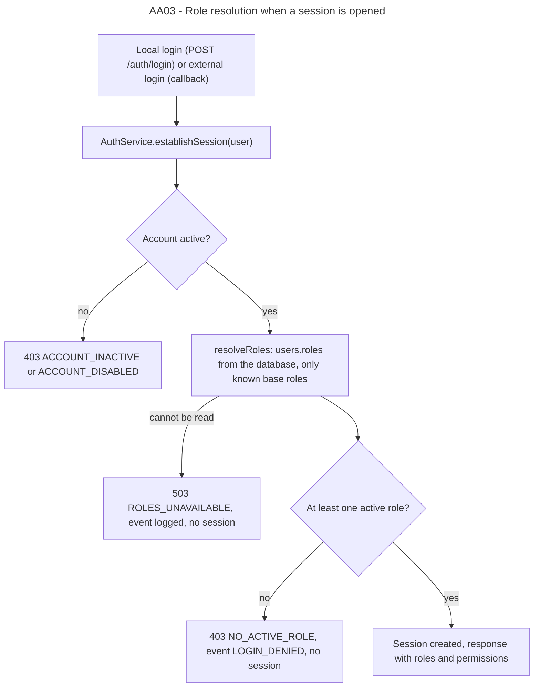
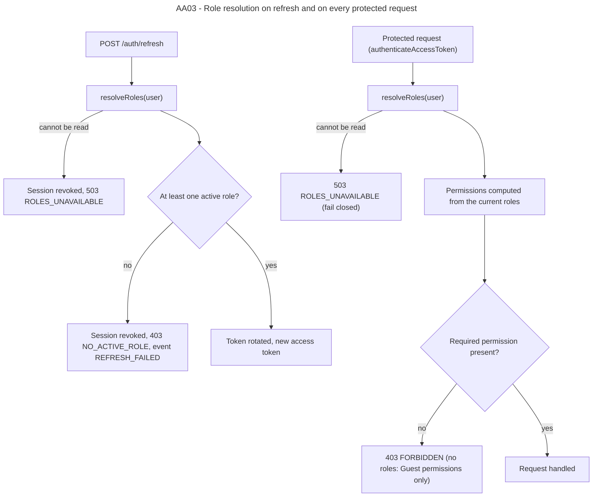

# Role Resolution (AA03)

| Attribute | Value |
|:---|:---|
| User Story | AA03 - Internal Role Resolution |
| C4 view | Dynamic diagrams, Level 3 (Component) |
| SAD view | Process View, Level 3 |
| Diagram type | Flowcharts (Mermaid) |
| Containers | Back-end API, Web Application (SPA), MongoDB |
| Endpoints | `POST /users`, `POST /auth/login`, `GET /auth/external/{provider}/callback`, `POST /auth/refresh`, `GET /auth/me`, every protected endpoint |
| Allowed roles | Public (login, refresh, callback), MANAGER (`POST /users`), authenticated (`GET /auth/me`) |
| Error handling | 403 `NO_ACTIVE_ROLE`, 503 `ROLES_UNAVAILABLE`, 403 `FORBIDDEN` (missing permission) |
| Decision records | Builds on [ADR 0004](../../adr/0004-authentication-and-authorization.md) (as amended by AA04 and AA03) and [ADR 0032](../../adr/0032-secure-session-handling-in-the-api-and-the-spa.md) |

## Description

Roles are internal to LaPrizza. They are stored in `users.roles` and always read by the back end. They never come from the request body, the access token, the identity provider or the browser storage.

Every account starts with the role `CUSTOMER`. A Manager may add other roles when creating a local account. Assigning `CUSTOMER` never changes the account status and grants only the Customer permissions.

On every login (local or external), refresh and protected request, the back end reads the stored roles again and keeps only the known base roles (`activeRoles`). An account without an active role cannot open a session. When the roles cannot be read, the request fails closed: nothing is granted.

A returning user is never created again. Login does not add a `CUSTOMER` role that a Manager removed, and does not change the account status.

## New accounts

| Creation path | Roles stored | Status |
|:---|:---|:---|
| Local account (`POST /users`, permission `users:create`, Manager) | `CUSTOMER` and the requested roles, without duplicates | `active` (Sprint 1 flow, AA06 will use invitations) |
| First login with a verified external identity ([AA02](./external-authentication.md)) | `CUSTOMER` only. Roles or groups sent by the identity provider are ignored | `inactive`, no session (activation by a Manager) |
| Initial Manager (seeder) | `CUSTOMER`, `MANAGER` | `active` |

`withInitialCustomerRole()` (`domain/users/users.domain.js`) is the single rule used by the three creation paths.

## Diagrams

### Opening a session

The same rule applies to the local login and to the external login, because both end in `establishSession` ([Session Handling](./session-handling.md)).

### Refresh and protected requests

`GET /auth/me` returns the current roles and permissions. The SPA updates its session from that answer and hides what is no longer allowed.

## Error codes

| Code | When | Raised by | Message in the SPA |
|:---|:---|:---|:---|
| `NO_ACTIVE_ROLE` | The account has no active role on login, external login or refresh | `establishSession`, `refresh` | Access denied: the account has no active role, contact the manager |
| `ROLES_UNAVAILABLE` | The stored roles could not be read | `resolveRoles` | Access could not be confirmed, try again later |
| `ACCOUNT_INACTIVE`, `ACCOUNT_DISABLED` | Unchanged ([Session Handling](./session-handling.md)) | `establishSession` | Unchanged |

Both codes are on the closed list of the external login callback, so they can appear in `/auth/callback?status=error&code=<CODE>`. The texts exist in English and Portuguese.

## AA03 acceptance criteria

| Criterion | How it is met | Evidence |
|:---|:---|:---|
| Every new account gets the role Customer | `withInitialCustomerRole()` in the three creation paths | `role-resolution.domain.test.js`, `auth.service.test.js`, `external-auth.service.test.js` |
| Roles are never taken from the identity provider or the client | External accounts get only `CUSTOMER`. Roles in a request body are ignored. The access token carries no role | `external-auth.service.test.js`, `auth.service.test.js` |
| Customer grants no staff access | Permissions come from the role matrix (AA05). Customer has no staff permission | Authorization matrix tests (AA05) |
| A returning user keeps the stored roles and status | Login only reads the account. A removed `CUSTOMER` role is not added back | `auth.service.test.js` |
| Inactive or disabled accounts stay blocked | `establishSession` checks the status before the roles | `auth.service.test.js` |
| The same rule applies to local and external login | Both end in `establishSession` | `auth.service.test.js`, `external-auth.service.test.js` |
| An account without an active role is denied with a clear message | `403 NO_ACTIVE_ROLE`, no session, translated message | `auth.service.test.js`, `aa03-role-errors.test.js` |
| A role change applies without a new login | Roles read on every request and refresh. Without roles the session ends on the next refresh | `auth.service.test.js` |
| Unknown role state fails closed | `503 ROLES_UNAVAILABLE`, nothing granted, session revoked on refresh | `auth.service.test.js` |

## Test evidence

| Layer | File | Covers |
|:---|:---|:---|
| Domain | `backend/test/domain/role-resolution.domain.test.js` | `withInitialCustomerRole`, `activeRoles`, `evaluateRoleAuthorization` |
| Application | `backend/test/application/auth.service.test.js` (`AA03:` tests) | Local creation, returning user, inactive and disabled accounts, no active role, roles in the request ignored, fail closed on login, request and refresh, `GET /auth/me` |
| Application | `backend/test/application/external-auth.service.test.js` (`AA03:` tests) | Roles from the provider ignored, linked account without roles denied |
| API | `backend/test/api/api.auth.test.js` | Local registration answers with `CUSTOMER` |
| Front end | `frontend/test/shared/auth/aa03-role-errors.test.js` | Messages of `NO_ACTIVE_ROLE` and `ROLES_UNAVAILABLE` in English and Portuguese, local and external login |

The tests use `node:test` with its native `mock` ([ADR 0028](../../adr/0028-mock-based-unit-testing.md)).

### Manual validation

The development accounts of `npm run seed:dev-users` include `customer@laprizza.dev` and `noroles@laprizza.dev`. The team records the result in this table.

| Step | Expected | Result |
|:---|:---|:---|
| 1. Manager creates a user without roles (`POST /users`) | Response and database with `roles: ["CUSTOMER"]` | |
| 2. Manager creates a user with `roles: ["EMPLOYEE"]` | `["CUSTOMER", "EMPLOYEE"]` | |
| 3. Login with `customer@laprizza.dev` | No staff entries in the menu, staff route shows access denied, staff endpoint answers 403 | |
| 4. Login with `noroles@laprizza.dev` | Message `NO_ACTIVE_ROLE`, no session | |
| 5. Login body with `"roles": ["MANAGER"]` | Request refused (400) or answered with the stored roles only | |
| 6. A Manager removes a role of a logged-in user | Next request to a route of that role answers 403, without a new login | |
| 7. All roles removed from a logged-in user | Next refresh answers `NO_ACTIVE_ROLE` and the SPA logs out | |
| 8. Remove `CUSTOMER` from a user, then log in again | `CUSTOMER` is not added back | |
| 9. First external login with a new account | `ACCOUNT_PENDING_ACTIVATION`, database with `roles: ["CUSTOMER"]` and `status: "inactive"` | |

## Known limitations and follow-ups

| Item | Impact | Proposal |
|:---|:---|:---|
| `POST /users` checks `users:create`, not `roleAssignmentPermission` of each requested role | No impact today: only the Manager can create users and holds every assignable role | Check the assignment permission of each requested role when another role gets `users:create` |
| `customerId` is refused unless `CUSTOMER` is in the requested roles | A request without roles and with a `customerId` is refused, although the account would receive `CUSTOMER` | Check `customerId` against the roles after `withInitialCustomerRole()` |
| Roles are read on every protected request | One extra read per request | Cache with invalidation on role change, if load requires it ([ADR 0015](../../adr/0015-introduce-redis-for-caching.md)) |

## Use of AI

| Tool | Purpose | Validation |
|:---|:---|:---|
| Claude (Anthropic) | Split of the user story, drafts of the code, tests and this document | The team reviews and runs the code and the tests (`npm test`, `npm run lint`). The manual validation table above is the evidence of the behaviour in the SPA |

See the [README](./README.md) for the notation key and the element catalogue.
