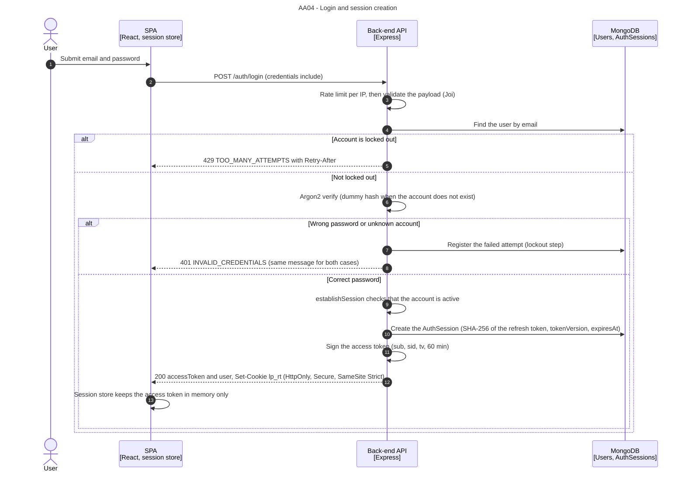
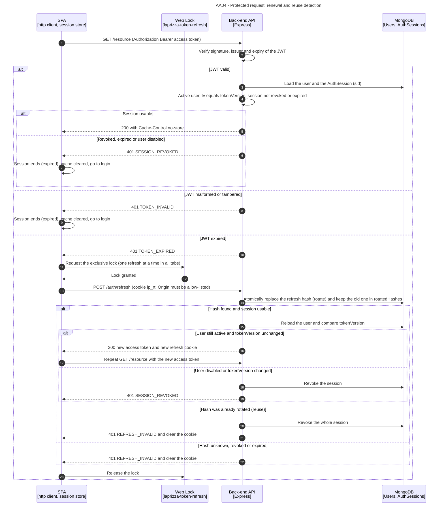
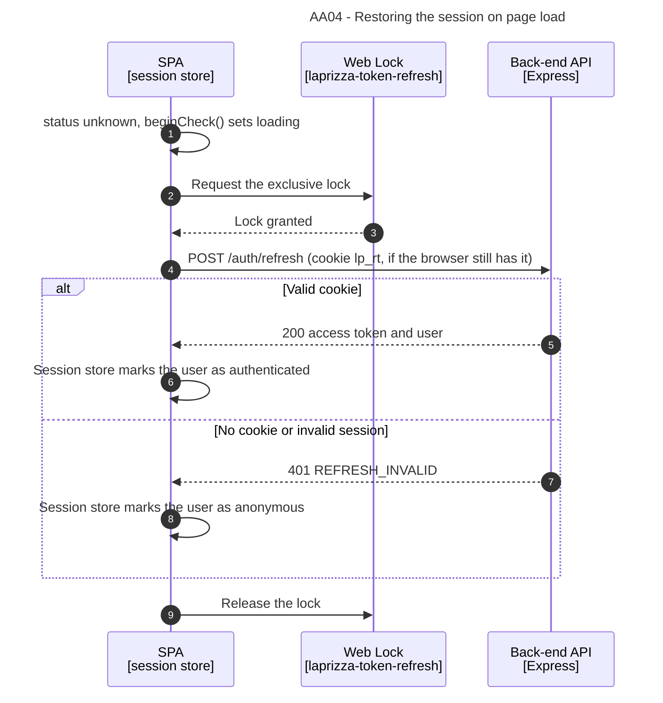
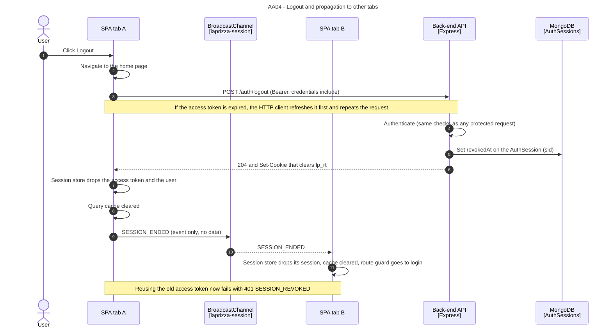
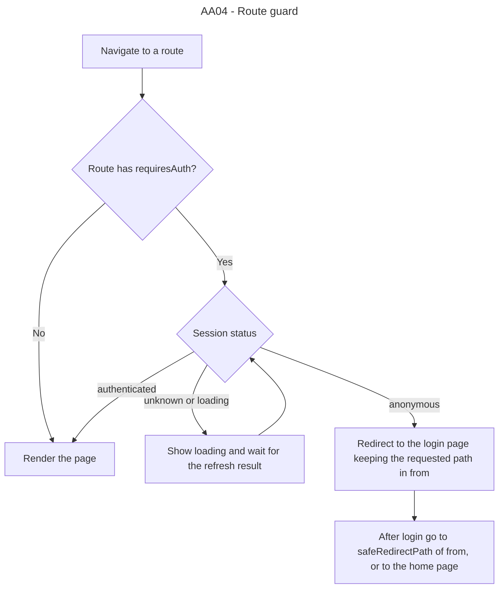

# Session Handling (AA04)

| Attribute | Value |
|:---|:---|
| User Story | AA04 - Secure Session Handling |
| Diagram type | Sequence diagrams and a flowchart (Mermaid) |
| Containers | Back-end API, Web Application (SPA), MongoDB |
| Endpoints | `POST /auth/login`, `POST /auth/refresh`, `POST /auth/logout`, `POST /auth/logout-all` |
| Decision record | [ADR 0032](../../adr/0032-secure-session-handling-in-the-api-and-the-spa.md), builds on [ADR 0011](../../adr/0011-implement-refresh-tokens-for-secure-sessions.md) |

## Description

A session is one `AuthSession` document in MongoDB. The browser holds two credentials that point to it:

| Credential | Content | Where it lives | Lifetime | Checked |
|:---|:---|:---|:---|:---|
| Access token | Signed JWT (HS256, issuer `laprizza-api`) with `sub` (user), `sid` (session) and `tv` (token version) | SPA memory only, sent as `Authorization: Bearer` | `ACCESS_TOKEN_TTL_MINUTES` (60) | On every protected request, together with the user and the session in the database |
| Refresh token | 256 random bits (`randomBytes(32)`), only its SHA-256 is stored | `HttpOnly` cookie `lp_rt`, path `/api/v1/auth` | `REFRESH_TOKEN_TTL_DAYS` (7), absolute | Only by `POST /auth/refresh`, rotated on every use |

The roles used for authorization always come from the database (`req.user.roles`), never from the token or the client ([Role Resolution (AA03)](./role-resolution.md)). Local login and the external login ([AA02](./external-authentication.md)) both end in `establishSession`, so they create the same kind of session.

## Diagrams

### Login

An inactive or disabled account that proves its password receives `403 ACCOUNT_INACTIVE` or `403 ACCOUNT_DISABLED` from `establishSession` and no session is created.

### Protected request and renewal

When the refresh fails, the SPA ends the session and the route guard sends the user to the login page with the "session expired" message. A missing token returns `401 TOKEN_MISSING` and an authenticated user without the required role returns `403 FORBIDDEN`, so authentication failure and lack of permission are always distinguishable.

### Restoring the session after a reload

### Logout and other tabs

`POST /auth/logout-all` follows the same path but increments `tokenVersion` and revokes every session of the user.

### Route guard in the SPA

The guard only avoids rendering protected screens. The back end still authorizes every request.

## Session invalidation rules

| Event | Effect on the session | Effect on access tokens already issued |
|---|---|---|
| Logout | `AuthSession` revoked, cookie cleared | Refused on the next request (`sid` no longer usable) |
| Logout all | `tokenVersion` incremented, all sessions of the user revoked | Refused (`tv` and `sid` mismatch) |
| Account disabled or set inactive | `tokenVersion` incremented, sessions revoked | Refused (user not active, `tv` mismatch) |
| Password reset | Password replaced, `tokenVersion` incremented, all sessions revoked | Refused |
| Password change | Other sessions revoked, the current one is kept | Other sessions refused, the current one keeps working |
| Role change | Sessions untouched | New roles apply on the next request (roles read from the database) |
| All roles removed | Session revoked on the next refresh (`403 NO_ACTIVE_ROLE`) | Protected requests refused (`403`, Guest permissions only) |
| Access token expires | Session untouched | Client refreshes (rotation) and repeats the request |
| Rotated refresh token presented again | Whole session revoked (theft assumed) | Refused |
| Refresh token reaches its absolute expiry | Document removed by the TTL index on `expiresAt` | Refused |

## Configuration (`.env`)

### Back end

| Variable | Default | Purpose | Production (HTTPS) |
|---|---|---|---|
| `JWT_SECRET` | none, startup fails without it | Signs and verifies access tokens (HS256). Changing it invalidates every access token | Long random value from the secret store ([ADR 0017](../../adr/0017-secrets-management-strategy.md)), never committed |
| `ACCESS_TOKEN_TTL_MINUTES` | `60` | Access token lifetime | `60` or less |
| `REFRESH_TOKEN_TTL_DAYS` | `7` | Absolute lifetime of the session | `7` |
| `REFRESH_COOKIE_NAME` | `lp_rt` | Name of the refresh cookie | `lp_rt` |
| `REFRESH_COOKIE_SECURE` | `true` | `Secure` flag of the cookie. Only `false` disables it | `true` |
| `REFRESH_COOKIE_SAMESITE` | `strict` | `SameSite` flag. `none` requires `REFRESH_COOKIE_SECURE=true`, otherwise the server refuses to start | `strict` (SPA and API on the same site) |
| `CORS_ORIGIN` | `http://localhost:4200` | Comma-separated SPA origins. Used by CORS (with credentials) and as the allow-list of `POST /auth/refresh` | Exact origin of the SPA |
| `TRUST_PROXY` | `false` | Express `trust proxy`. Needed so `req.ip` is the client when a reverse proxy is in front | Number of proxies, for example `1` |
| `RATE_LIMIT_ENABLED` | `true` (`false` when `NODE_ENV=test`) | Enables the per-IP limiters | `true` |
| `AUTH_RATE_LIMIT_WINDOW_MINUTES` | `15` | Window of the limiter applied to every `/auth/*` route, except `GET /auth/external/providers` | `15` |
| `AUTH_RATE_LIMIT_MAX` | `10` | Requests per IP in that window | `10` (see limitations) |
| `FORGOT_RATE_LIMIT_WINDOW_MINUTES` | `60` | Window of the password recovery limiter | `60` |
| `FORGOT_RATE_LIMIT_MAX` | `3` | Recovery requests per IP in that window | `3` |
| `LOGIN_LOCKOUT_THRESHOLD` | `3` | Consecutive failures before the first wait | `3` |
| `LOGIN_LOCKOUT_STEPS_SECONDS` | `60,300,1800` | Wait after each further failure. The last value repeats | `60,300,1800` |
| `LOGIN_THROTTLE_RETENTION_HOURS` | `24` | How long failures of unknown accounts are remembered | `24` |
| `PASSWORD_RESET_TTL_MINUTES` | `30` | Lifetime of the single-use recovery link | `30` |
| `APP_BASE_URL` | `http://localhost:4200` | Base of the recovery link sent by email | Public URL of the SPA |
| `NODE_ENV` | `development` | Log format and default of `RATE_LIMIT_ENABLED` | `production` |

The lockout is stored per account (and per email hash for unknown accounts), so it survives restarts. The per-IP rate limiter is kept in memory and restarts from zero with the server.

### Front end

| Variable | Default | Purpose |
|---|---|---|
| `VITE_API_BASE_URL` | `http://localhost:3000/api/v1` | Base URL of the API. It holds no credentials |

### Local development

* Browsers treat `localhost` as a secure context, so `REFRESH_COOKIE_SECURE=true` works there. Tools that do not (for example the httpyac flows) need `REFRESH_COOKIE_SECURE=false` in a local `.env`, which must never be committed or used outside development.
* Set `RATE_LIMIT_ENABLED=false` locally to avoid being blocked while testing repeatedly.
* Web Locks and `BroadcastChannel` need HTTPS or `localhost`.

## Threat model

### Scope and trust boundaries

| Item | Description |
|---|---|
| Assets | Access token, refresh token, `AuthSession` records, user roles and status, protected business data shown by the SPA |
| Boundary 1 | Browser to API over HTTPS. The browser is untrusted for identity and roles |
| Boundary 2 | API to MongoDB. The only place where session state is authoritative |
| Boundary 3 | Between tabs of the same browser profile (shared cookie, separate memory) |
| Out of scope | Compromised user device or browser, compromised server or database host, infrastructure access (see [SSH security](../../sys-admin/ssh-security.md)) |

### Threats and mitigations

| ID | Threat | Mitigation in the system | Evidence | Residual risk |
|---|---|---|---|---|
| T1 | Theft of tokens by XSS | Access token only in memory. Refresh token in an `HttpOnly` cookie, so scripts cannot read it | `session-store.js`, cookie options in `auth.controller.js` | A script running in the page can still call the API while the page is open. No Content-Security-Policy is configured by the application |
| T2 | CSRF against the cookie endpoint | `SameSite=Strict`, cookie limited to `/api/v1/auth`, `Origin` must be allow-listed on `/auth/refresh`. Business endpoints need the Bearer header, which browsers do not attach on their own | `requireAllowedOrigin` in `auth.routes.js` | Requests without an `Origin` header are accepted, but they still need the cookie |
| T3 | Stolen access token replayed | HTTPS, 60 minute lifetime, never in URLs, and every request re-checks the session, so logout or disabling the user refuses it at once | `authenticateAccessToken` in `auth.service.js`, `auth.middleware.test.js` | Valid until revoked or expired |
| T4 | Stolen refresh token replayed | Rotation on every use, only the SHA-256 is stored, a rotated token presented again revokes the whole session, absolute expiry | `rotateRefreshToken`, `findByRotatedHash` | The thief and the user race for the first use. The loser is refused and the session ends |
| T5 | Session fixation | Session id and refresh token are generated by the server at each login. The client cannot supply them | `establishSession` | None identified |
| T6 | Stale or escalated permissions | Role read from the database on every request, `tokenVersion` and session revocation on disabling or password change, roles from the client are never accepted | `authenticateAccessToken`, `requireRole`, `users.service.js` | None identified |
| T7 | Brute force and credential stuffing | Progressive lockout per account, per-IP rate limit, same `401` for every failure and a dummy hash for unknown accounts | `computeLockoutDelayMs`, `rate-limit.js` | The rate limiter is in memory ([ADR 0008](../../adr/0008-implement-rate-limiting-policies.md)). Lockout can be used to annoy a known user |
| T8 | Session data leaking through URLs, messages or logs | Credentials only in the header and the cookie. Errors use generic codes. The security logger drops keys that look like secrets | `security-logger.test.js`, `auth-errors.js` | `LOGIN_FAILED` logs the email, which is personal data and needs a retention period (GDP01). `sessionId` is logged on purpose (ADR 0032, D8) |
| T9 | Protected data visible after logout (back button, shared computer) | `Cache-Control: no-store` on API responses, query cache cleared at session end, reload when restored from the back/forward cache, route guard | `session-cache.test.js`, `route-protection.test.js`, `guard.test.js` | The cached `index.html` holds no user data. Its headers depend on the web server |
| T10 | Refresh race between tabs revoking a healthy session | Web Lock serializes refreshes across tabs | `refresh-lock.test.js` | Without a secure context the lock is unavailable and the race is possible |
| T11 | Other tabs keep a session that was ended elsewhere | `BroadcastChannel` event, and the server refuses the old token anyway | `session-sync.test.js`, flow 6.2 in `auth-test-flow.http` | Without `BroadcastChannel` the tab notices on its next request |
| T12 | Open redirect after login | Only same-app absolute paths are accepted, never the login page itself | `redirect.test.js` | None identified |
| T13 | Logout request lost (network failure) | The SPA forgets the session locally anyway. The session expires by itself and "log out everywhere" revokes it on demand | `auth-api.js` | The refresh cookie may still restore the session until it expires |
| T14 | Leak or loss of `JWT_SECRET` | Kept outside the repository ([ADR 0017](../../adr/0017-secrets-management-strategy.md)). Rotating it invalidates all access tokens and the refresh flow issues new ones | `loadConfig` | A leaked secret allows forged tokens until it is rotated. Forged tokens still fail when the `sid` or `tv` do not match a real session |

## AA04 acceptance criteria

| Criterion | How it is met | Evidence |
|---|---|---|
| The session is maintained securely | Access token in memory, refresh token in an `HttpOnly`, `Secure`, `SameSite=Strict` cookie, rotation, hashes only in the database | `auth.service.test.js`, `auth.controller.test.js` |
| Protected operations verify a valid session of an active, authorized user | `authenticate` and `requireRole` on every protected route | `auth.middleware.test.js` |
| Expired or invalid sessions require renewal or a new login | `TOKEN_EXPIRED` triggers one refresh and a retry, any other session failure ends the session and the guard redirects to login | `http-client-auth.test.js`, `guard.test.js` |
| Logout prevents reuse of the ended session | Session revoked and cookie cleared. The old access token gets `401 SESSION_REVOKED` | flows 6.1 and 6.2 in `auth-test-flow.http` |
| Local and external authentication behave the same | Both call `establishSession` ([External Authentication](./external-authentication.md)) | `auth.service.test.js`, `external-auth.service.test.js` |
| Session information is not exposed in URLs, messages or logs | See T3, T8 and T12 | `security-logger.test.js` |
| Going back after logout shows nothing protected | See T9 | `session-cache.test.js`, `session-sync.test.js` |

## Known limitations and follow-ups

| Item | Impact | Proposal |
|---|---|---|
| `/auth/refresh` and `/auth/logout` share the login rate limiter (10 requests per 15 minutes per IP) | Many reloads can block refresh and look like a logout | Use a separate, more permissive limiter for refresh and logout |
| A network error during refresh ends the session in the SPA | An offline user is logged out | Only end the session on a `401` from the refresh endpoint |
| Idle timeout without warning | A session unused for `SESSION_IDLE_TIMEOUT_MINUTES` (30) ends silently; the next reload or request asks for login ([ADR 0032](../../adr/0032-secure-session-handling-in-the-api-and-the-spa.md) D9) | Show a warning before it expires if users find it abrupt |
| External authentication (AA02) uses the same session, but only the cases that need no provider account are in `external-auth-test-flow.http` | The full login is validated by hand | See the manual validation table in [External Authentication](./external-authentication.md) |
| In-memory rate limiter | Not shared between instances | Redis store if the API is replicated |
| No Content-Security-Policy | Weaker XSS containment | Add the header at the web server or with `helmet` |
