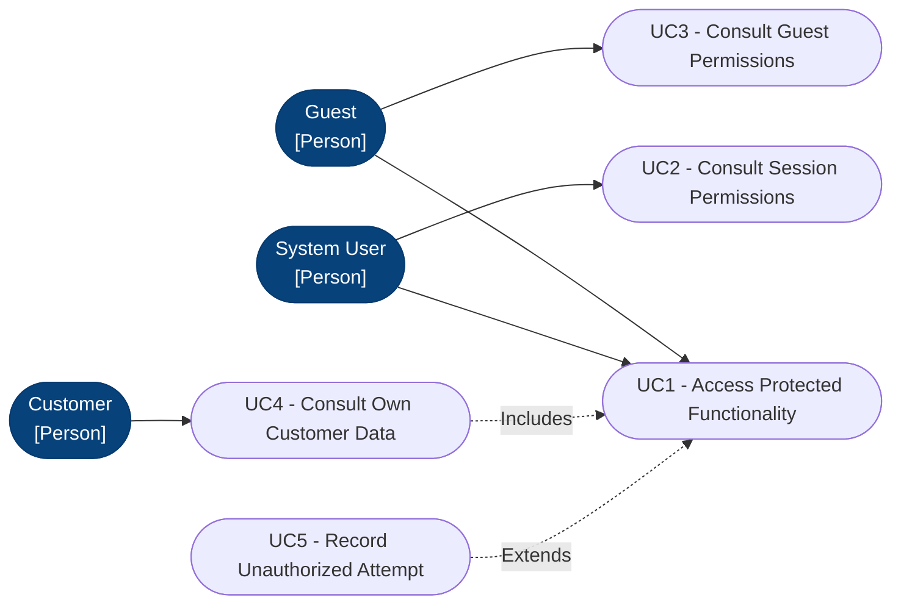

# Authorization Enforcement - Design Diagrams (Mermaid)

The Authorization Enforcement feature (AA05) checks the permissions of the requester whenever protected information or functionality is requested. Permissions come from a single role → permission matrix in the back end (Table 1, least privilege); routes check permissions, never role names. A request without a session is a Guest and only has the Guest permissions. An authentication failure answers `401` and a lack of permission answers `403`, and every refused attempt is written to the security log without passwords or session secrets. A customer reads only their own personal data, through an endpoint that takes the customer from the session. The Web Application reads the same permissions from the back end (`GET /auth/me`, `GET /auth/guest-permissions`) to show only the sections and actions the user may use (WEB03); the API still checks every request.

Process View (SAD), Level 3, documented as C4 dynamic diagrams of the **Back-end API** container. The **Web Application** appears as a single container.

## Use Cases

The use cases are described in the [Use Case Views](../../analysis/use-case-views.md#aa05-authorization-enforcement).

## Diagrams

| Use case | Endpoint | Roles | Success | Document |
|---|---|---|---|---|
| [UC1 - Access Protected Functionality](./access-protected-functionality.md) | Every guarded route (`requirePermission`, `requireAuthenticated`) | As in the matrix below | Business answer of the route | `access-protected-functionality.md` |
| [UC2 - Consult Session Permissions](./consult-session-permissions.md) | `GET /auth/me` | Any authenticated user | 200 OK | `consult-session-permissions.md` |
| [UC3 - Consult Guest Permissions](./consult-guest-permissions.md) | `GET /auth/guest-permissions` | Public (Guest) | 200 OK | `consult-guest-permissions.md` |
| [UC4 - Consult Own Customer Data](./consult-own-customer-data.md) | `GET /customers/me` | CUSTOMER (`customers:read:own`) | 200 OK | `consult-own-customer-data.md` |
| UC5 - Record Unauthorized Attempt | - (part of every refusal) | - | `ACCESS_DENIED` security event | shown in [UC1](./access-protected-functionality.md) |

## Permission matrix

`ROLE_PERMISSIONS` and `GUEST_PERMISSIONS` in `src/domain/auth/permissions.domain.js`. A user with several roles gets the union of their permissions; every authenticated user also has the Guest permissions; a user without roles has only the Guest permissions (and cannot log in, AA03).

| Permission | Guest | Customer | Employee | Manager | Administrator |
|---|---|---|---|---|---|
| `catalogue:read` | ✅ | ✅ | ✅ | ✅ | ✅ |
| `customers:read:own` | - | ✅ | - | - | - |
| `customers:read`, `customers:write` | - | - | - | ✅ | - |
| `products:read` | - | - | ✅ | ✅ | - |
| `products:write`, `categories:write`, `pizzas:write` | - | - | - | ✅ | - |
| `allergens:read`, `allergens:write` | - | - | - | ✅ | - |
| `stock:read` | - | - | ✅ | ✅ | - |
| `stock:read:inactive`, `stock:write` | - | - | - | ✅ | - |
| `kitchen:read`, `kitchen:write` | - | - | - | ✅ | - |
| `forecasts:read`, `forecasts:write`, `suppliers:read`, `suppliers:import`, `planning:execute` | - | - | - | ✅ | - |
| `resources:read` | - | ✅ | ✅ | ✅ | ✅ |
| `resources:write` | - | - | - | - | ✅ |
| `users:read`, `users:create`, `users:manage`, `users:invite`, `roles:assign:*` | - | - | - | - | ✅ |

The Administrator row was added by AA06 ([ADR-0041](../../adr/0041-administrator-role-role-change-records-and-activation-invitations.md)) by changing only this data. Guests and customers see the allergens of each product through the public catalogue; the allergen endpoints are for allergen management.

## Permission of each resource

All paths are under `/api/v2` (current version). `/api/v1` is a deprecated alias served by the same router (`api-versions.js`).

| Resource (routes) | Read | Write |
|---|---|---|
| `/catalogue` | `catalogue:read` (public, rate limited per IP for Guests) | - |
| `/customers`, `/customers/{id}` | `customers:read` | `customers:write` |
| `/customers/me` | `customers:read:own` | - |
| `/products`, `/product-categories`, `/pizza-size`, `/pizza-component-type`, `/predefined-pizzas`, `/products/{productId}/size-configurations` | `products:read` | `products:write`, `categories:write`, `pizzas:write` |
| `/allergens` | `allergens:read` | `allergens:write` |
| `/stock` | `stock:read` (active products); `stock:read:inactive` with `includeInactive=true` | `stock:write` |
| `/kitchen-configurations`, `/assembly-line-configurations` | `kitchen:read` | `kitchen:write` |
| `/forecasts`, `/supplier-scenarios` | `forecasts:read`, `suppliers:read` | `forecasts:write`, `suppliers:import` |
| `/planning`, `/ai-data` | `planning:execute` | `planning:execute` |
| `/shared-resources` | `resources:read` | `resources:write` |
| `/users` | `users:read` | `users:create`, `users:manage`, `users:invite`, `roles:assign:<role>` |
| `/auth/me`, `/auth/logout`, `/auth/logout-all`, `/auth/password/change` | any authenticated user (`requireAuthenticated`) | |
| `/health`, `/version`, `/openapi.json`, `/auth/guest-permissions`, `/auth/login`, `/auth/refresh`, `/auth/password/forgot`, `/auth/password/reset`, `/auth/activation/*`, `/auth/external/*` | public entry points | |

## Business rules shown in the diagrams

- **Permissions, never role names.** Routes use `requirePermission(Permission.X)` (or `requireAuthenticated` for the session routes). Services that need a finer rule (ownership, inactive stock) also use permissions ([ADR-0043](../../adr/0043-permission-based-authorization-matrix.md)).
- **Server-side roles.** The access token carries only the user, the session and the token version. On every protected request the user and the session are read from the database, the active roles are resolved (AA03) and turned into permissions (`permissionsFor`). A role change, a deactivation or a revoked session applies on the next request.
- **Guest.** A request without `Authorization` gets the Guest principal (`GUEST_PERMISSIONS`) without touching the database. If the route is not public for Guests, the answer is `401 TOKEN_MISSING`, never `403`, so the Web Application can send the user to the login.
- **401 versus 403.** `401` for a missing, malformed, invalid or expired token and for a revoked session or inactive account (`TOKEN_MISSING`, `TOKEN_INVALID`, `TOKEN_EXPIRED`, `SESSION_REVOKED`). `403 FORBIDDEN` for a valid session without the permission. `503 ROLES_UNAVAILABLE` when the roles cannot be read (fail closed).
- **Refused before the business logic.** A refused request never reaches the controller, the service or the business repositories, and the answer never says which permission was missing.
- **Data ownership.** A customer reads their own record through `GET /customers/me`, which uses the `customerId` of the session; `GET /customers/{id}` needs `customers:read` (Manager), so changing the id answers `403`. `canReadCustomer` (`ownership.domain.js`) accepts the record only with `customers:read`, or with `customers:read:own` and the same `customerId`. An account without a linked customer gets `404 CUSTOMER_PROFILE_NOT_FOUND`.
- **Inactive stock.** `GET /stock` returns only active products; `includeInactive=true` also needs `stock:read:inactive` (Manager), checked after the query is validated.
- **Recorded attempts.** Every `401` and `403` writes `ACCESS_DENIED` with user id and roles (when known), IP, method, path, route pattern, user agent (200 characters at most), required permission and reason (`TOKEN_MISSING`, `TOKEN_INVALID`, `TOKEN_EXPIRED`, `SESSION_REVOKED`, `MISSING_PERMISSION`). The security logger drops fields named like a secret (`pass`, `token`, `secret`, `cookie`, `authorization`, `hash`) and redacts values that look like a Bearer token, a JWT or an Argon2 hash.
- **Public routes limited.** Guest requests to `/catalogue` go through the `public` rate limiter (per IP, `PUBLIC_RATE_LIMIT_WINDOW_MINUTES`, `PUBLIC_RATE_LIMIT_MAX`, default 120 per minute). Requests with a token skip it. `429 RATE_LIMITED` is logged as `RATE_LIMITED`.
- **Responses not cached.** `/api` answers carry `Cache-Control: no-store`, so a protected answer is never reused for another user. The only exception is `GET /auth/guest-permissions`, which is the same for everyone and may be cached for 5 minutes (`public, max-age=300`). `/auth/me` and `/auth/guest-permissions` have no rate limiter, because the Web Application calls them often.

## Related ADRs

| ADR | Decision | Status |
|---|---|---|
| [ADR-0004](../../adr/0004-authentication-and-authorization.md) | Authentication and authorization (Argon2 with JWT) | Accepted, amended |
| [ADR-0008](../../adr/0008-implement-rate-limiting-policies.md) | Rate limiting policies | Accepted |
| [ADR-0014](../../adr/0014-api-uri-routing-versioning-strategy.md) | API URI versioning (`/api/v2`, `/api/v1` deprecated alias) | Accepted |
| [ADR-0016](../../adr/0016-implement-structured-logging-and-monitoring.md) | Structured logging and monitoring | Accepted |
| [ADR-0028](../../adr/0028-mock-based-unit-testing.md) | Mock-based unit testing with `node:test` | Accepted |
| [ADR-0032](../../adr/0032-secure-session-handling-in-the-api-and-the-spa.md) | Secure session handling in the API and the SPA | Accepted |
| [ADR-0041](../../adr/0041-administrator-role-role-change-records-and-activation-invitations.md) | Administrator role, role change records and activation invitations | Accepted |
| [ADR-0043](../../adr/0043-permission-based-authorization-matrix.md) | Permission-based authorization with a single role matrix | Accepted |

## Notation key

| Notation | Meaning |
|---|---|
| Actor (stick figure) | Person using the system, with the role shown in the label |
| Participant "Web Application" | Container (React, Vite), shown without its internal components |
| Shaded box "Back-end API" | System boundary of the container (Node.js, Express) that holds all the components |
| Participant label | `Name`, followed by `[Type: technology]` |
| Solid arrow | Call or request |
| Dashed arrow | Return value or response |
| Arrow to the same participant | Work done inside that component |
| Number on an arrow | Order of the interaction (autonumber) |
| `alt` / `else` frame | Alternative flows, only one of them runs |
| `opt` frame | Optional flow |
| `Note` | Reference to another diagram or a remark |

## Element catalogue

| Element | Type | Technology | Responsibility | Used in |
|---|---|---|---|---|
| Guest | Person | - | Person without a session | [UC1](./access-protected-functionality.md), [UC3](./consult-guest-permissions.md) |
| System User | Person | - | Authenticated user with one or more roles | [UC1](./access-protected-functionality.md), [UC2](./consult-session-permissions.md) |
| Customer | Person | - | Authenticated user with the role `CUSTOMER` and a linked customer record | [UC4](./consult-own-customer-data.md) |
| Web Application | Container | React, Vite | Sends the access token, reads the permissions, hides what the user may not use, sends Guests to the login on `401` and shows "access denied" on `403` (WEB03) | All diagrams |
| Router | Component | Express router | Applies the guard of the route, validates ids, query and body with Joi and calls the controller | All diagrams |
| Authorization middleware | Component | Express middleware (`authorization.middleware.js`) | `requirePermission(permission)`, `requireAuthenticated`: Guest principal without a token, authentication with a token, permission check, `401`/`403` | [UC1](./access-protected-functionality.md), [UC2](./consult-session-permissions.md), [UC4](./consult-own-customer-data.md) |
| Authentication middleware | Component | Express middleware (`auth.middleware.js`) | Reads the Bearer token and calls `AuthService.authenticateAccessToken`; logs `ACCESS_DENIED` on `401` | [UC1](./access-protected-functionality.md), [UC2](./consult-session-permissions.md), [UC4](./consult-own-customer-data.md) |
| AuthService | Component | Node.js module | `authenticateAccessToken` (token, user, session, roles → principal), `getCurrentUser` (session user DTO) | [UC1](./access-protected-functionality.md), [UC2](./consult-session-permissions.md) |
| AuthController | Component | Express controller | `me` (200 with the session user), `guestPermissions` (200 with the Guest set) | [UC2](./consult-session-permissions.md), [UC3](./consult-guest-permissions.md) |
| Permission matrix | Component | Node.js module, pure functions (`permissions.domain.js`) | `Permission`, `GUEST_PERMISSIONS`, `ROLE_PERMISSIONS`, `permissionsFor`, `hasPermission` | All diagrams |
| Ownership rules | Component | Node.js module, pure functions (`ownership.domain.js`) | `canReadCustomer` | [UC4](./consult-own-customer-data.md) |
| CustomersController | Component | Express controller | `getMe` (200, `no-store`) | [UC4](./consult-own-customer-data.md) |
| CustomersService | Component | Node.js module | `getOwnCustomer` (customer of the session only) | [UC4](./consult-own-customer-data.md) |
| UsersRepository | Component | Repository, MongoDB (`Users`) | `findById` (status, roles, `customerId`, `tokenVersion`) | [UC1](./access-protected-functionality.md), [UC2](./consult-session-permissions.md) |
| SessionsRepository | Component | Repository, MongoDB (`AuthSession`) | `findById` (session not revoked nor expired) | [UC1](./access-protected-functionality.md) |
| CustomersRepository | Component | Repository, MongoDB (`Customers`) | `findById` | [UC4](./consult-own-customer-data.md) |
| SecurityLogger | Component | Node.js module (`security-logger.js`) | `ACCESS_DENIED`, `ROLES_UNAVAILABLE`, `RATE_LIMITED`; drops and redacts secrets | [UC1](./access-protected-functionality.md) |

## Notes

- The Web Application side (menu built from the permissions, route guards, "access denied" and "not found" pages, refresh of the permissions when the tab becomes visible) belongs to WEB03 and uses only the permissions returned by UC2 and UC3.
- Migration `migrations/aa05-user-roles.js` turns the single `role` of each user into the array `roles`; the server refuses to start while a user still has the old field (`npm run migrate:up`). The rollback keeps the most privileged role and warns about accounts with more than one role or none.
- Development helper: `npm run seed:dev-users` creates one account per base role, one with two roles and one without roles, to try the matrix by hand.
- Tests:
  - Unit tests with `node:test` mocks ([ADR-0028](../../adr/0028-mock-based-unit-testing.md)): `test/domain/permissions.domain.test.js`, `test/domain/ownership.domain.test.js`, `test/middleware/authorization.middleware.test.js`, `test/middleware/auth.middleware.test.js`, `test/infrastructure/security-logger.test.js`, `test/application/auth.service.test.js` (roles read on every request, `getCurrentUser`), `test/application/customers.service.test.js` (`getOwnCustomer`), `test/application/stock.service.test.js` (inactive products), `test/api/auth.controller.test.js` (`/auth/me`).
  - Guard rails: `test/api/api.route-permissions.test.js` lists every route of the app and fails on a route without a guard that is not in `PUBLIC_ENTRY_POINTS`, on a guarded route without a row in the expected matrix, and on an unknown permission.
  - Authorization matrix: `test/api/api.authorization-matrix.test.js` sends every protected route as every persona (Guest, Customer, Employee, Manager, Administrator, Administrator + Manager, Manager + Employee, Customer + Employee, user without roles) and checks allowed, `401 TOKEN_MISSING` or `403 FORBIDDEN`, and the `ACCESS_DENIED` event without credentials. The expected access (`test/support/authorization-matrix.js`) is written by hand from Table 1, never derived from `ROLE_PERMISSIONS`.
  - API tests: `api.auth.test.js` (`/auth/me`, role changes without a new login), `api.customers.test.js` (data ownership), `api.stock.test.js` (inactive stock), `api.public-rate-limit.test.js` (Guest limit on the catalogue, `/auth/me` before the `/auth` limiter), `api.shared-resources.test.js`.
  - httpyac flows: the `.http` flows in `backend/test-flows` check `401` without a token and `403` for roles without the permission in each resource (for example `customers-test-flow.http`, section 6, data ownership).
