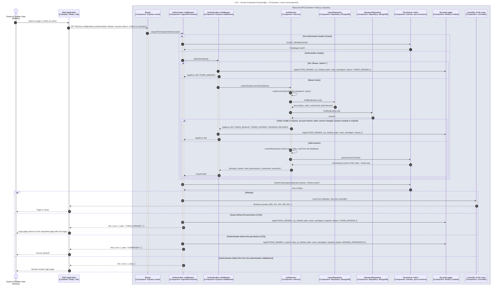

# UC1 - Access Protected Functionality

| Attribute | Value |
|---|---|
| C4 view | Dynamic diagram, Level 3 (Component) |
| SAD view | Process View, Level 3 |
| Containers | Web Application, Back-end API, Database |
| Endpoint | Every guarded route, for example `GET /kitchen-configurations` (`requirePermission(Permission.KITCHEN_READ)`) |
| Allowed roles | Those whose permissions include the permission of the route ([permission matrix](./README.md#permission-matrix)) |
| Success response | The business answer of the route (the request reaches the controller) |
| Error handling | 401 `TOKEN_MISSING`, `TOKEN_INVALID`, `TOKEN_EXPIRED`, `SESSION_REVOKED`; 403 `FORBIDDEN`; 503 `ROLES_UNAVAILABLE`. Every 401 and 403 is recorded (UC5) |
| ADRs | [ADR-0032](../../adr/0032-secure-session-handling-in-the-api-and-the-spa.md), [ADR-0046](../../adr/0046-permission-based-authorization-matrix.md) |

## Description

Every protected route starts with `requirePermission(permission)` (or `requireAuthenticated` for the session routes, [UC2](./consult-session-permissions.md)). The guard builds the principal of the request and checks the permission before any validation of the body, controller or service runs.

1. **Guest.** Without an `Authorization` header the principal is the Guest (`GUEST_PERMISSIONS`), with no database access. If the route allows Guests (for example `catalogue:read`), the request goes on; otherwise it answers `401 TOKEN_MISSING`.
2. **Authentication.** With a header, the authentication middleware requires the `Bearer` scheme and calls `AuthService.authenticateAccessToken`: it verifies the signature and expiry of the access token, reads the user and the session (`sid`) from the database, and checks that the account may authenticate, that the token version matches and that the session is not revoked nor expired. Any failure answers `401` with its code.
3. **Roles and permissions.** The active roles are read from the database (AA03) and turned into permissions with `permissionsFor` (union of the roles plus the Guest set). The principal is `{ userId, roles, permissions, customerId, sessionId }`. If the roles cannot be read, the request fails closed with `503 ROLES_UNAVAILABLE`.
4. **Permission check.** `hasPermission(principal.permissions, permission)`: allowed requests go to the route's validation and controller; a valid session without the permission answers `403 FORBIDDEN`. The answer never names the missing permission.
5. **Record (UC5).** Every refusal writes an `ACCESS_DENIED` security event with the context of the request and the reason, never the token, the cookie or the password.

The Web Application treats the answers the same way for every page (WEB03): `401` ends the session and goes to the login, keeping the requested page to return to after the login; `403` shows "access denied".

## Diagram

`503 ROLES_UNAVAILABLE` (roles cannot be read) is left out of the diagram; it is documented in [Role Resolution (AA03)](../authentication/role-resolution.md).

See the [README](./README.md) for the notation key and the element catalogue.
