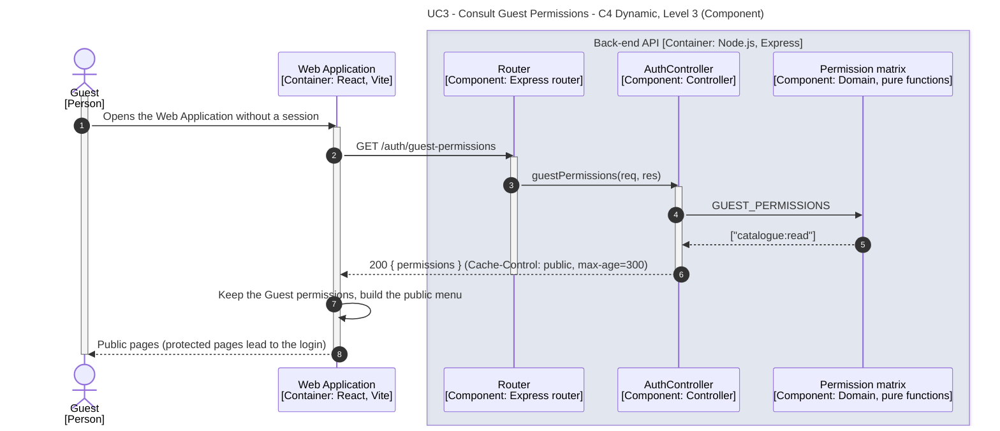

# UC3 - Consult Guest Permissions

| Attribute | Value |
|---|---|
| C4 view | Dynamic diagram, Level 3 (Component) |
| SAD view | Process View, Level 3 |
| Containers | Web Application, Back-end API |
| Endpoint | `GET /auth/guest-permissions` |
| Allowed roles | Public (Guest); listed in `PUBLIC_ENTRY_POINTS` |
| Success response | 200 OK `{ "permissions": ["catalogue:read"] }`, `Cache-Control: public, max-age=300` |
| Error handling | None specific (the answer does not depend on the request) |
| ADRs | [ADR-0046](../../adr/0046-permission-based-authorization-matrix.md) |

## Description

Without a session, the Web Application still needs to know what a Guest may use, to build the public menu and to tell "log in" apart from "access denied". It reads the Guest set from the back end instead of keeping its own copy of the matrix.

1. **Route.** Public and without a rate limiter, registered next to `/auth/me`.
2. **Answer.** `AuthController.guestPermissions` returns a copy of `GUEST_PERMISSIONS`. No database access, no user data. The answer is the same for everyone, so it may be cached for 5 minutes.

The Web Application keeps the Guest set in its own store, separate from the session. A page whose permission is not in it sends the Guest to the login; after the login the permissions of the session ([UC2](./consult-session-permissions.md)) are used.

## Diagram

See the [README](./README.md) for the notation key and the element catalogue.
