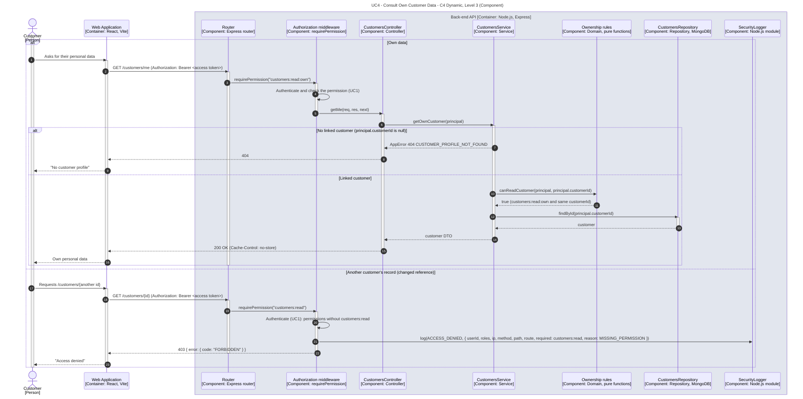

# UC4 - Consult Own Customer Data

| Attribute | Value |
|---|---|
| C4 view | Dynamic diagram, Level 3 (Component) |
| SAD view | Process View, Level 3 |
| Containers | Web Application, Back-end API, Database |
| Endpoint | `GET /customers/me` |
| Allowed roles | CUSTOMER (`customers:read:own`) |
| Success response | 200 OK with the customer record linked to the session, `Cache-Control: no-store` |
| Error handling | 401 (no or invalid session), 403 `FORBIDDEN` (no `customers:read:own`), 404 `CUSTOMER_PROFILE_NOT_FOUND` (no linked customer); `GET /customers/{id}` answers 403 to a customer |
| ADRs | [ADR-0043](../../adr/0043-permission-based-authorization-matrix.md) |

## Description

A customer must never read another customer's personal data by changing a record reference or a request parameter. The endpoint for the customer's own data therefore has no parameter: the customer comes from the session.

1. **Guard.** `requirePermission("customers:read:own")` authenticates the request and checks the permission ([UC1](./access-protected-functionality.md)). The principal carries the `customerId` read from the user in the database, never from the token or the client.
2. **Ownership.** `CustomersService.getOwnCustomer(principal)` uses only `principal.customerId`. `canReadCustomer(principal, customerId)` accepts it with `customers:read`, or with `customers:read:own` and the same `customerId`. Without a linked customer the answer is `404 CUSTOMER_PROFILE_NOT_FOUND`, without querying the database.
3. **Answer.** 200 with the customer DTO and `Cache-Control: no-store`.

Trying another record through the generic endpoint, `GET /customers/{id}`, is refused by its guard (`customers:read`, Manager only) with `403 FORBIDDEN` and recorded as `ACCESS_DENIED`, whatever the id.

## Diagram

See the [README](./README.md) for the notation key and the element catalogue.
