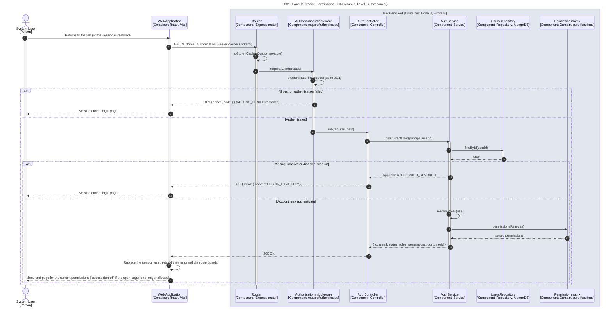

# UC2 - Consult Session Permissions

| Attribute | Value |
|---|---|
| C4 view | Dynamic diagram, Level 3 (Component) |
| SAD view | Process View, Level 3 |
| Containers | Web Application, Back-end API, Database |
| Endpoint | `GET /auth/me` |
| Allowed roles | Any authenticated user, whatever the roles (`requireAuthenticated`) |
| Success response | 200 OK `{ "id", "email", "status", "roles": [...], "permissions": [...], "customerId": "<id>" \| null }`, `Cache-Control: no-store` |
| Error handling | 401 `TOKEN_MISSING`, `TOKEN_INVALID`, `TOKEN_EXPIRED`, `SESSION_REVOKED` (recorded, [UC1](./access-protected-functionality.md)); 503 `ROLES_UNAVAILABLE` |
| ADRs | [ADR-0043](../../adr/0043-secure-session-handling-in-the-api-and-the-spa.md), [ADR-0053](../../adr/0053-permission-based-authorization-matrix.md) |

## Description

The Web Application asks for the current user and permissions after the session is restored and whenever the tab becomes visible again, so a role added or removed by an Administrator applies without a new login (WEB03). The login and refresh answers carry the same user object (`toSessionUserDto`), so `/auth/me` is only needed to refresh it.

1. **Route.** `/auth/me` is the first route of the `/auth` router, with its own `noStore`, and has no rate limiter: the Web Application calls it often and it is never counted as a login attempt.
2. **Guard.** `requireAuthenticated` builds the principal as in [UC1](./access-protected-functionality.md). A Guest answers `401 TOKEN_MISSING`. No permission is required: a user without roles still gets an answer (only the Guest permissions).
3. **Current user.** `AuthService.getCurrentUser(principal.userId)` reads the user again, refuses an account that may no longer authenticate (`401 SESSION_REVOKED`), resolves the active roles and builds the DTO with `permissionsFor(roles)`.
4. **Answer.** 200 with id, e-mail, status, roles, sorted permissions and the linked `customerId`. No password hash, token version, login counters or session data.

The Web Application replaces the user of the session with the answer; if a permission was lost while a page that needs it is open, that page shows "access denied" and the menu is rebuilt.

## Diagram

See the [README](./README.md) for the notation key and the element catalogue.
