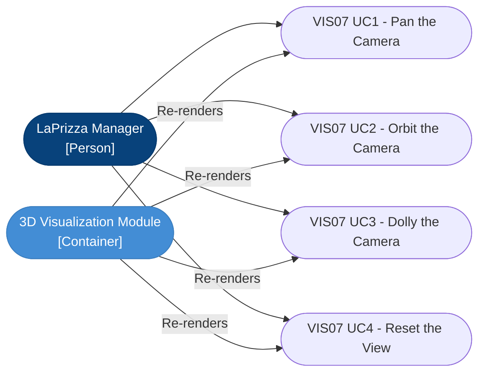

# Camera Interaction - Design Diagrams (Mermaid)

The perspective camera interaction (VIS07) lets the Manager explore the 3D kitchen with the mouse: left drag pans along the floor, right drag orbits around the current target, the wheel dollies in and out, and a "Reset view" button goes back to the initial view. Every limit is derived from the dimensions of the active kitchen configuration. It is client-side only: everything happens in the browser, in the **3D Visualization** module embedded in the **Web Application**. It calls no endpoint of its own; the kitchen layout comes from the active kitchen configuration ([WEB06 UC3](../kitchen-configuration/get-active-kitchen-configuration.md)).

Process View (SAD), Level 2, documented as C4 dynamic diagrams of the **Web Application** and **3D Visualization** containers. No back end is involved, so the diagrams show no components.

## Use Cases

The use cases are described in the Use Case Views: [VIS07](../../analysis/use-case-views.md#vis07-perspective-camera-interaction).

## Diagrams

| Use case | Trigger | Pages | Result | Document |
|---|---|---|---|---|
| [VIS07 UC1 - Pan the Camera](./pan-camera.md) | Left-click and drag on the viewer | `/visualization3d`, `/kitchen-configurations` | Target and camera slide parallel to the floor, within the floor plus a margin | `pan-camera.md` |
| [VIS07 UC2 - Orbit the Camera](./orbit-camera.md) | Right-click and drag on the viewer | `/visualization3d`, `/kitchen-configurations` | Camera turns around the current target, within the polar and azimuth limits | `orbit-camera.md` |
| [VIS07 UC3 - Dolly the Camera](./dolly-camera.md) | Mouse wheel (or middle-click and drag) | `/visualization3d`, `/kitchen-configurations` | Camera moves towards or away from the target, within the distance limits | `dolly-camera.md` |
| [VIS07 UC4 - Reset the View](./reset-view.md) | "Reset view" button | `/visualization3d`, `/kitchen-configurations` | Camera back at the initial position, looking at the centre of the floor | `reset-view.md` |

## Camera and limits

The camera is the `PerspectiveCamera` created by the React Three Fiber `Canvas`, with a vertical field of view of 50°. R3F updates its `aspect` and calls `updateProjectionMatrix()` whenever the viewer is resized.

The kitchen is centred on the origin and the floor is the plane `y = 0` (X spans the width, Z the length), so **the centre of the floor is `(0, 0, 0)`**. All values are computed by `computeCameraSetup` (`camera-view.js`) from `content.dimensions` (`width`, `length`, `height`, defaulting to 10, 10 and 5). Below, `L = max(width, length)` and `R = hypot(width, length, height) / 2`.

| Setting | Rule | Kitchen 10.5 × 15 × 3.2 | Why |
|---|---|---|---|
| Initial target | `(0, 0, 0)` | `(0, 0, 0)` | Centre of the floor (VIS07 criterion) |
| Initial distance | `max(minDistance, (L / 2) / tan(fov / 2))` | 16.1 m | Half of the largest side fills half of the vertical field of view |
| Initial position | Polar angle 55°, azimuth 0 (on the +Z side) | `(0, 9.2, 13.2)` | Elevated three-quarter view of the whole kitchen |
| Minimum distance (`minDistance`) | `max(1, 0.1 × L)` | 1.5 m | Close enough to inspect one piece of equipment |
| Maximum distance (`maxDistance`) | `1.5 × initial distance` | 24.1 m | Some room to step back, the kitchen never becomes tiny |
| Minimum polar angle | 0.1 rad (≈ 6°) | 6° | Never exactly vertical, where the controls flip |
| Maximum polar angle | `90° − fov / 2` | 65° | The top edge of the view is at most horizontal: the camera never sees above its own height and stays above the floor |
| Azimuth | −135° to +135° | ±135° | The orbit never makes a full turn |
| Pan bounds of the target | `x ∈ ±(width / 2 + m)`, `z ∈ ±(length / 2 + m)`, `y = 0`, with `m = 0.05 × L` | x ±6.0, z ±8.25 (m = 0.75) | The kitchen never leaves the view; the margin lets elements near the walls be centred |
| `near` | `clamp(minDistance / 20, 0.05, 0.5)` | 0.075 | Depth precision without clipping close objects |
| `far` | `maxDistance + 2R + 2m` | 44.2 | The whole kitchen is visible from the farthest allowed position |
| Obstacles | Bounding boxes of the configuration elements, expanded by 0.25 m; minimum camera height 0.3 m | - | The camera cannot go through equipment or under the floor |

### Mouse mapping and sensitivity

| Input | `OrbitControls` action | Speed |
|---|---|---|
| Left-click and drag | `MOUSE.PAN`, parallel to the floor (`screenSpacePanning = false`) | `panSpeed` 0.6 |
| Right-click and drag | `MOUSE.ROTATE` around the target | `rotateSpeed` 0.5 |
| Wheel, or middle-click and drag | `MOUSE.DOLLY` towards the target (`zoomToCursor = false`) | `zoomSpeed` 1.5 |
| All | Damping (`enableDamping`, `update()` on every frame) | `dampingFactor` 0.08 |

The browser context menu is disabled on the canvas, so the right button only orbits. Touch gestures keep the `OrbitControls` defaults.

## Business rules shown in the diagrams

- **Initial target at the centre of the floor:** on mount, `CameraControls` moves the target to `(0, 0, 0)` and the camera to the initial position.
- **Pan within reasonable limits:** on every `change` event, `constrainPan` clamps the target to the floor plus the margin and keeps it at `y = 0`, and moves the camera by the same offset. The event is dispatched after the camera has looked at the target, so the view direction and distance do not change and there is no jump.
- **Orbit within reasonable limits:** `OrbitControls` clamps the polar angle (6° to 65°) and the azimuth (±135°) on every `update()`, including while the movement slows down.
- **Dolly within reasonable limits:** `OrbitControls` clamps the distance to the target between `minDistance` and `maxDistance`. The camera moves (it is a perspective dolly, not an orthographic zoom).
- **No camera inside objects:** after the pan limit, `isCameraPositionAllowed` checks the camera against the obstacle boxes and the minimum height. If the move is not allowed, the last allowed position and target are restored. The obstacle boxes are the objects marked with `userData.cameraBlocker` (kitchen elements and assembly line components), recomputed at most every 500 ms because models can load late. The walls are not obstacles: the kitchen is seen from outside, like a dollhouse.
- **Responsive and smooth:** damping 0.08 with one `update()` per frame (`useFrame` with priority −1, so R3F keeps rendering the scene), and speeds below the `OrbitControls` defaults for rotation and pan.
- **Reset view:** the button moves the camera to the initial view after flushing the pending inertia (one `update()` without damping), so it stops exactly there, and records it as the last allowed position.
- **Active configuration changes:** the setup is memoised on the dimensions; when they change, the controls are rebuilt and the view starts again from the floor centre. An activation on the Kitchen Configuration page also remounts the viewer ([ADR-0027](../../adr/0027-viewer-reload-mechanism-in-the-frontend.md)).
- **Clean-up:** on unmount, the `change` and `contextmenu` listeners are removed and `controls.dispose()` is called; R3F disposes the renderer and stops the frame loop. React `StrictMode` mounts the component twice in development: the controls are created inside the effect, so the first instance is disposed before the second one is created.
- **No active configuration:** `KitchenViewer` shows "No active kitchen configuration to display." and no scene or camera is created (WEB06, [ADR-0025](../../adr/0025-active-configuration-endpoint-and-no-fallback-policy.md)).
- **Access:** the viewer is shown on `/visualization3d` and `/kitchen-configurations`, which both require the `kitchen:read` permission (Manager).
- **No persistence:** the camera position is kept only in memory and no endpoint is called.

## Related ADRs

| ADR | Decision | Status |
|---|---|---|
| [ADR-0054](../../adr/0054-perspective-camera-controls-with-limits-derived-from-the-kitchen.md) | Perspective camera controls with the Three.js `OrbitControls` and limits derived from the kitchen | Accepted |
| [ADR-0030](../../adr/0030-adoption-of-r3f-for-3d-module-integration.md) | Adoption of R3F for 3D module integration | Accepted |
| [ADR-0025](../../adr/0025-active-configuration-endpoint-and-no-fallback-policy.md) | Active configuration endpoint and no-fallback policy | Accepted |
| [ADR-0027](../../adr/0027-viewer-reload-mechanism-in-the-frontend.md) | Viewer reload mechanism: state-based React key reset | Accepted |
| [ADR-0018](../../adr/0018-internationalization-of-the-web-application-%28english-and-portuguese%29.md) | Internationalization of the Web Application (English and Portuguese) | Accepted |

## Notation key

| Notation | Meaning |
|---|---|
| Actor (stick figure) | Person using the system, with the role shown in the label |
| Participant "Web Application" | Container (React, Vite) that holds the pages and the "Reset view" button |
| Participant "3D Visualization" | Container (WebGL, Three.js) that holds the scene, the camera and its controls |
| Participant label | `Name`, followed by `[Type: technology]` |
| Solid arrow | Call or request |
| Dashed arrow | Return value or response |
| Arrow to the same participant | Work done inside that container |
| Number on an arrow | Order of the interaction (autonumber) |
| `alt` / `else` frame | Alternative flows, only one of them runs |
| `loop` frame | Flow that repeats |
| `opt` frame | Optional flow |
| `Note` | Reference to another diagram or a remark |

## Element catalogue

The diagrams show only containers. The table lists the front-end modules inside them, for reference.

| Element | Type | Technology | Responsibility | Used in |
|---|---|---|---|---|
| Manager | Person | - | Back-office user with the MANAGER role | [UC1](./pan-camera.md), [UC2](./orbit-camera.md), [UC3](./dolly-camera.md), [UC4](./reset-view.md) |
| Web Application | Container | React, Vite | Hosts the viewer on `/visualization3d` and `/kitchen-configurations` (`KitchenViewer`) and the "Reset view" button (`kitchenConfig.viewer.resetView`: "Reset view" / "Repor vista") | [UC4](./reset-view.md) |
| 3D Visualization | Container | WebGL, Three.js, React Three Fiber | Renders the kitchen and moves the camera | [UC1](./pan-camera.md), [UC2](./orbit-camera.md), [UC3](./dolly-camera.md), [UC4](./reset-view.md) |
| `KitchenScene` (`kitchen-scene.jsx`) | Module of the 3D Visualization | R3F `Canvas` | Creates the `PerspectiveCamera` (fov 50, `near`, `far`, initial position), memoises `computeCameraSetup` on the dimensions, renders `CameraControls` and the "Reset view" button | All |
| `CameraControls` (`camera-controls.jsx`) | Module of the 3D Visualization | Three.js `OrbitControls`, `useFrame` | Creates and configures the controls, applies the pan limit and the obstacle check on `change`, disables the context menu, exposes `reset()`, disposes everything on unmount | All |
| `camera-view.js` | Module of the 3D Visualization | JavaScript, pure functions | `computeCameraSetup`, `constrainPan`, `maxPolarAngleForFov`, `isCameraPositionAllowed` and the constants (fov, angles, speeds, margins) | All |

## Notes

- The drei `OrbitControls` used until VIS06 was replaced by the Three.js implementation (`three/examples/jsm/controls/OrbitControls.js`), see [ADR-0054](../../adr/0054-perspective-camera-controls-with-limits-derived-from-the-kitchen.md).
- The initial distance frames the floor in a wide viewer (16:9). In a nearly square viewer, the side corners of a square kitchen may start slightly outside the view; one wheel step back shows them.
- The obstacles are axis-aligned bounding boxes, so the camera stops a little before rotated or round models.
- The user story names the LaPrizza Manager; only the MANAGER role has `kitchen:read`.
- Tests: `frontend/test/features/visualization3d-scene.test.js` covers `isCameraPositionAllowed` (inside a box, outside, above, under the minimum height). The mouse interaction itself is validated manually in the browser.
