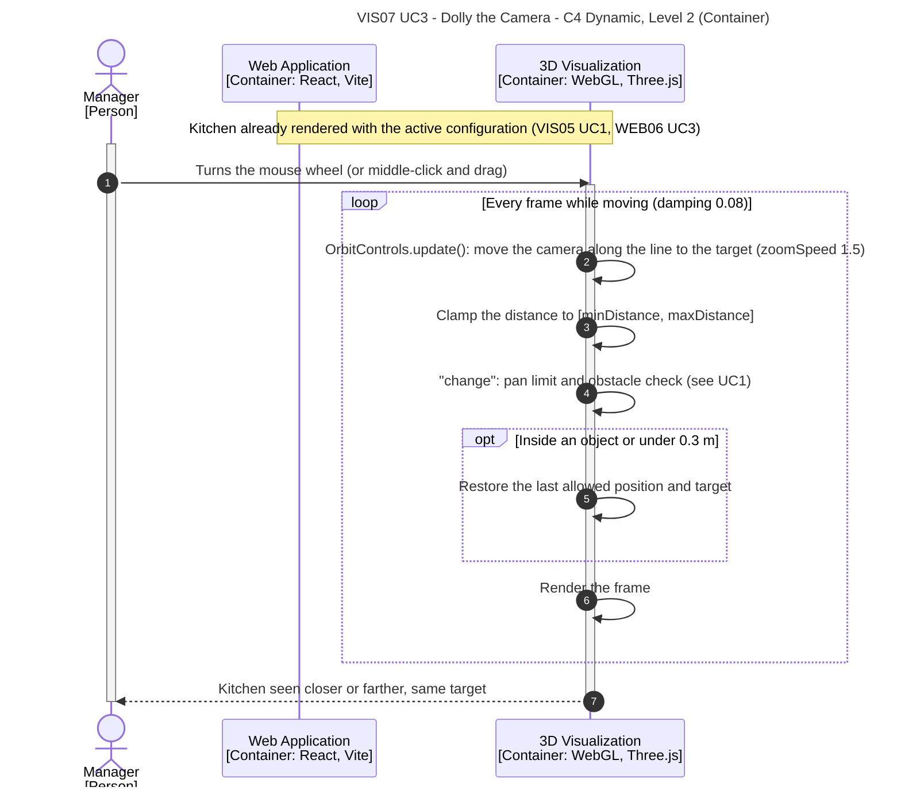

# VIS07 UC3 - Dolly the Camera

| Attribute | Value |
|---|---|
| C4 view | Dynamic diagram, Level 2 (Container) |
| SAD view | Process View, Level 2 |
| Containers | Web Application, 3D Visualization |
| Endpoints | None (client-side only). The kitchen dimensions come from `GET /kitchen-configurations/active` (see [WEB06 UC3](../kitchen-configuration/get-active-kitchen-configuration.md)). |
| Allowed roles | Users with the `kitchen:read` permission (MANAGER), who see the viewer on `/visualization3d` and `/kitchen-configurations` |
| Success response | n/a (the camera moves towards or away from the target) |
| Error handling | Dolly past the limits: the camera stops at `minDistance` or `maxDistance`. Move into an object: the last allowed position is restored. |
| ADRs | [ADR-0050](../../adr/0050-perspective-camera-controls-with-limits-derived-from-the-kitchen.md), [ADR-0039](../../adr/0039-adoption-of-r3f-for-3d-module-integration.md) |

## Description

The Manager turns the mouse wheel over the viewer (or drags with the middle button). The `OrbitControls` maps it to dolly (`MOUSE.DOLLY`): the `PerspectiveCamera` itself moves along the line to the target, so the perspective changes; it is not an orthographic zoom. `zoomToCursor` is off, so the camera always moves towards the target and the target does not change. The step is scaled by `zoomSpeed` 1.5 and smoothed by damping.

On every `update()`, the controls clamp the distance to the target between `minDistance = max(1, 0.1 × max(width, length))` and `maxDistance = 1.5 ×` the initial distance (1.5 m and 24.1 m for a 10.5 × 15 kitchen). Both come from the kitchen dimensions, and `near`/`far` are set so that nothing is clipped within that range. The `change` handler then applies the same obstacle check as [UC1](./pan-camera.md): the camera stops before entering an object.

## Diagram

See the [README](./README.md) for the notation key, the limits and the element catalogue.
