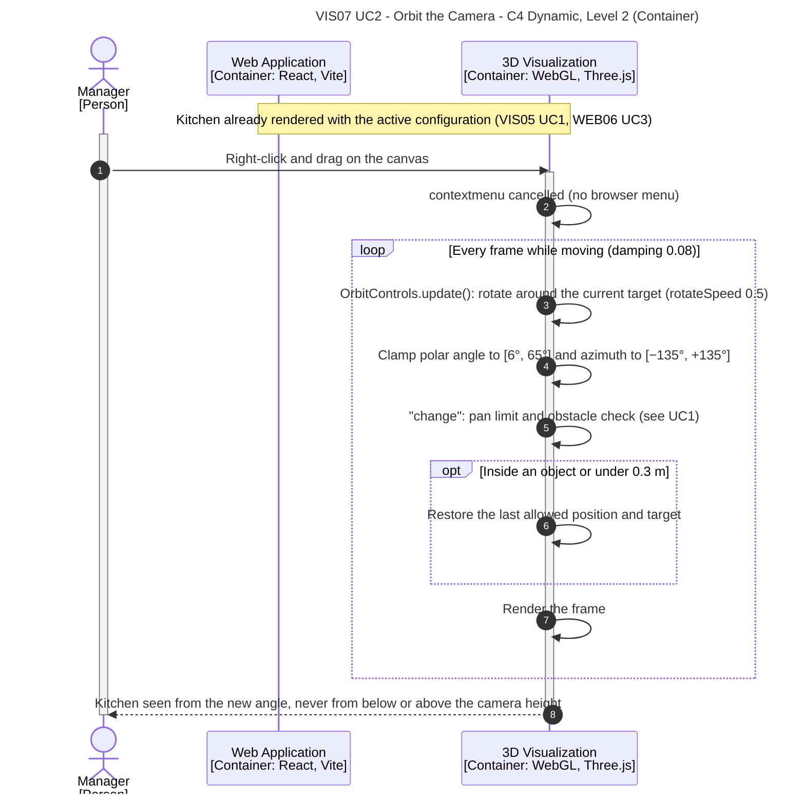

# VIS07 UC2 - Orbit the Camera

| Attribute | Value |
|---|---|
| C4 view | Dynamic diagram, Level 2 (Container) |
| SAD view | Process View, Level 2 |
| Containers | Web Application, 3D Visualization |
| Endpoints | None (client-side only). The kitchen dimensions come from `GET /kitchen-configurations/active` (see [WEB06 UC3](../kitchen-configuration/get-active-kitchen-configuration.md)). |
| Allowed roles | Users with the `kitchen:read` permission (MANAGER), who see the viewer on `/visualization3d` and `/kitchen-configurations` |
| Success response | n/a (the camera turns around the current target) |
| Error handling | Orbit past the limits: the camera stops at the polar or azimuth limit. Move into an object: the last allowed position is restored. |
| ADRs | [ADR-0050](../../adr/0050-perspective-camera-controls-with-limits-derived-from-the-kitchen.md), [ADR-0039](../../adr/0039-adoption-of-r3f-for-3d-module-integration.md) |

## Description

The Manager right-clicks on the viewer and drags. The browser context menu does not open, because `CameraControls` cancels the `contextmenu` event on the canvas. The `OrbitControls` maps the right button to rotate (`MOUSE.ROTATE`): the camera turns around the **current** target (the centre of the floor, or wherever the last pan left it), at the same distance, scaled by `rotateSpeed` 0.5 and smoothed by damping.

On every `update()`, the controls clamp the spherical coordinates of the camera around the target:

- **Polar angle** (from the vertical) between 0.1 rad (≈ 6°), so the camera is never exactly overhead, where it would flip, and `90° − fov / 2` (65°), so the top edge of the view is at most horizontal: the camera never sees above its own height and always stays above the floor.
- **Azimuth** between −135° and +135° around the initial side (+Z), so the orbit never makes a full turn.

The `change` handler then applies the same pan limit and obstacle check as [UC1](./pan-camera.md).

## Diagram

See the [README](./README.md) for the notation key, the limits and the element catalogue.
