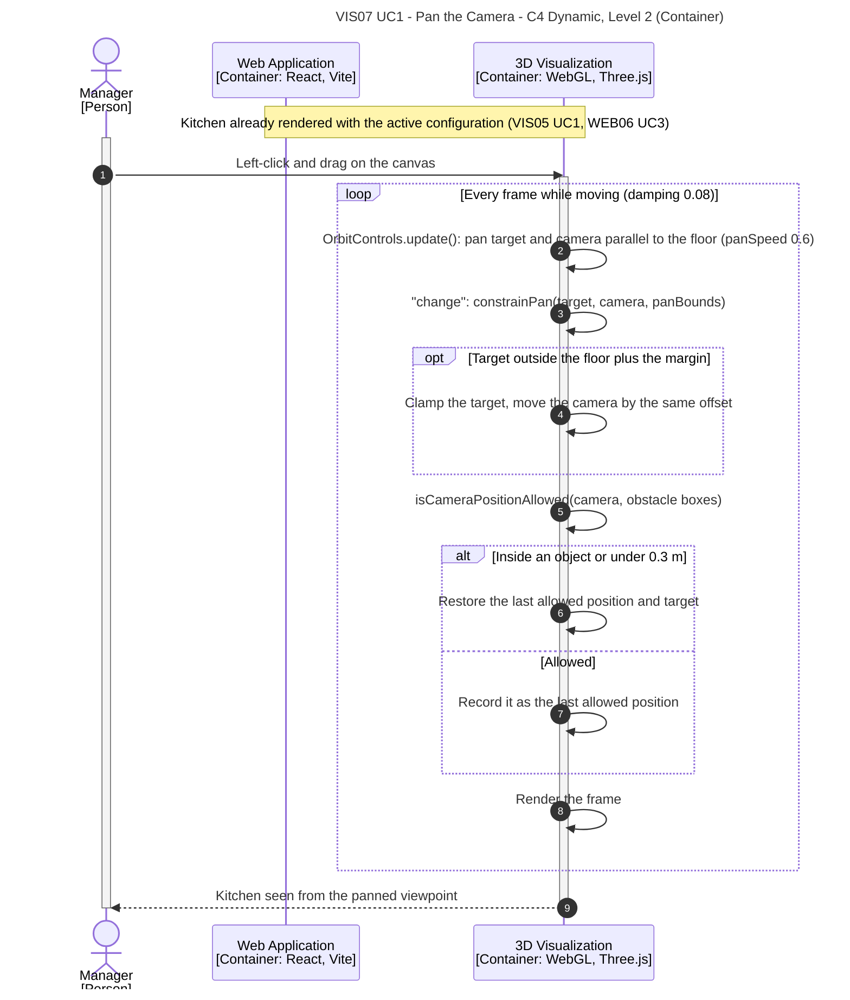

# VIS07 UC1 - Pan the Camera

| Attribute | Value |
|---|---|
| C4 view | Dynamic diagram, Level 2 (Container) |
| SAD view | Process View, Level 2 |
| Containers | Web Application, 3D Visualization |
| Endpoints | None (client-side only). The kitchen dimensions come from `GET /kitchen-configurations/active` (see [WEB06 UC3](../kitchen-configuration/get-active-kitchen-configuration.md)). |
| Allowed roles | Users with the `kitchen:read` permission (MANAGER), who see the viewer on `/visualization3d` and `/kitchen-configurations` |
| Success response | n/a (the view slides parallel to the floor) |
| Error handling | Pan past the limits: the target stops at the floor bounds plus the margin. Move into an object: the last allowed position is restored. |
| ADRs | [ADR-0054](../../adr/0054-perspective-camera-controls-with-limits-derived-from-the-kitchen.md), [ADR-0030](../../adr/0030-adoption-of-r3f-for-3d-module-integration.md) |

## Description

The Manager left-clicks on the viewer and drags. The `OrbitControls` maps the left button to pan (`MOUSE.PAN`) with `screenSpacePanning = false`, so the target and the camera slide on a plane parallel to the floor and the camera height does not change. The movement is scaled by `panSpeed` 0.6 and smoothed by damping (`dampingFactor` 0.08): one `update()` per frame keeps it moving for a short time after the mouse is released.

On every `update()` that moves the camera, the controls dispatch `change`. The handler first applies the pan limit (`constrainPan`): the target is clamped to `x ∈ ±(width / 2 + m)` and `z ∈ ±(length / 2 + m)` (margin `m = 0.05 × max(width, length)`) and kept at `y = 0`, and the camera is moved by the same offset, so the view direction and distance stay the same and there is no jump. It then checks that the camera is outside every obstacle box and above 0.3 m (`isCameraPositionAllowed`); if not, the last allowed position and target are restored.

## Diagram

See the [README](./README.md) for the notation key, the limits and the element catalogue.
