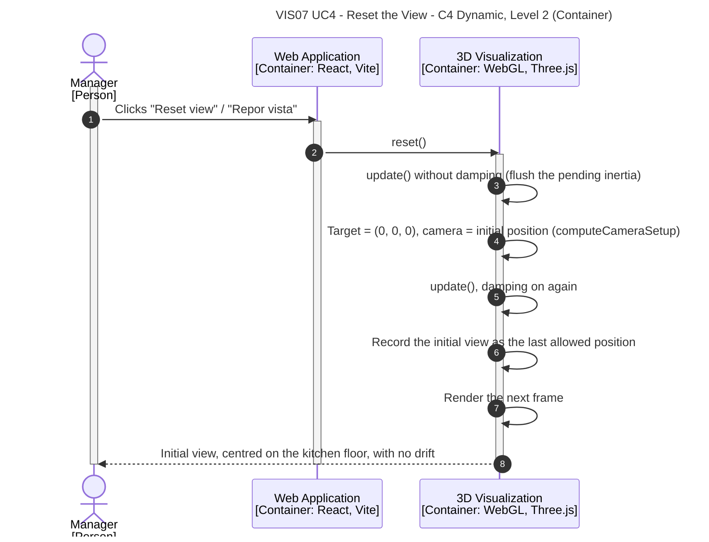

# VIS07 UC4 - Reset the View

| Attribute | Value |
|---|---|
| C4 view | Dynamic diagram, Level 2 (Container) |
| SAD view | Process View, Level 2 |
| Containers | Web Application, 3D Visualization |
| Endpoints | None (client-side only). The camera position is not stored and no request is made. |
| Allowed roles | Users with the `kitchen:read` permission (MANAGER), who see the viewer on `/visualization3d` and `/kitchen-configurations` |
| Success response | n/a (the camera is back at the initial position, looking at the centre of the floor) |
| Error handling | None. Before the controls exist (viewer still mounting), the button does nothing. |
| ADRs | [ADR-0054](../../adr/0054-perspective-camera-controls-with-limits-derived-from-the-kitchen.md), [ADR-0018](../../adr/0018-internationalization-of-the-web-application-%28english-and-portuguese%29.md) |

## Description

The "Reset view" button ("Repor vista" in Portuguese, key `kitchenConfig.viewer.resetView`) sits in the top-left corner of the viewer, on top of the canvas; the lighting panel (VIS06) is in the top-right corner. It uses the secondary button style of the Web Application.

A click calls `reset()` of `CameraControls`, which moves the camera to the initial view computed by `computeCameraSetup`: target `(0, 0, 0)` (the centre of the floor) and the initial position (polar angle 55°, initial distance from the kitchen size). To stop exactly there, it first runs one `update()` without damping, which flushes the inertia left by the last movement, then sets the target and the position, runs `update()` again and turns damping back on. The restored position is recorded as the last allowed position for the obstacle check.

The same initial view is used when the viewer is mounted and when the kitchen dimensions change (another configuration is activated), because the setup is recomputed and the controls are rebuilt.

## Diagram

See the [README](./README.md) for the notation key, the limits and the element catalogue.
