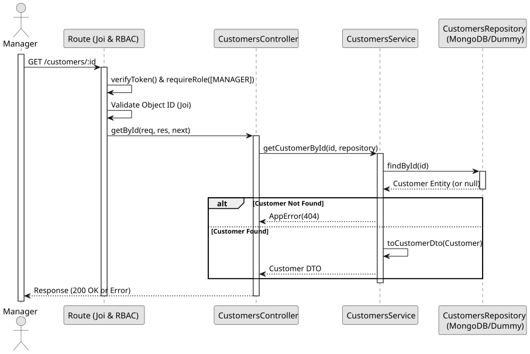

# UC3: Get Customer by ID

## Use Case View

**Primary Actor:** Manager  
**Description:** Allows a manager to retrieve the details of a specific customer using their unique ID.

**Preconditions:**

- The Manager must be authenticated and authorized.
- The target customer must exist.

**Main Success Scenario:**

1. The Manager requests the details of a customer by providing their ID.
2. The System validates the format of the provided ID.
3. The System searches the database for a customer with the given ID.
4. The System maps the found customer entity to a DTO.
5. The System returns the customer details.

**Alternative Flows:**

- _Invalid ID format:_ The System throws a 400 Bad Request error.
- _Customer not found:_ The System throws a 404 Not Found error.

**Postconditions:**

- None (Read-only operation).

## 1. Domain Assumptions

- The NIF (Tax Identification Number) is an optional piece of information, primarily collected for future invoicing purposes.

## 2. Solution Design

## 3. Business Test Planning

- **Isolation Strategy:** All application tests use dependency injection via isolated in-memory Dummies (`customers.dummy.repository.js`), avoiding Mocking libraries entirely.
- **Application Tests (`customers.service.test.js`):**
  - `getCustomerById and listCustomers fetch and map correctly`

## 4. Postman E2E Tests

- **Base Endpoint:** `GET /api/v1/customers/:id`
- **Validated Scenarios:**
  - Request without Bearer Token -> `401 Unauthorized`
  - Request with `EMPLOYEE` Bearer Token -> `403 Forbidden` (RBAC enforcement)
  - Request with invalid ID format -> `400 Bad Request` (Joi CastError prevention)
  - Request with non-existent ID -> `404 Not Found`
  - Request with valid ID -> `200 OK` (Returns customer DTO)
