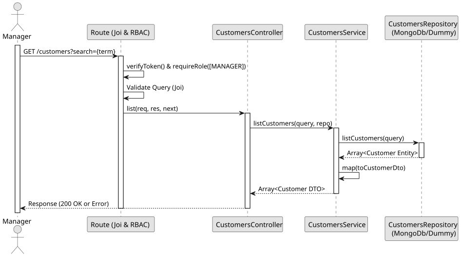

# UC2: List and Search Customers

## Use Case View

**Primary Actor:** Manager  
**Description:** Allows a manager to retrieve a list of all customers or search for specific customers by name, email, or phone number.

**Preconditions:**

- The Manager must be authenticated and authorized.

**Main Success Scenario:**

1. The Manager requests the list of customers, optionally providing a search query.
2. The System queries the database for customers matching the search term (if provided).
3. The System maps the retrieved customer entities to DTOs.
4. The System returns the list of matching customers.

**Alternative Flows:**

- _No matching customers found:_ The System returns an empty array `[]` with a 200 OK status.

**Postconditions:**

- None (Read-only operation).

## 1. Domain Assumptions

- The NIF (Tax Identification Number) is an optional piece of information, primarily collected for future invoicing purposes.

## 2. Solution Design

## 3. Business Test Planning

- **Isolation Strategy:** All application tests use dependency injection via isolated in-memory Dummies (`customers.dummy.repository.js`), avoiding Mocking libraries entirely.
- **Application Tests (`customers.service.test.js`):**
  - `getCustomerById and listCustomers fetch and map correctly`
  - `listCustomers filters by name, email and phone number`

## 4. Postman E2E Tests

- **Base Endpoint:** `GET /api/v1/customers`
- **Validated Scenarios:**
  - Request without Bearer Token -> `401 Unauthorized`
  - Request with `EMPLOYEE` Bearer Token -> `403 Forbidden` (RBAC enforcement)
  - Valid request without search query -> `200 OK` (Returns all customers)
  - Valid request with matching search query -> `200 OK` (Returns matched customers)
  - Valid request with non-matching search query -> `200 OK` (Returns `[]`)
