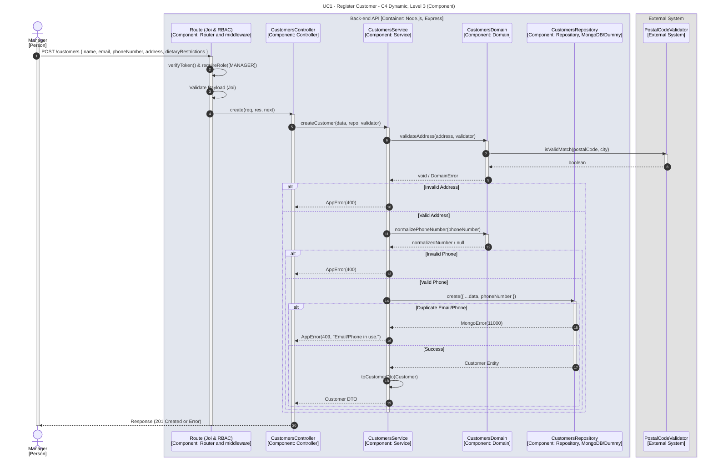

# UC1 - Register Customer

| Attribute | Value |
|---|---|
| C4 view | Dynamic diagram, Level 3 (Component) |
| SAD view | Process View, Level 3 |
| Container | Back-end API |
| Endpoint | `POST /customers` |
| Allowed roles | MANAGER |
| Success response | 201 Created |
| Error handling | 400 (invalid address or phone number), 409 (email or phone number already in use) |

## Description

A Manager registers a customer. The domain validates the address using the external postal code validator and normalizes the phone number before the customer is persisted. A duplicated email or phone number results in a conflict error.

## Diagram

See the [README](./README.md) for the notation key and the element catalogue.
