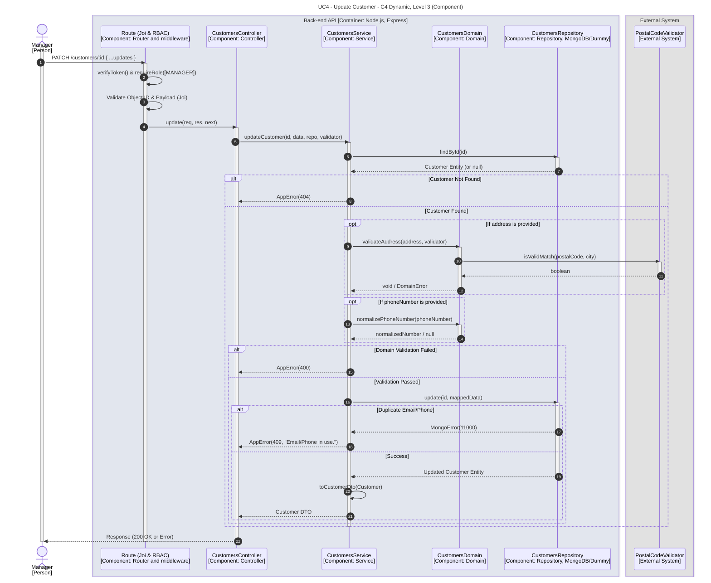

# UC4 - Update Customer

| Attribute | Value |
|---|---|
| C4 view | Dynamic diagram, Level 3 (Component) |
| SAD view | Process View, Level 3 |
| Container | Back-end API |
| Endpoint | `PATCH /customers/:id` |
| Allowed roles | MANAGER |
| Success response | 200 OK |
| Error handling | 404 (customer not found), 400 (invalid address or phone number), 409 (email or phone number already in use) |

## Description

A Manager partially updates a customer. The address and the phone number are validated again only when they are provided. A duplicated email or phone number results in a conflict error.

## Diagram

See the [README](./README.md) for the notation key and the element catalogue.
