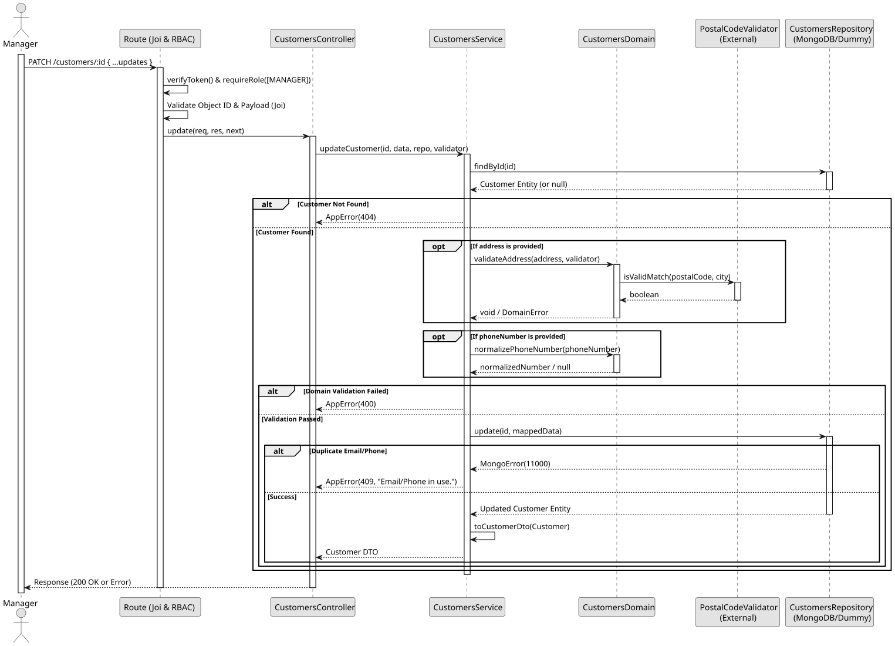

# UC4: Update Customer

## Use Case View

**Primary Actor:** Manager  
**Description:** Allows a manager to update an existing customer's details or logically deactivate their profile.

**Preconditions:**

- The Manager must be authenticated and authorized.
- The target customer must exist.

**Main Success Scenario:**

1. The Manager provides the customer ID and the fields to be updated.
2. The System validates the object ID format and the payload.
3. The System verifies the customer exists.
4. The System validates the provided data (e.g., verifying postal code match if an address is provided, or normalizing a new phone number).
5. The System checks if the updated email or phone number is already in use by another customer.
6. The System persists the partial changes, preserving existing data for un-updated fields.
7. The System returns the updated customer record.

**Alternative Flows:**

- _Invalid data or ID format provided:_ The System throws a 400 Bad Request error.
- _Customer not found:_ The System throws a 404 Not Found error.
- _Duplicate email or phone:_ The System throws a 409 Conflict error.

**Postconditions:**

- The targeted customer's data is updated in the database.

## 1. Domain Assumptions

- The NIF (Tax Identification Number) is an optional piece of information, primarily collected for future invoicing purposes.

## 2. Solution Design

## 3. Business Test Planning

- **Isolation Strategy:** All application tests use dependency injection via isolated in-memory Dummies (`customers.dummy.repository.js`) and a Dummy Postal Code Validator, avoiding Mocking libraries entirely.
- **Domain Tests (`customers.domain.test.js`):**
  - `validatePhoneNumber validates strictly Portuguese formats`
  - `normalizePhoneNumber returns the 9 national digits or null`
  - `validateAddress relies securely on the injected validator`
- **Application Tests (`customers.service.test.js`):**
  - `updateCustomer applies partial changes and preserves existing data`
  - `updateCustomer rejects a phone or email used by another customer`
  - `createCustomer and updateCustomer turn an address mismatch into a 400 AppError`

## 4. Postman E2E Tests

- **Base Endpoint:** `PATCH /api/v1/customers/:id`
- **Validated Scenarios:**
  - Request without Bearer Token -> `401 Unauthorized`
  - Request with `EMPLOYEE` Bearer Token -> `403 Forbidden` (RBAC enforcement)
  - Empty JSON payload -> `400 Bad Request` (Requires at least one field to update)
  - Invalid ID format -> `400 Bad Request`
  - Non-existent ID -> `404 Not Found`
  - Postal code and city mismatch -> `400 Bad Request`
  - Duplicate email or phone number -> `409 Conflict`
  - Valid partial update or deactivation -> `200 OK`
