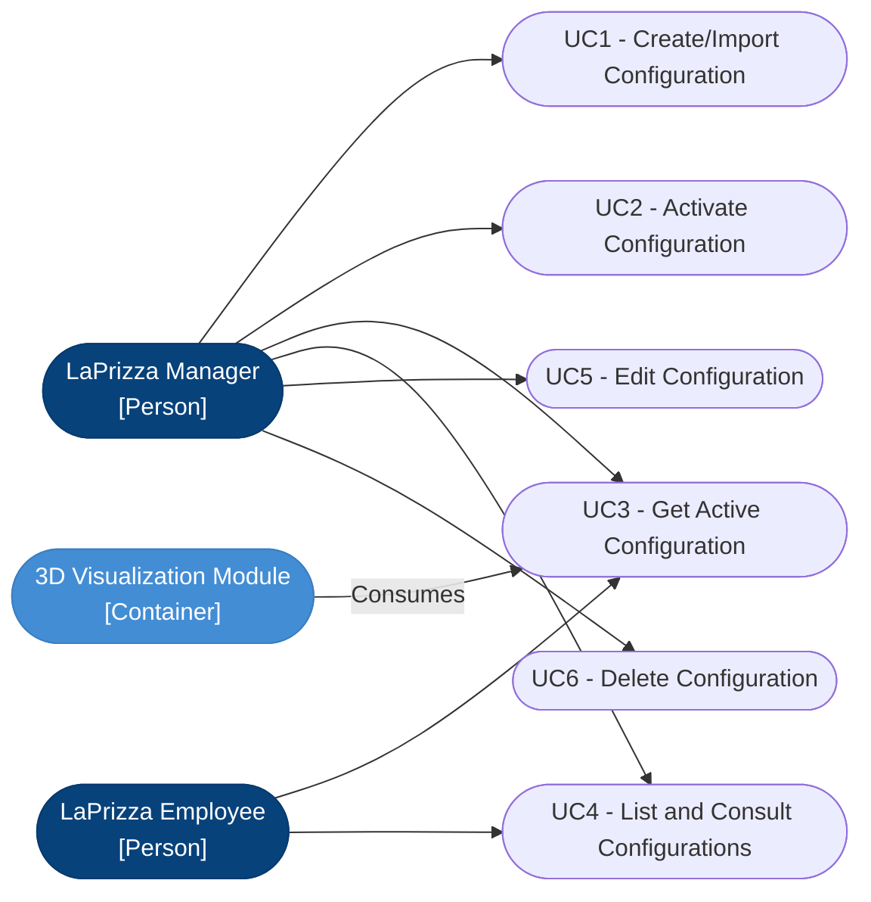

# Kitchen Configuration - Design Diagrams (Mermaid)

The Kitchen Configuration aggregate manages the layout, dimensions, equipment, and assembly lines of the restaurant's kitchen. It provides the data required by the 3D Visualization module to render the environment.

Process View (SAD), Level 3, documented as C4 dynamic diagrams of the **Back-end API** container, along with Context, Container, and Component views for the frontend and backend modules. The accepted JSON format is in [Kitchen Configuration JSON Format](./kitchen-configuration-json-format.md).

## Use Cases

The use cases are described in the [Use Case Views](../../analysis/use-case-views.md#web06-kitchen-configuration-and-3d-integration).

## Diagrams

| Use case | Endpoint | Roles | Success | Document |
|---|---|---|---|---|
| [UC1 - Create / Import Kitchen Configuration](./create-import-kitchen-configuration.md) | `POST /kitchen-configurations` | MANAGER | 201 Created | `create-import-kitchen-configuration.md` |
| [UC2 - Activate Kitchen Configuration](./activate-kitchen-configuration.md) | `PATCH /kitchen-configurations/{id}/activate` | MANAGER | 200 OK | `activate-kitchen-configuration.md` |
| [UC3 - Get Active Kitchen Configuration](./get-active-kitchen-configuration.md) | `GET /kitchen-configurations/active` | MANAGER, EMPLOYEE | 200 OK | `get-active-kitchen-configuration.md` |

## REST API summary

All paths are under `/api/v1`. Every route requires a valid token (`401` otherwise) and one of the allowed roles (`403` otherwise).

| Method and path | Use case | Roles | Success | Errors |
|---|---|---|---|---|
| `GET /kitchen-configurations` | UC4 | MANAGER, EMPLOYEE | 200 | |
| `POST /kitchen-configurations` | UC1 | MANAGER | 201 | 400 |
| `POST /kitchen-configurations/validate` | UC1 (dry-run, nothing stored) | MANAGER | 200 `{ "valid": true }` | 400 |
| `GET /kitchen-configurations/active` | UC3 | MANAGER, EMPLOYEE | 200 | 404 (none active) |
| `GET /kitchen-configurations/{id}` | UC4 | MANAGER, EMPLOYEE | 200 | 400 (invalid id), 404 |
| `PATCH /kitchen-configurations/{id}` | UC5 | MANAGER | 200 | 400, 404 |
| `DELETE /kitchen-configurations/{id}` | UC6 | MANAGER | 204 | 400, 404, 409 (active) |
| `PATCH /kitchen-configurations/{id}/activate` | UC2 | MANAGER | 200 | 400, 404, 409, 500 |

400 responses to create, edit and validate carry `details`, the list of violations, each prefixed by its property path.

The context, container and component views are in [C4 Views](./c4-views.md):

| View | Scope |
|---|---|
| Level 1: System Context | LaPrizza, its users and the external systems used by the feature |
| Level 2: Containers | Web Application, 3D Visualization, Back-End Application and Database |
| Level 3: Components of the Back-end Module | Components of the Kitchen Configuration module of the Back-End Application |
| Level 3: Components of the Front-end Page | Components of the Kitchen Configuration page and of the embedded viewer |

## Business rules shown in the diagrams

- A configuration is imported from a JSON file read in the browser. The file is loaded into the editor for review and, when the Manager saves, sent as `application/json` to the same `POST` endpoint used to create it, so there is no upload endpoint ([ADR-0026](../../adr/0026-import-approach.md)).
- The content is validated in the domain with a JSON Schema (Ajv) for the structure (types, required properties, dimensions and scales greater than zero) and with business rules (unique element ids, asset references that are absolute `http(s)` URLs or root-relative paths). All violations are returned together in `details`, each with its property path, otherwise the request fails with 400 ([ADR-0022](../../adr/0022-content-validation-strategy.md)).
- `POST /kitchen-configurations/validate` runs the same validation without storing anything.
- A valid configuration is stored as a nested BSON object ([ADR-0020](../../adr/0020-strorage-model-of-kitchen-configurations.md)), with self-contained URL/URI asset references ([ADR-0021](../../adr/0021-asset-references-strategy.md)), and is created inactive.
- Only one configuration is active at a time. The switch deactivates the current one and activates the selected one in a single transaction, backed by a partial unique index on `isActive: true` (`active_kitchen_config_unique`), so the system is never without an active configuration or with two ([ADR-0023](../../adr/0023-atomic-activation-strategy.md)). Concurrent activations answer 409, an unexpected failure answers 500 with a generic message, and activating the already active configuration is a no-op that answers 200.
- After an activation, or after an edit of the active configuration, the page changes the React key of the viewer, which remounts it and fetches the active layout again, without a full page refresh ([ADR-0027](../../adr/0027-viewer-reload-mechanism-in-the-frontend.md)).
- The active configuration has a dedicated endpoint. When there is none it answers 404 and no hardcoded fallback layout is returned ([ADR-0025](../../adr/0025-active-configuration-endpoint-and-no-fallback-policy.md)).
- Creation, validation, edit, deletion and activation are restricted to Manager. The list, a single configuration and the active configuration can be read by Manager and Employee. The page is available to both roles; for Employees it shows no create, edit, activate or delete controls.
- The active configuration cannot be deleted (409, and the page does not offer the button), but it can be edited if the new content passes all validations ([ADR-0024](../../adr/0024-rules-for-editing-and-deleting-the-active-configuration.md)). These two use cases (UC5 and UC6) have no process view yet.

## Related ADRs

| ADR | Decision | Status |
|---|---|---|
| [ADR-0020](../../adr/0020-strorage-model-of-kitchen-configurations.md) | Storage model of kitchen configurations: nested BSON object | Accepted |
| [ADR-0021](../../adr/0021-asset-references-strategy.md) | Asset references strategy: self-contained URL/URIs | Accepted |
| [ADR-0022](../../adr/0022-content-validation-strategy.md) | Content validation strategy: JSON Schema plus domain rules | Accepted |
| [ADR-0023](../../adr/0023-atomic-activation-strategy.md) | Atomic activation strategy: flag with partial unique index and transaction | Accepted |
| [ADR-0024](../../adr/0024-rules-for-editing-and-deleting-the-active-configuration.md) | Rules for editing and deleting the active configuration | Accepted |
| [ADR-0025](../../adr/0025-active-configuration-endpoint-and-no-fallback-policy.md) | Active configuration endpoint and no-fallback policy | Accepted |
| [ADR-0026](../../adr/0026-import-approach.md) | Import approach: file read in the browser, sent as JSON | Accepted |
| [ADR-0027](../../adr/0027-viewer-reload-mechanism-in-the-frontend.md) | Viewer reload mechanism: state-based React key reset | Accepted |
| [ADR-0028](../../adr/0028-mock-based-unit-testing.md) | Mock-based unit testing with `node:test` | Accepted |
| [ADR-0029](../../adr/0029-frontend-end-to-end-%28e2e%29-testing-framework.md) | Frontend end-to-end testing framework: Playwright | Proposed |

## Notation key

| Notation | Meaning |
|---|---|
| Actor (stick figure) | Person using the system, with the role shown in the label |
| Shaded box "Web Application" | Container (React, Vite) that holds the page components |
| Shaded box "3D Visualization" | Container (WebGL, Three.js) that holds the viewer |
| Shaded box "Back-end API" | System boundary of the container (Node.js, Express) that holds all the components |
| Shaded box "External System" | System outside the boundaries of the containers |
| Participant label | `Name`, followed by `[Type: technology]` |
| Solid arrow | Call or request |
| Dashed arrow | Return value or response |
| Arrow to the same participant | Work done inside that component |
| Number on an arrow | Order of the interaction (autonumber) |
| `alt` / `else` frame | Alternative flows, only one of them runs |
| `loop` frame | Flow that repeats for each item |
| `Note` | Reference to another diagram |

## Element catalogue

| Element | Type | Technology | Responsibility | Used in |
|---|---|---|---|---|
| Manager | Person | - | Back-office user with the MANAGER role | [UC1](./create-import-kitchen-configuration.md), [UC2](./activate-kitchen-configuration.md), [UC3](./get-active-kitchen-configuration.md) |
| Employee | Person | - | Restaurant staff with the EMPLOYEE role, read-only access | [UC3](./get-active-kitchen-configuration.md) |
| KitchenConfigurationPage | Component | React page | Lists the configurations, shows the JSON of one, opens the form, runs the activation and deletion (Managers only), shows the API errors and changes the viewer key after an activation or an edit of the active configuration | [UC1](./create-import-kitchen-configuration.md), [UC2](./activate-kitchen-configuration.md), [UC3](./get-active-kitchen-configuration.md) |
| KitchenConfigurationForm | Component | React form, FileReader | Creates or edits a configuration: name, JSON editor and file import. The file is parsed in the browser and loaded into the editor; parsing errors are reported before anything is sent; the violations returned by the API are listed with their property paths | [UC1](./create-import-kitchen-configuration.md) |
| KitchenViewer | Component | React component, Three.js (integration point) | Fetches the active configuration when mounted (`useKitchenConfiguration`), shows an empty state on 404 and, once the VIS scene is plugged in, loads the referenced assets and renders it. Belongs to the 3D Visualization container | [UC2](./activate-kitchen-configuration.md), [UC3](./get-active-kitchen-configuration.md) |
| Route (Joi & RBAC) | Component | Express router and middleware | Authenticates the request (`verifyToken`), authorizes by role (`requireRole`), validates ids and payload with Joi and delegates to the controller | All diagrams |
| KitchenConfigurationController | Component | Express controller | Translates the HTTP request into a service call and the result into an HTTP response | All diagrams |
| KitchenConfigurationService | Component | Node.js module | Orchestrates the use case: runs the validations, loads data through the repository, maps entities to DTOs and translates domain and persistence errors into `AppError` (400 with `details`, 404, 409, 500) | All diagrams |
| KitchenConfigurationDomain | Component | Node.js module, JSON Schema (Ajv) | Name rule, structural validation with the JSON Schema and the business invariants (unique element ids, asset references). Reports every violation with its property path | [UC1](./create-import-kitchen-configuration.md) |
| KitchenConfigurationRepository | Component | MongoDB (production) or mocks (tests) | Persistence access behind a repository interface; the activation switches the active configuration in a transaction | All diagrams |
| Asset Host | External System | URL/URI | Serves the 3D models and textures referenced by the configuration | [UC3](./get-active-kitchen-configuration.md) |

## Notes

- `GET /kitchen-configurations/active` and `POST /kitchen-configurations/validate` must be registered before the routes with an `{id}` parameter, so that `active` and `validate` are not read as an id.
- The endpoint paths are the ones implemented in `kitchen-configuration.routes.js`. The OpenAPI description remains the contract ([ADR-0005](../../adr/0005-contract-first-rest-api.md)) and must be kept in line with them.
- Tests: domain, services and controllers are unit tested with the native `node:test` mocks ([ADR-0028](../../adr/0028-mock-based-unit-testing.md)); the page and the viewer are covered by Playwright E2E tests ([ADR-0029](../../adr/0029-frontend-end-to-end-%28e2e%29-testing-framework.md)); the API flow is exercised by `kitchen-configuration-test-flow.http`. Local and CI databases must run as a replica set to support the activation transaction ([ADR-0023](../../adr/0023-atomic-activation-strategy.md)).