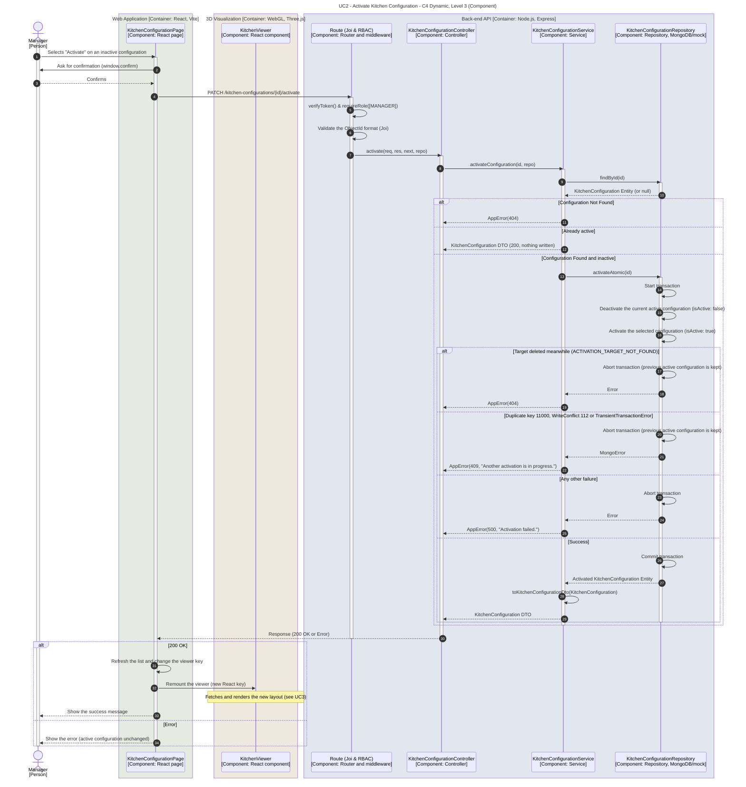

# UC2 - Activate Kitchen Configuration

| Attribute | Value |
|---|---|
| C4 view | Dynamic diagram, Level 3 (Component) |
| SAD view | Process View, Level 3 |
| Containers | Web Application, 3D Visualization, Back-end API, Database |
| Endpoint | `PATCH /kitchen-configurations/{id}/activate` |
| Allowed roles | MANAGER |
| Success response | 200 OK (also when the configuration is already active; nothing is written) |
| Error handling | 400 (malformed id), 404 (configuration not found, also when it is deleted during the activation), 409 (another activation is in progress), 500 (unexpected failure, generic message without internal details) |
| ADRs | [ADR-0023](../../adr/0023-atomic-activation-strategy.md), [ADR-0027](../../adr/0027-viewer-reload-mechanism-in-the-frontend.md) |

## Description

A Manager makes a stored configuration the active one. Only one configuration can be active at a time, so the switch must be atomic: `KitchenConfigurationRepository.activateAtomic(id)` deactivates the current active configuration and activates the selected one inside a single database transaction, backed by a partial unique index on `isActive: true` (named `active_kitchen_config_unique`, created by the migration and declared in the model with the same name; ADR-0023). The system is therefore never left without an active configuration or with two of them. If the transaction fails, it is aborted and the previous active configuration is kept.

The service translates the repository outcome into HTTP semantics:

| Repository outcome | AppError |
|---|---|
| Target not found before the transaction (`findById` returns `null`) | 404 |
| Target deleted inside the transaction (error code `ACTIVATION_TARGET_NOT_FOUND`) | 404 |
| Duplicate key (`11000`), write conflict (`112`) or `TransientTransactionError` label | 409 "Another activation is in progress." |
| Anything else, or `activateAtomic` returns nothing | 500 "Activation failed." (the original message is not exposed) |

Activating a configuration that is already active is idempotent: the service returns it with 200 without opening a transaction.

After a successful activation the page refreshes the list and changes the React key of the embedded `KitchenViewer`, which remounts it. On mount, the viewer fetches the new active configuration ([UC3 - Get Active Kitchen Configuration](./get-active-kitchen-configuration.md)), without a full page refresh (ADR-0027). The Activate button is only offered to Managers, on configurations that are not active, after a confirmation dialog.

## Diagram

See the [README](./README.md) for the notation key and the element catalogue.
