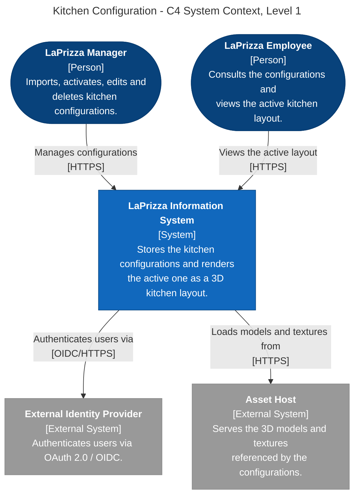
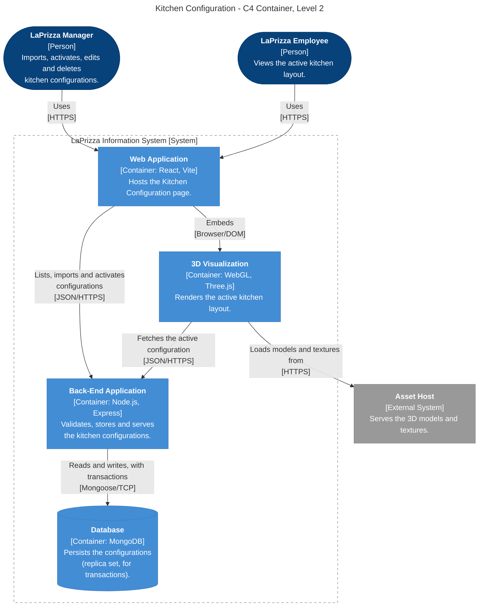
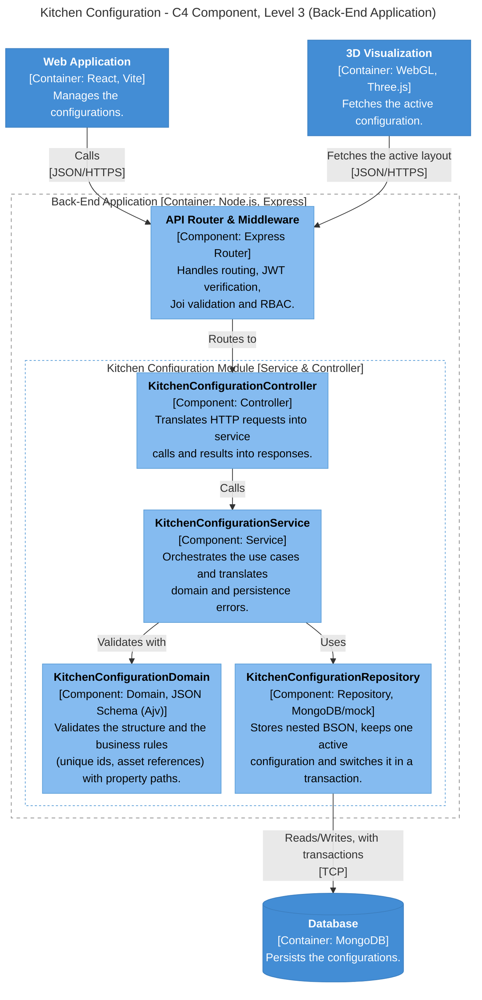
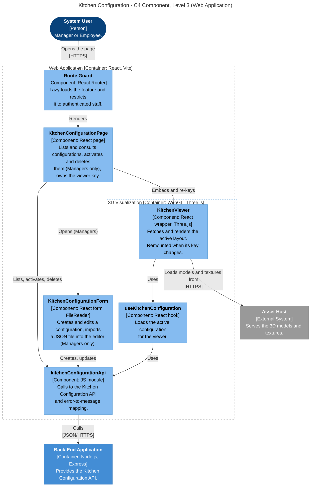

# Kitchen Configuration - C4 Views (Mermaid)

C4 views of the Kitchen Configuration feature (WEB06): the system context, the containers involved and the components of the **Back-end API** module and of the **Web Application** page. They are zoomed-in versions of the system-wide views in the [SAD](../../design/views.md), with the same element names and colours.

- [Level 1: System Context](#level-1-system-context)
- [Level 2: Containers](#level-2-containers)
- [Level 3: Components of the Back-end Module](#level-3-components-of-the-back-end-module)
- [Level 3: Components of the Front-end Page](#level-3-components-of-the-front-end-page)
- [Decision traceability](#decision-traceability)

## Level 1: System Context

### Element Catalogue

| Element                     | Type            | Description                                                                                                                                  |
| :-------------------------- | :-------------- | :------------------------------------------------------------------------------------------------------------------------------------------- |
| LaPrizza Manager            | Person          | Imports, activates, edits and deletes kitchen configurations and consults them.                                                              |
| LaPrizza Employee           | Person          | Consults the configurations and views the active kitchen layout (read-only).                                                                 |
| LaPrizza Information System | System          | Stores the kitchen configurations and renders the active one as a 3D kitchen layout.                                                         |
| External Identity Provider  | External System | Authenticates users via OAuth 2.0 / OIDC.                                                                                                    |
| Asset Host                  | External System | Serves the 3D models and textures that a configuration references by URL/URI ([ADR-0021](../../adr/0021-asset-references-strategy.md)). Its location is not constrained by the ADR. |

## Level 2: Containers

### Element Catalogue

| Element              | Type            | Responsibility                                                                                                                                  | Technology       |
| :------------------- | :-------------- | :---------------------------------------------------------------------------------------------------------------------------------------------- | :--------------- |
| LaPrizza Manager     | Person          | Imports, activates, edits and deletes kitchen configurations.                                                                                   |                  |
| LaPrizza Employee    | Person          | Views the active kitchen layout.                                                                                                                |                  |
| Web Application      | Container       | Hosts the Kitchen Configuration page: list, import (file read in the browser), activation and the embedded viewer.                              | React, Vite      |
| 3D Visualization     | Container       | Renders the active kitchen layout and loads its assets directly from the URL/URIs in the configuration.                                         | WebGL, Three.js  |
| Back-End Application | Container       | Validates the configurations (JSON Schema plus domain rules), stores them, switches the active one atomically and serves the active layout.     | Node.js, Express |
| Database             | Container       | Stores the configurations as nested BSON objects. A replica set (single-node in local environments) is required by the activation transaction.  | MongoDB          |
| Asset Host           | External System | Serves the 3D models and textures referenced by the configurations.                                                                             | HTTPS            |

### Interfaces

| Connector                                | Protocol          | Purpose                                                                            |
| :--------------------------------------- | :---------------- | :--------------------------------------------------------------------------------- |
| Web Application to 3D Visualization      | Browser (embedding) | Hosts the viewer inside the page and remounts it when the active configuration changes |
| Web Application to Back-End Application  | JSON/HTTPS (REST) | Lists, imports (`application/json`), activates, edits and deletes configurations   |
| 3D Visualization to Back-End Application | JSON/HTTPS (REST) | Fetches the active configuration (`GET /kitchen-configurations/active`)            |
| 3D Visualization to Asset Host           | HTTPS             | Loads the models and textures referenced by the configuration                      |
| Back-End Application to Database         | Mongoose / TCP    | Reads and writes; multi-document transaction for the activation                    |

## Level 3: Components of the Back-end Module

This view shows the components of the Kitchen Configuration module inside the Back-End Application. The module follows the layered DDD structure of the other feature modules ([ADR-0002](../../adr/0002-layered-domain-driven-design-%28ddd%29-architecture.md)).

### Element Catalogue

| Element                         | Type      | Responsibility                                                                                                                                                                 | Technology                                  |
| :------------------------------ | :-------- | :----------------------------------------------------------------------------------------------------------------------------------------------------------------------------- | :------------------------------------------ |
| API Router & Middleware         | Component | Authenticates the request, authorizes by role (`MANAGER` for writes and validation; `MANAGER` and `EMPLOYEE` for the list, one configuration and the active configuration), validates ids and payload shape with Joi and delegates         | Express Router                              |
| KitchenConfigurationController  | Component | Translates the HTTP request into a service call and the result into an HTTP response                                                                                           | Express controller                          |
| KitchenConfigurationService     | Component | Orchestrates the use cases, maps entities to DTOs and translates domain and persistence errors into `AppError`                                                                 | Node.js module                              |
| KitchenConfigurationDomain      | Component | Validates the name, the structure with the JSON Schema (Ajv, [ADR-0022](../../adr/0022-content-validation-strategy.md)) and the business invariants that the schema cannot express (unique element ids, asset references that are absolute http(s) URLs or root-relative paths). Reports every violation with its exact property path | Node.js module, Ajv |
| KitchenConfigurationRepository  | Component | Persistence access behind a repository interface; stores the configuration as a nested BSON object ([ADR-0020](../../adr/0020-strorage-model-of-kitchen-configurations.md)); guarantees at most one active configuration with a partial unique index on `isActive: true` and switches it in a transaction ([ADR-0023](../../adr/0023-atomic-activation-strategy.md)) | MongoDB (production) or mocks (tests)  |
| Web Application                 | Container | External to this view; manages the configurations                                                                                                                              | React, Vite                                 |
| 3D Visualization                | Container | External to this view; fetches the active configuration                                                                                                                        | WebGL, Three.js                             |
| Database                        | Container | External to this view; persists the configurations                                                                                                                             | MongoDB                                     |

### Interfaces

| Connector                                                | Protocol          | Purpose                                                                      |
| :------------------------------------------------------- | :---------------- | :--------------------------------------------------------------------------- |
| Web Application to API Router & Middleware               | JSON/HTTPS (REST) | Calls `GET`, `POST`, `PATCH` and `DELETE /kitchen-configurations` and `PATCH /kitchen-configurations/{id}/activate` |
| 3D Visualization to API Router & Middleware              | JSON/HTTPS (REST) | Calls `GET /kitchen-configurations/active`                                   |
| API Router & Middleware to KitchenConfigurationController | In-process        | Routes the validated, authorized request                                     |
| KitchenConfigurationController to KitchenConfigurationService | In-process    | Invokes the use case                                                         |
| KitchenConfigurationService to KitchenConfigurationDomain | In-process        | Validates the name, the structure and the business rules                     |
| KitchenConfigurationService to KitchenConfigurationRepository | In-process    | Reads and writes the configurations                                          |
| KitchenConfigurationRepository to Database               | TCP               | Reads and writes; multi-document transaction for the activation              |

## Level 3: Components of the Front-end Page

This view shows the components of the Kitchen Configuration page inside the Web Application, including the 3D viewer that it embeds. The Web Application is a feature-based, lazy-loaded React SPA ([ADR-0007](../../adr/0007-web-application-%28spa%29-technology-and-structure.md)).

### Element Catalogue

| Element                   | Type            | Responsibility                                                                                                                                                                                                  | Technology                  |
| :------------------------ | :-------------- | :-------------------------------------------------------------------------------------------------------------------------------------------------------------------------------------------------------------- | :-------------------------- |
| Route Guard               | Component       | Lazy-loads the feature module and allows access only to authenticated users, reusing the layout and authentication of the SPA. The page checks the role again: Managers and Employees are served, other roles get an access-denied message | React Router                |
| KitchenConfigurationPage  | Component       | Lists the configurations (marking the active one), shows the JSON of one, opens the form and runs the activation and deletion after a confirmation. Create, edit, activate and delete are offered to Managers only; Employees get a read-only view. Shows the API errors and the success message, and keeps the state used as the viewer's React key, which it changes after an activation or after an edit of the active configuration | React                       |
| KitchenConfigurationForm  | Component       | Form to create or edit a configuration (name and JSON editor). The import button reads the file with the browser `FileReader` API, parses it and loads it into the editor; parsing errors are reported before anything is sent. On save, sends the parsed content as `application/json` ([ADR-0026](../../adr/0026-import-approach.md)) and lists the violations returned by the API with their property paths | React, FileReader API       |
| useKitchenConfiguration   | Component       | Hook that loads the active configuration (`GET /kitchen-configurations/active`) and exposes it with the loading and error state | React                       |
| kitchenConfigurationApi   | Component       | Hand-written client with one function per endpoint of the Kitchen Configuration API, and the mapping of HTTP errors (400, 404, 409) to translation keys. It is not generated by Orval ([ADR-0009](../../adr/0009-generate-dynamic-http-client-with-orval.md) is not applied to this feature) | JavaScript module           |
| KitchenViewer             | Component       | Integration point of the 3D module. Fetches the active configuration when mounted and shows an empty state on 404 ([ADR-0025](../../adr/0025-active-configuration-endpoint-and-no-fallback-policy.md)). Once the VIS scene is plugged in, it loads the assets it references and renders the scene; a change of its React key clears and rebuilds the WebGL context ([ADR-0027](../../adr/0027-viewer-reload-mechanism-in-the-frontend.md)) | React, WebGL (planned)      |
| Back-End Application      | Container       | External to this view; provides the Kitchen Configuration API                                                                                                                                                   | Node.js, Express            |
| Asset Host                | External System | External to this view; serves the models and textures                                                                                                                                                           | HTTPS                       |

### Interfaces

| Connector                              | Protocol          | Purpose                                                                  |
| :------------------------------------- | :---------------- | :----------------------------------------------------------------------- |
| System User to Route Guard             | HTTPS             | Opens the Kitchen Configuration page                                     |
| Route Guard to KitchenConfigurationPage | In-process       | Renders the page for allowed users                                       |
| KitchenConfigurationPage to its children | In-process      | Opens the form and embeds the viewer with its key                        |
| KitchenConfigurationPage and KitchenConfigurationForm to kitchenConfigurationApi; KitchenViewer to useKitchenConfiguration to kitchenConfigurationApi | In-process | Make the API calls |
| kitchenConfigurationApi to Back-End Application | JSON/HTTPS (REST) | Lists, creates, edits, deletes, activates and fetches the active configuration |
| KitchenViewer to Asset Host            | HTTPS             | Loads the models and textures referenced by the configuration            |

## Decision traceability

| ADR | Decision | Where it shows in the views |
| :-- | :------- | :-------------------------- |
| [ADR-0020](../../adr/0020-strorage-model-of-kitchen-configurations.md) | Nested BSON object | KitchenConfigurationRepository |
| [ADR-0021](../../adr/0021-asset-references-strategy.md) | Self-contained URL/URI asset references | Asset Host, 3D Visualization to Asset Host |
| [ADR-0022](../../adr/0022-content-validation-strategy.md) | JSON Schema plus domain rules | KitchenConfigurationDomain |
| [ADR-0023](../../adr/0023-atomic-activation-strategy.md) | Boolean flag with partial unique index and transaction | KitchenConfigurationRepository, Database (replica set) |
| [ADR-0024](../../adr/0024-rules-for-editing-and-deleting-the-active-configuration.md) | Reject deletion of the active configuration, allow edits with re-validation | KitchenConfigurationPage actions, KitchenConfigurationService, KitchenConfigurationDomain |
| [ADR-0025](../../adr/0025-active-configuration-endpoint-and-no-fallback-policy.md) | Dedicated endpoint, strict 404 with no fallback | API Router & Middleware, KitchenConfigurationService, KitchenViewer |
| [ADR-0026](../../adr/0026-import-approach.md) | File read in the browser, sent as `application/json` | KitchenConfigurationForm |
| [ADR-0027](../../adr/0027-viewer-reload-mechanism-in-the-frontend.md) | State-based React key reset | KitchenConfigurationPage, KitchenViewer |
