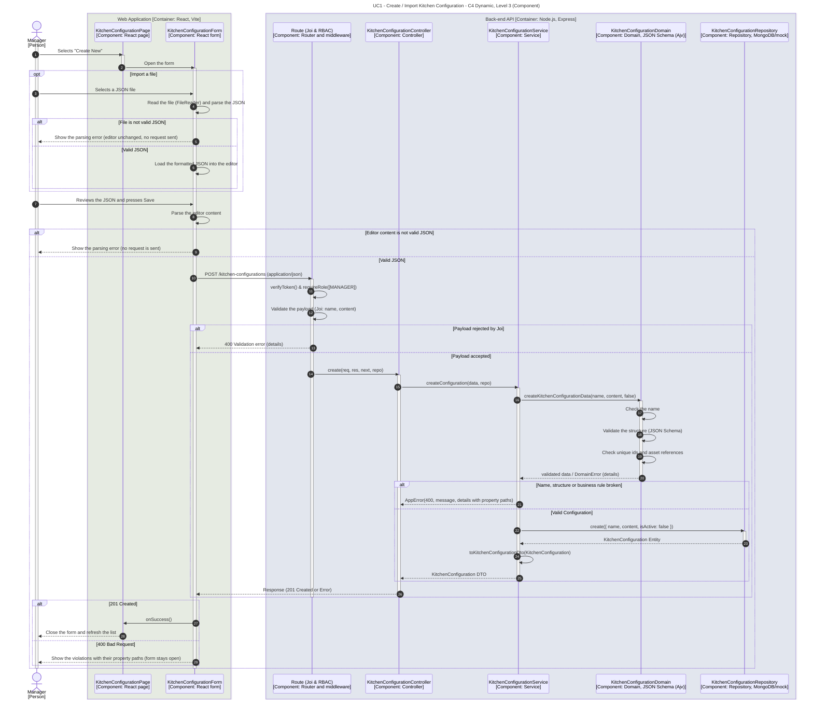

# UC1 - Create / Import Kitchen Configuration

| Attribute | Value |
|---|---|
| C4 view | Dynamic diagram, Level 3 (Component) |
| SAD view | Process View, Level 3 |
| Containers | Web Application, Back-end API, Database |
| Endpoints | `POST /kitchen-configurations` (create / import), `POST /kitchen-configurations/validate` (dry-run, no persistence) |
| Allowed roles | MANAGER |
| Success response | 201 Created (`POST /kitchen-configurations`), 200 OK `{ "valid": true }` (`POST /kitchen-configurations/validate`) |
| Error handling | 400 `Validation error` (body rejected by Joi: missing `name` or `content`) or 400 `Invalid Kitchen Configuration Content: ...` (JSON Schema or domain rule violated). Both carry `details`, the list of violations, each prefixed by its property path. |
| ADRs | [ADR-0020](../../adr/0020-strorage-model-of-kitchen-configurations.md), [ADR-0021](../../adr/0021-asset-references-strategy.md), [ADR-0022](../../adr/0022-content-validation-strategy.md), [ADR-0026](../../adr/0026-import-approach.md) |

The accepted JSON format is described in [Kitchen Configuration JSON Format](./kitchen-configuration-json-format.md).

## Description

A Manager creates a configuration by typing or pasting JSON in the form, or by importing a JSON file. The import button reads the file in the browser (`FileReader`), parses it and loads the formatted JSON into the editor, where the Manager can inspect and adjust it. Nothing is sent until the Manager presses Save. A file that is not valid JSON is rejected in the browser and no request is made. The same happens for text typed in the editor that cannot be parsed. Saving sends the parsed content as `application/json` to the same `POST` endpoint that creates a configuration directly through the API, so no upload endpoint exists (ADR-0026).

The Back-end API validates in three steps, all inside `KitchenConfigurationDomain` (`createKitchenConfigurationData` and `validateKitchenConfigurationContent`):

1. **Name:** required and not blank (it is trimmed).
2. **Structure (JSON Schema, Ajv):** required properties, types, `dimensions` and `scale` strictly greater than zero, `type` enumeration, colour format. All violations are collected (`allErrors`).
3. **Domain rules:** unique element ids and valid asset references. A `modelReference` or texture map (`roughnessMap`, `bumpMap`, `normalMap`) must be an absolute `http(s)` URL or a root-relative path (`/...`). Protocol-relative (`//host`), other schemes and bare relative paths are rejected (ADR-0021).

Violations are returned to the client in `details`, each one starting with its property path (for example `/elements/1/id duplicate element id 'oven-01'`), and the form shows them to the Manager. A valid configuration is stored as a nested BSON object (ADR-0020) and is created inactive. Making it the active configuration is a separate use case ([UC2 - Activate Kitchen Configuration](./activate-kitchen-configuration.md)).

`POST /kitchen-configurations/validate` runs the same validation on `{ "content": ... }` without storing anything. It is available to Managers through the API and is not used by the page.

## Diagram

See the [README](./README.md) for the notation key and the element catalogue.
