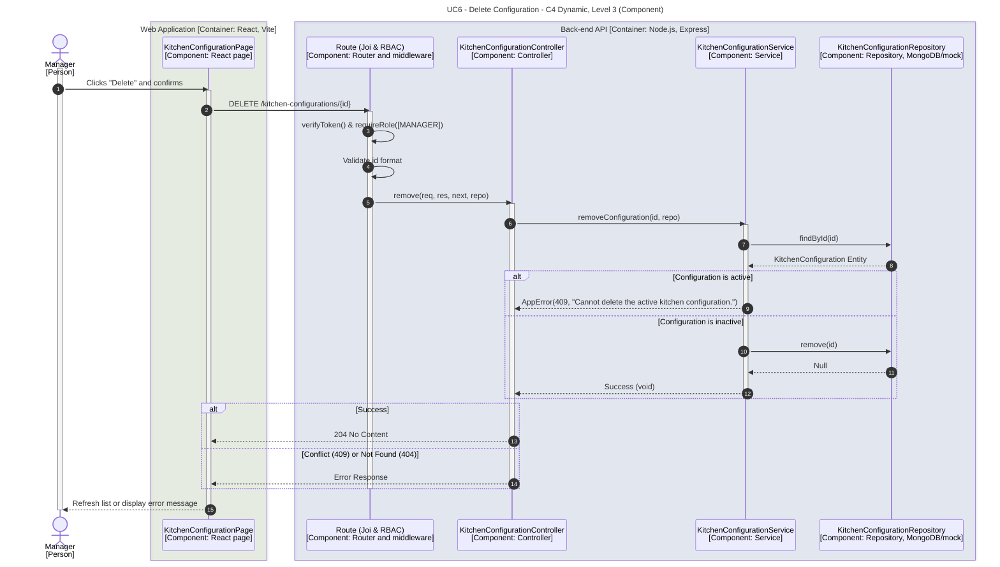

# UC6 - Delete Configuration

| Attribute | Value |
|---|---|
| C4 view | Dynamic diagram, Level 3 (Component) |
| SAD view | Process View, Level 3 |
| Containers | Web Application, Back-end API, Database |
| Endpoint | `DELETE /kitchen-configurations/{id}` |
| Allowed roles | MANAGER |
| Success response | 204 No Content |
| Error handling | 400 (invalid id format), 401/403 (no valid token or role not allowed), 404 (not found), 409 (Cannot delete active configuration) |
| ADRs | [ADR-0024](../../adr/0024-rules-for-editing-and-deleting-the-active-configuration.md) |

## Description

A Manager removes a stored configuration. To prevent the system from ending up without a layout to render in the 3D module, the active configuration cannot be deleted. If a deletion attempt targets the active configuration, the API returns a 409 Conflict error. In the Web Application, the delete action is hidden for the active layout.

## Diagram

