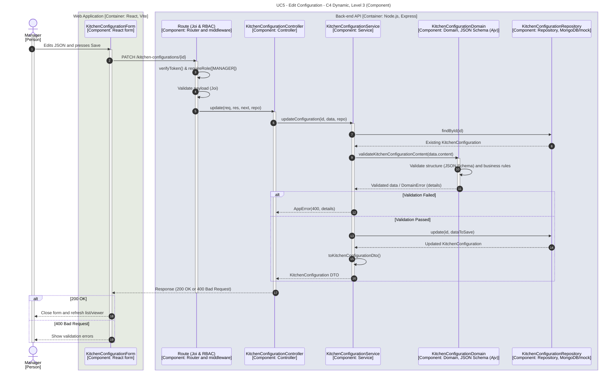

# UC5 - Edit Configuration

| Attribute | Value |
|---|---|
| C4 view | Dynamic diagram, Level 3 (Component) |
| SAD view | Process View, Level 3 |
| Containers | Web Application, Back-end API, Database |
| Endpoint | `PATCH /kitchen-configurations/{id}` |
| Allowed roles | MANAGER |
| Success response | 200 OK |
| Error handling | 400 (Validation error), 401/403 (no valid token or role not allowed), 404 (not found) |
| ADRs | [ADR-0022](../../adr/0022-content-validation-strategy.md), [ADR-0024](../../adr/0024-rules-for-editing-and-deleting-the-active-configuration.md), [ADR-0027](../../adr/0027-viewer-reload-mechanism-in-the-frontend.md) |

## Description

A Manager edits an existing kitchen configuration. The new content is subject to the same structural (JSON Schema) and domain (unique ids, valid references) validations as creation. Editing the active configuration is permitted; upon success, the frontend remounts the viewer to fetch and render the updated layout without requiring a full page refresh.

## Diagram

