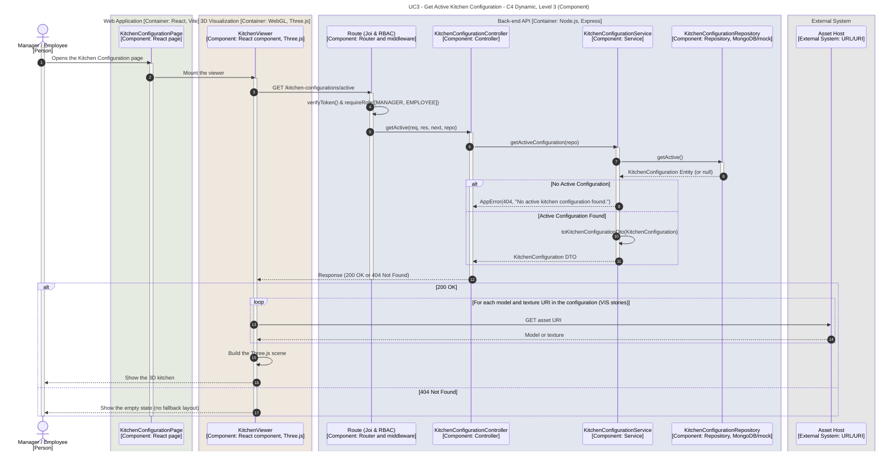

# UC3 - Get Active Kitchen Configuration

| Attribute | Value |
|---|---|
| C4 view | Dynamic diagram, Level 3 (Component) |
| SAD view | Process View, Level 3 |
| Containers | Web Application, 3D Visualization, Back-end API, Database, Asset Host |
| Endpoint | `GET /kitchen-configurations/active` |
| Allowed roles | MANAGER, EMPLOYEE |
| Success response | 200 OK |
| Error handling | 401/403 (no valid token or role not allowed), 404 (no active configuration; there is no fallback layout) |
| ADRs | [ADR-0021](../../adr/0021-asset-references-strategy.md), [ADR-0025](../../adr/0025-active-configuration-endpoint-and-no-fallback-policy.md) |

## Description

The Kitchen Configuration page is available to Managers (full management) and Employees (read-only: list, consult the JSON and the viewer). When the page is opened, and every time the viewer is remounted (see [UC2](./activate-kitchen-configuration.md)), the embedded `KitchenViewer` requests the active configuration through the `useKitchenConfiguration` hook, which calls the dedicated endpoint.

If no configuration is active, the API fails explicitly with 404 and does not return a hardcoded fallback layout, so a misconfigured system is never masked (ADR-0025). The viewer shows an explicit empty state.

If a configuration is active, it is returned as a single self-contained payload (`id`, `name`, `content`, `isActive`). The 3D scene loads each model and texture directly from the URL/URIs inside it, without secondary requests to the Back-end API (ADR-0021).

**Implementation status:** the `KitchenViewer` is the integration point for the 3D module (VIS01 to VIS07). Until the Three.js scene is plugged in, it fetches the configuration, shows its name or the empty state, and does not load assets. The asset loop in the diagram belongs to the VIS user stories.

## Diagram

See the [README](./README.md) for the notation key and the element catalogue.
