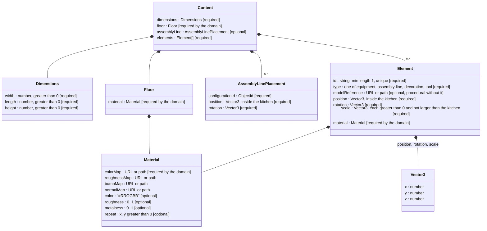

# Kitchen Configuration - JSON Format

The `content` of a kitchen configuration is a JSON document described by `kitchen-configuration.schema.json` (JSON Schema draft-07, validated with Ajv) and by the domain rules of `kitchen-configuration.domain.js`. This is the format required by WEB06 and consumed by the 3D viewer (VIS02 to VIS04).

A configuration stored in the Back-End has this shape (the `content` is the document described here):

```json
{
  "id": "<ObjectId>",
  "name": "Standard Layout",
  "isActive": false,
  "content": { "dimensions": {}, "elements": [] }
}
```

## Structure



| Property | Type | Rule |
|---|---|---|
| `dimensions.width`, `length`, `height` | number | Required, strictly greater than 0 (metres) |
| `floor.material` | Material | Required with textures (domain rule, VIS04/WEB04) |
| `assemblyLine.configurationId` | string | 24-hex ObjectId of an assembly line configuration (WEB06) |
| `assemblyLine.position` | `{x, y, z}` | Inside the kitchen (domain rule, see below) |
| `elements[].id` | string | Required, at least 1 character, **unique** within the configuration (domain rule) |
| `elements[].type` | string | Required, one of `equipment`, `assembly-line`, `decoration`, `tool` |
| `elements[].modelReference` | string | Optional; when present, absolute `http(s)` URL or root-relative path. Without it the element is drawn procedurally |
| `elements[].position` | `{x, y, z}` | Required, inside the kitchen (domain rule) |
| `elements[].rotation` | `{x, y, z}` | Required, numbers (degrees) |
| `elements[].scale` | `{x, y, z}` | Required, strictly greater than 0 and at most the kitchen size on the same axis (domain rule) |
| `elements[].material` | Material | Required with textures (domain rule, VIS04/WEB04) |
| `material.colorMap` | string | Required, asset reference |
| `material.roughnessMap`, `bumpMap`, `normalMap` | string | At least one of them, asset references |
| `material.color`, `roughness`, `metalness`, `repeat` | | Optional |

`elements` may be empty. Properties that the schema does not list are not rejected, except in `floor`.

### Textures are mandatory (VIS04, WEB04)

Every object of the scene, the floor included, is drawn with image textures loaded from the URLs of this JSON: a `colorMap` and at least one of `roughnessMap`, `bumpMap` or `normalMap`. A missing material, or one without textures, is refused (`collectRequiredTextureViolations` in `material.domain.js`). No texture is generated in code. The SPA proposes a new configuration with a textured floor. How the viewer loads and applies the textures is in [Textures and Materials (VIS04)](../textures-and-materials/README.md); the assembly line, which follows the same material rules, is in [Assembly Line (VIS03)](../assembly-line/README.md).

### Positions and sizes inside the kitchen (WEB04)

The origin is the centre of the floor (y up). `spatial/bounds.domain.js` refuses:

| Value | Allowed range |
|---|---|
| `position.x` (elements, assembly line) | `-width/2` to `width/2` |
| `position.z` (elements, assembly line) | `-length/2` to `length/2` |
| `position.y` (elements, assembly line) | `0` to `height` |
| `scale.x`, `scale.y`, `scale.z` | at most `width`, `height`, `length` (elements are modelled at unit size) |

The assembly line configuration applies the same rules in its own frame (x from `-width/2` to `width/2`, z from `0` to `length`, y from `0` to `height`).

## Asset references

`modelReference` and the texture maps are self-contained references that the viewer loads directly, without going through the Back-End ([ADR-0021](../../adr/0021-asset-references-strategy.md)). Accepted forms:

| Form | Example | Result |
|---|---|---|
| Absolute `http(s)` URL | `https://cdn.laprizza.pt/models/oven.gltf` | Accepted |
| Root-relative path | `/textures/red_brick/diffuse.jpg` | Accepted |
| Bare relative path | `models/oven.gltf` | Rejected |
| Protocol-relative | `//evil.example/oven.gltf` | Rejected |
| Other schemes | `javascript:...`, `data:...`, `file:...` | Rejected |

The existence of the referenced file is not checked by the Back-End.

## Example

```json
{
  "dimensions": { "width": 12, "length": 20, "height": 4 },
  "floor": {
    "material": {
      "colorMap": "/textures/tiled_floor_001/diffuse.jpg",
      "normalMap": "/textures/tiled_floor_001/normal.jpg",
      "roughnessMap": "/textures/tiled_floor_001/rough.jpg",
      "repeat": { "x": 6, "y": 6 }
    }
  },
  "elements": [
    {
      "id": "oven-01",
      "type": "equipment",
      "modelReference": "/assets/models/wood-fired-oven.gltf",
      "position": { "x": 5, "y": 0, "z": -8 },
      "rotation": { "x": 0, "y": 90, "z": 0 },
      "scale": { "x": 1, "y": 1, "z": 1 },
      "material": {
        "colorMap": "/textures/red_brick/diffuse.jpg",
        "normalMap": "/textures/red_brick/normal.jpg"
      }
    }
  ]
}
```

## Validation errors

Invalid content is rejected with `400` and the list of violations in `details`. Each entry starts with the path of the offending property, and all violations found in the same step are reported together.

| Step | Example violation |
|---|---|
| Schema | `.dimensions.width should be > 0` (the wording and path form come from Ajv 6) |
| Duplicate id | `/elements/1/id duplicate element id 'oven-01'` |
| Asset reference | `/elements/0/modelReference must be an absolute http(s) URL or a root-relative path` |
| Missing textures | `/elements/0/material is required: every object needs textures (...)` |
| Outside the kitchen | `/elements/0/position/x must be between -6 and 6 (inside the kitchen)` |
| Too large | `/elements/0/scale/x must be at most 12 (the size of the kitchen)` |

The schema step runs first. If it fails, the domain rules are not evaluated until the structure is correct.

### Errors in the editor (WEB04)

The SPA editor (`shared/json/json-editor.jsx`) shows line numbers. A syntax error is reported with its line and column before any request; each violation of the API is located from its path (`json-locations.js`: `/a/0/b` and Ajv's `.a[0].b` forms; a missing property points to the object that should contain it). The message starts with "Line N" and the line is highlighted in the gutter and behind the text.

## Related

- [UC1 - Create / Import Kitchen Configuration](./create-import-kitchen-configuration.md)
- [README](./README.md)
