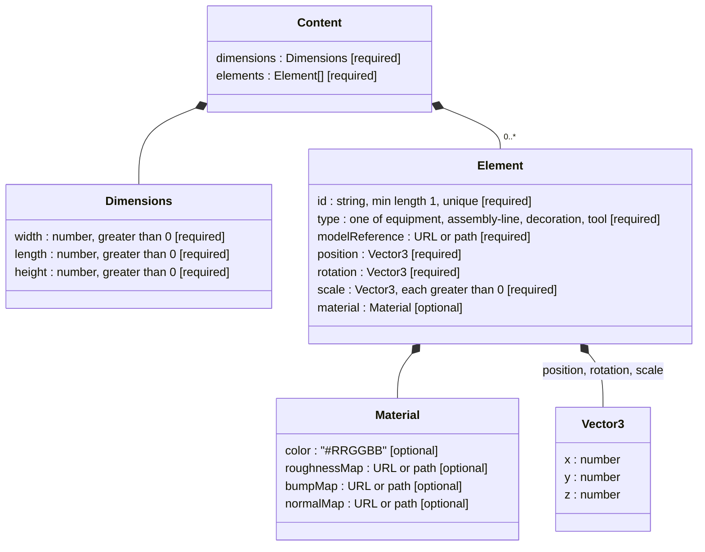

# Kitchen Configuration - JSON Format

The `content` of a kitchen configuration is a JSON document described by `kitchen-configuration.schema.json` (JSON Schema draft-07, validated with Ajv) and by the domain rules of `kitchen-configuration.domain.js`. This is the format required by WEB06 and consumed by the 3D viewer (VIS02 to VIS04).

A configuration stored in the Back-End has this shape (the `content` is the document described here):

```json
{
  "id": "<ObjectId>",
  "name": "Standard Layout",
  "isActive": false,
  "content": { "dimensions": {}, "elements": [] }
}
```

## Structure



| Property | Type | Rule |
|---|---|---|
| `dimensions.width`, `length`, `height` | number | Required, strictly greater than 0 |
| `elements[].id` | string | Required, at least 1 character, **unique** within the configuration (domain rule) |
| `elements[].type` | string | Required, one of `equipment`, `assembly-line`, `decoration`, `tool` |
| `elements[].modelReference` | string | Required, absolute `http(s)` URL or root-relative path (domain rule, see below) |
| `elements[].position` | `{x, y, z}` | Required, numbers |
| `elements[].rotation` | `{x, y, z}` | Required, numbers (orientation) |
| `elements[].scale` | `{x, y, z}` | Required, numbers strictly greater than 0 |
| `elements[].material.color` | string | Optional, `#RRGGBB` (hexadecimal) |
| `elements[].material.roughnessMap`, `bumpMap`, `normalMap` | string | Optional, same reference rule as `modelReference` |

`elements` may be empty. Properties that the schema does not list are not rejected.

## Asset references

`modelReference` and the texture maps (`roughnessMap`, `bumpMap`, `normalMap`) are self-contained references that the viewer loads directly, without going through the Back-End ([ADR-0021](../../adr/0021-asset-references-strategy.md)). Accepted forms:

| Form | Example | Result |
|---|---|---|
| Absolute `http(s)` URL | `https://cdn.laprizza.pt/models/oven.gltf` | Accepted |
| Root-relative path | `/assets/models/oven.gltf` | Accepted |
| Bare relative path | `models/oven.gltf` | Rejected |
| Protocol-relative | `//evil.example/oven.gltf` | Rejected |
| Other schemes | `javascript:...`, `data:...`, `file:...` | Rejected |

The existence of the referenced file is not checked by the Back-End.

## Example

```json
{
  "dimensions": { "width": 12, "length": 20, "height": 4 },
  "elements": [
    {
      "id": "oven-01",
      "type": "equipment",
      "modelReference": "/assets/models/wood-fired-oven.gltf",
      "position": { "x": 5, "y": 0, "z": -8 },
      "rotation": { "x": 0, "y": 1.5708, "z": 0 },
      "scale": { "x": 1, "y": 1, "z": 1 },
      "material": {
        "color": "#8b5a2b",
        "roughnessMap": "/assets/textures/brick-roughness.jpg",
        "normalMap": "https://cdn.laprizza.pt/textures/brick-normal.jpg"
      }
    },
    {
      "id": "conveyor-01",
      "type": "assembly-line",
      "modelReference": "https://cdn.laprizza.pt/models/conveyor.glb",
      "position": { "x": 0, "y": 0, "z": -8 },
      "rotation": { "x": 0, "y": 0, "z": 0 },
      "scale": { "x": 2, "y": 1, "z": 1 }
    }
  ]
}
```

## Validation errors

Invalid content is rejected with `400` and the list of violations in `details`. Each entry starts with the path of the offending property, and all violations found in the same step are reported together.

| Step | Example violation |
|---|---|
| Schema | `/dimensions/width should be > 0` (the wording comes from Ajv and may vary with its version) |
| Duplicate id | `/elements/1/id duplicate element id 'oven-01'` |
| Asset reference | `/elements/0/modelReference must be an absolute http(s) URL or a root-relative path` |
| Texture reference | `/elements/0/material/normalMap must be an absolute http(s) URL or a root-relative path` |

The schema step runs first. If it fails, the domain rules are not evaluated until the structure is correct.

## Related

- [UC1 - Create / Import Kitchen Configuration](./create-import-kitchen-configuration.md)
- [README](./README.md)
